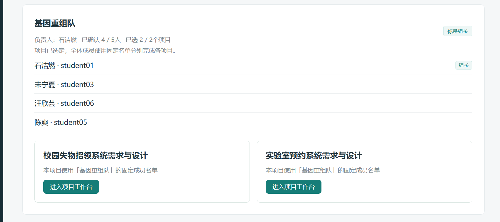
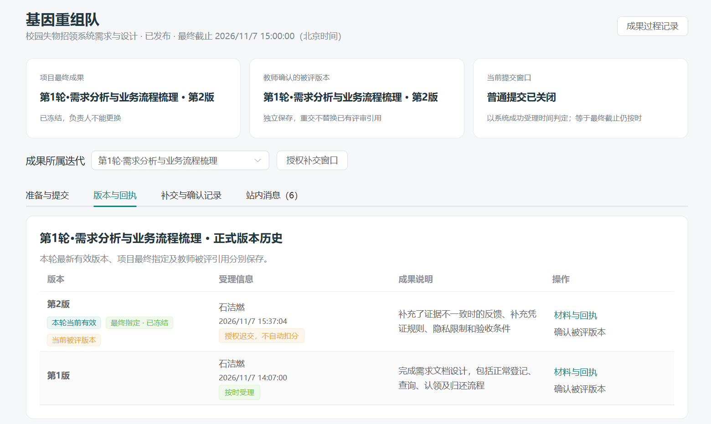
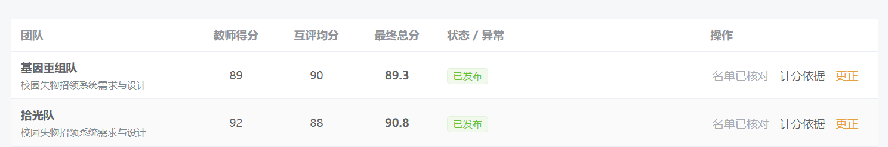

# 系统说明

软件工程课程 · 基因重组小组 · 2026年11月7日

本说明记录课堂演示时的业务操作。当前线上入口及逐步核验方式见[线上核验指南](../线上核验指南.md)。

课协用于管理项目制课程从发布要求到公布成绩的全过程。教师在课程内发布可选项目，学生先组成固定团队，再由组长统一选题。各项目独立记录任务、成果和成绩。助教按授权检查成果，教师可追溯每次提交、整改和评价所依据的具体版本。

## 一 用户角色与权限

| 角色 | 主要职责 |
|----|----|
| 平台管理员 | 创建账号和课程，在课程成员中分配教师、助教、学生角色。 |
| 教师 | 发布项目和评分标准，授权助教检查及截止后补交，确认评价对象，组织互评并发布成绩。 |
| 组长 | 邀请组员、统一选题，安排迭代和分工，代表团队正式提交、重交并指定最终成果。 |
| 普通组员 | 接受邀请，更新本人任务，准备成果材料，完成分配的互评并查询本人已发布成绩。 |
| 助教 | 检查被授权团队的成果，提出整改意见并复查。补交审批与正式评分由教师处理。 |

## 二 启动与登录

按[环境清单](环境清单.md)安装依赖。在项目的 school_system 目录打开两个 PowerShell 窗口，分别启动后端和前端。

powershell -ExecutionPolicy Bypass -File .\scripts\backend.ps1

powershell -ExecutionPolicy Bypass -File .\scripts\frontend.ps1

浏览器打开 http://127.0.0.1:5173。默认后端端口为 8080，本地采用 H2 文件数据库。首次运行会初始化基础演示账号，登录方式见[项目 README](../school_system/README.md)。另建的课堂案例需在同一服务中准备，课程、成绩与成果文件随该实例的数据库和附件目录保存。

# 三 课程项目与团队协作

演示课程为“软件工程_2024级1班”。平台管理员添加课程成员后，郭立君以教师身份进入「课程项目池」，新建并发布以下三个项目。

| 项目 | 最终截止（北京时间） | 演示中的用途 |
|----|----|----|
| 校园失物招领系统需求与设计 | 2026-11-07 15:00 | 两队选题，走通交付、整改和评价。 |
| 实验室预约系统需求与设计 | 2026-11-14 00:00 | 两队选题，展示同一队伍的第二个项目入口。 |
| 校园二手交易系统需求与设计 | 2026-11-17 00:00 | 作为项目池中的备选题目。 |

失物招领项目最初设置为 11 月 7 日 14:10，实际调整为当天 15:00。前期选题截图保留当时的旧截止时间。

## 组队与选题

学生进入「组队与选题」。组长创建团队并发邀请，组员登录接受。每名学生在同一课程只能加入一队，队伍须有 3–5 名已确认成员。演示中基因重组队由石洁燃、未宁夏、陈爽和汪欣芸组成，拾光队由刘洋、周子涵和林予安组成。

两位组长均勾选失物招领和实验室预约，点击「确认选择（2 / 2）」。确认后名单和选题固定，同一团队可进入两个独立的项目工作台。

图 1 基因重组队选题确认后的两个项目入口

## 迭代与任务

基因重组队在失物招领项目进入「迭代与任务」，创建「第1轮·需求分析与业务流程梳理」。组长先完成四项任务分工，再点击「开始迭代」。组员分别更新本人任务，进度从 0/4 到 4/4。组长填写总结后结束本轮，页面显示「已结束」。

# 四 成果提交与整改

组员可准备材料，组长在「成果与版本 → 准备与提交」选择材料并填写成果说明，再正式提交。平台记录受理时间并生成版本和回执。重交生成新版本，历史文件仍可查阅。单文件上限为 50 MB，每版文件总量上限为 200 MB。

| 演示环节 | 实际操作与结果 |
|----|----|
| 截止前提交 | 两队提交第 1 版。基因重组队 14:07:00 受理，拾光队 14:32:07 受理，均属按时提交。 |
| 截止后检查 | 15:00 关闭普通提交。获教师逐队授权的助教在「检查与互评 → 助教检查」检查第 1 版并提出整改。 |
| 申请与授权 | 组长在「成果与版本」申请补交或整改。教师在「补交与确认记录」批准并填写团队专属窗口。基因重组队窗口为 15:30:20 至 16:00:20。 |
| 提交第 2 版并复查 | 基因重组队于 15:37:04 重交，拾光队于 15:41:33 重交。两版均保留授权迟交标记，系统不自动扣分。助教针对第 2 版检查整改内容。 |

## 最终成果与被评版本

正常情况下，组长在截止前进入「版本与回执」，点目标版本的「指定为最终成果」，可在截止前改选。截止时已有指定冻结，之后教师核验材料并确认被评版本。

演示中两队到截止均未指定。教师在第 2 版一行点「核实未指定异常」，检查材料和链接、勾选可访问并填写依据，保存后补定最终成果。随后对同一版执行「确认被评版本」，供互评和教师评分引用。后续重交保留已有最终指定和评审引用。

图 2 基因重组队的最终成果与被评版本均指向第 2 版

# 五 同伴互评与成绩发布

## 教师发起互评

教师进入「检查与互评 → 同伴互评」，选中失物招领项目，发起「第1轮成果互评」，截止时间为 2026 年 11 月 7 日 17:30。自动分配生成 7 项任务，基因重组队的 4 名学生评审拾光队，拾光队的 3 名学生评审基因重组队。每人评审另一队，平台禁止自评。

学生在「我的互评待办」打开参评成果，核对第 2 版，按要求填写各项得分和评语后提交。当前版本按项目组织互评。

## 教师评分并发布

教师在「评分与成绩 → 教师评分」按需求与业务规则（40 分）、流程与异常处理（35 分）、验收与可追溯性（25 分）提交评分。项目总分按教师评分 70% 和有效互评均分 30% 计算。

| 团队       | 教师得分 | 互评均分 | 最终总分 |
|------------|----------|----------|----------|
| 基因重组队 | 89       | 90       | 89.30    |
| 拾光队     | 92       | 88       | 90.80    |

教师在「汇总与发布」查看待处理事项。演示中互评未完成或名单未核对时无法发布。补齐评分来源、核对计分名单后，教师发布该项目两队成绩。学生石洁燃登录后在「评分与成绩」查到本人项目成绩 89.30 分及被评第 2 版。

图 3 教师端两队成绩发布结果

# 六 运行范围与演示记录

## 其他可用操作

| 功能 | 入口及规则 |
|----|----|
| 里程碑 | 在「迭代与任务」选中可编辑的迭代，组长可新建里程碑并设置完成条件。 |
| 成绩导出与更正 | 教师在「评分与成绩 → 汇总与发布」可导出课程 CSV 或 XLSX，导出范围为该课程已发布成绩。已发布成绩可按更正流程处理并保留历史。 |
| 通知和过程记录 | 「站内通知」用于查看本人收到的业务消息。「过程记录」按访问权限查看任务、成果和评价等关键操作。 |

本次演示走通了失物招领项目从组队、选题到成绩发布的流程，并在学生端查到已发布成绩。里程碑、实验室预约项目的迭代和任务操作、匿名反馈查看、成绩导出与更正，以及通知和过程记录的独立操作留待后续演示。

## 演示中记录的操作问题

| 现场观察 | 当前操作方式 |
|----|----|
| 助教检查需要逐队授权 | 教师从项目详情进入「团队与成员」，打开每个团队的「助教检查授权」，分别授权。 |
| 截止后整改需要等待教师审批 | 助教提交检查意见后，组长单独申请限时补交，教师批准后开放窗口。助教可反馈和复查，审批由教师负责。 |
| 迭代结束后无法新建里程碑 | 需在迭代结束前新建里程碑。本次先结束迭代，因此跳过了里程碑展示。 |
| 补定最终成果的按钮含义容易混淆 | 「核实未指定异常」保存后补定最终成果。「确认被评版本」单独设置后续评价使用的版本。 |

## 复现课堂案例

在新实例复现时，先在同一门课添加教师、助教和 7 名学生。为三个项目重新设置将来的截止时间，完成组队和选题，在失物招领项目截止前提交第 1 版。截止后依次操作助教检查、教师授权补交、组长重交、助教复查、教师核实最终成果并确认被评版本、互评和成绩发布。

若复用已经发布成绩的实例，可直接检查版本、回执和成绩结果。若要重新演示组长指定或教师补定，需准备相应的截止前或截止后未处理状态。
