# 高校课程项目协作与评审平台需求分析报告

> 文档版本：V5.0
>
> 编制日期：2026-10-25
>
> 文档状态：完整合并修订稿
>
> 本文保留需求阶段的基线。现行操作见[线上核验指南](../线上核验指南.md)，实际功能验证见[测试脚本](../测试脚本/README.md)。

---

## 封面信息

- **课程名称**：软件工程
- **项目名称**：高校课程项目协作与评审平台
- **小组名称**：基因重组
- **指导教师**：郭立君
- **提交日期**：2026-10-30

### 小组成员与分工

| 姓名 | 学号 | 职责 | 主要负责工作 | 主要交付成果 |
|---|---|---|---|---|
| 石洁燃 | — | 组长；业务需求与需求管理负责人 | 组织需求讨论，整理业务依据，识别用户角色与业务目标，明确系统边界和需求优先级；梳理总体业务流程，组织争议规则确认、变更影响分析及需求基线评审。 | 业务目标与范围说明、角色责任表、总体业务流程图、用例图、需求决策与变更记录。 |
| 未宁夏 | — | 功能需求与场景分析负责人 | 将用户目标细化为功能需求，分析各角色的操作场景，明确触发条件、前置条件、正常流程、替代流程、异常处理和后置结果；为功能需求编制可核对的验收条件，并参与场景走查。 | 功能需求清单、用例规格、正常与异常场景说明、功能验收条件、场景走查记录。 |
| 陈爽 | — | 领域建模与业务约束负责人 | 识别核心业务对象，统一术语，分析对象关系、基数及数据约束；明确数据来源、敏感性、保留要求和访问边界，将业务政策整理为规则表和权限矩阵，并核对其与功能场景的一致性。 | 术语表、领域模型图、数据字典、业务规则表、角色权限矩阵。 |
| 汪欣芸 | — | 行为建模与需求质量负责人 | 分析跨角色活动及业务对象生命周期，明确状态转换的事件、执行角色、条件和异常结果；制定可测量的质量要求，组织需求来源核对、覆盖分析与跨模型一致性检查，维护需求与验收场景的追踪关系。 | 活动图与状态图、状态转换表、非功能需求表、验收场景、需求追踪矩阵、质量检查与问题闭环记录。 |

各成员对所负责需求的来源、模型和验收条件进行核对，并参与交叉评审。涉及范围、权限、评分、截止时间等关键规则的调整，由组长组织讨论并记录决策，同步更新受影响的需求、图模型和验收条件。实际完成情况及评审证据另在《需求分析质量验证报告》和《AI智能体使用验证报告》中记录。

## 摘要

针对高校项目制课程中协作信息分散、成果版本难以辨识、评价依据与成绩来源不易追溯等问题，本报告对高校课程项目协作与评审平台开展需求分析。平台以课程为管理边界、项目为交付单位、团队为协作主体，覆盖项目要求发布、学生组队、团队自主迭代、成果提交、助教检查、同伴互评、教师评分及成绩汇总与导出，并提供通知提醒和过程记录。

报告结合用户角色与业务场景，明确系统范围、功能需求、数据关系、业务规则和权限边界，通过用例、领域模型、活动与状态模型描述系统行为，并制定可测量的质量要求及验收条件。围绕成果交付与评价过程，明确团队负责人正式提交、最终成果版本指定与冻结、评审对象绑定及成绩更正留痕等关键规则，建立需求与验收场景之间的追踪关系，为后续系统设计、功能实现和测试验收提供统一依据。

关键词：课程项目；团队协作；成果版本；同伴互评；需求分析

## 目录

- [第 1 章 项目概述](#第-1-章-项目概述)
- [第 2 章 用户需求与业务流程分析](#第-2-章-用户需求与业务流程分析)
- [第 3 章 功能需求规格](#第-3-章-功能需求规格)
- [第 4 章 领域模型与数据需求](#第-4-章-领域模型与数据需求)
- [第 5 章 业务规则与角色权限分析](#第-5-章-业务规则与角色权限分析)
- [第 6 章 业务行为与状态分析](#第-6-章-业务行为与状态分析)
- [第 7 章 非功能需求与质量要求](#第-7-章-非功能需求与质量要求)
- [第 8 章 验收与需求验证](#第-8-章-验收与需求验证)
- [第 9 章 需求基线与项目约束](#第-9-章-需求基线与项目约束)
- [附录](#附录)

---

# 第 1 章 项目概述

## 1.1 项目背景与建设定位

基于高校课程项目从任务布置、团队协作到成果评审与成绩管理的全过程管理需求，建设“高校课程项目协作与评审平台”，为教师、助教和学生提供统一的项目要求发布、组队、团队自主迭代、成果版本管理、互评组织及成绩管理入口。平台以课程为管理边界、项目为交付单位、团队为协作主体，形成可追溯的过程记录和评价依据。

业务概念统一：教师发布“项目要求”，规定项目目标、交付内容、最终期限及评价要求；团队负责人依据项目要求创建“团队任务”，用于内部工作分配和进度跟踪，不能改变教师要求。每项团队任务必须归属于一轮“迭代”；迭代由各团队自主安排，不要求跨团队同步。里程碑是团队负责人设置并关联某轮迭代的重要交付检查点，记录目标日期、完成条件与完成情况。

| 概念 | 业务定义 | 创建或管理责任 | 约束 |
|---|---|---|---|
| 项目要求 | 教师对课程项目目标、交付、最终期限和评价的统一规定 | 教师 | 团队任务不得覆盖或变更项目要求 |
| 团队任务 | 团队为落实项目要求而拆分的内部工作 | 团队负责人创建、分配、调整；成员更新本人进度 | 必须归属一轮迭代；状态为未开始、进行中、已完成 |
| 迭代 | 团队自主规划的一轮工作周期 | 团队负责人组织 | 自主设定目标与计划时间；手动确认结束，记录遗留事项 |
| 里程碑 | 某轮迭代中的重要交付检查点 | 团队负责人 | 关联迭代，记录目标日期、完成条件及结果 |
| 迭代成果 | 团队针对一轮迭代正式提交的成果包 | 团队负责人正式提交或重交 | 一个迭代成果包可有多个历史版本 |
| 最终成果 | 从已提交的迭代成果中指定的具体版本 | 团队负责人指定；特殊异常由教师核实 | 不重新上传；指定关系不因后续重交自动改变 |
| 互评记录 | 学生对教师分配的指定最终成果版本形成的评价 | 教师组织、学生执行 | 可复核与重评，保留历史记录 |
| 正式成绩 | 教师依据评分规则确认并发布的课程考核结果 | 教师 | 成绩更正保留历史版本与原因 |

## 1.2 核心问题清单

基于项目要求与团队内部执行信息分散、迭代节奏不统一以及成果评审版本易混淆等实际风险，平台拟解决以下问题。

| 编号 | 核心问题 | 具体表现 | 平台拟提供的支持 |
|---|---|---|---|
| P-01 | 项目要求与团队任务混淆 | 教师统一交付要求与团队内部工作安排界限不清 | 分离项目要求和团队任务，并建立可追溯关联 |
| P-02 | 团队分工和协作记录分散 | 负责人、任务状态及工作记录难以统一查询 | 团队负责人分配任务，成员更新本人任务进度 |
| P-03 | 自主迭代与里程碑缺少管理 | 各团队进度不同，计划、遗留事项和交付检查点不易追踪 | 团队自主创建迭代、里程碑，手动结束迭代并保留调整记录 |
| P-04 | 成果版本及最终交付对象不明确 | 多次重交后难以确定最终被评版本 | 迭代成果版本留痕、负责人指定最终版本、截止冻结 |
| P-05 | 过程检查与正式互评关系混乱 | 容易误将助教检查通过视为启动互评的前提 | 助教独立开展过程检查，教师统一组织正式互评 |
| P-06 | 评分与成绩更正缺乏可追溯性 | 互评复核、教师评分及成绩来源容易不一致 | 记录评审历史、评分标准版本、成绩汇总和更正历史 |

## 1.3 建设目标

围绕“教师发布项目要求—学生组队—团队自主迭代—迭代成果提交—指定最终版本—教师组织互评—教师评分与成绩管理”的业务闭环，形成以下建设目标。

| 目标编号 | 建设目标 | 对应问题 | 目标说明 |
|---|---|---|---|
| G-01 | 明确项目要求与团队任务的职责边界 | P-01 | 教师统一发布要求，团队负责人自主拆解内部任务，关联关系可查询 |
| G-02 | 提高团队协作透明度 | P-02 | 支持任务分配、个人进度更新和关键变更留痕 |
| G-03 | 支持自主迭代与里程碑跟踪 | P-03 | 各团队独立安排迭代和里程碑，保留任务跨迭代调整记录 |
| G-04 | 保证最终交付版本明确可追溯 | P-04 | 迭代成果可重交留版，最终成果引用具体版本并按规则冻结 |
| G-05 | 规范过程检查与集中互评 | P-05 | 助教检查不阻断互评；教师依据最终版本统一分配互评任务 |
| G-06 | 提升评分及成绩管理的准确性 | P-06 | 支持评分来源核查、复核重评、成绩发布及有记录的更正 |

## 1.4 预期效果与成功指标

为支持后续需求验收，成功指标采用可核查的业务结果，不预设尚未由课程确定的数值阈值。

| 对应目标 | 预期效果 | 成功指标 | 验证方式 |
|---|---|---|---|
| G-01 | 项目要求和内部任务清晰分离 | 团队任务可追溯至项目要求且不改变教师要求 | 角色权限与关联关系走查 |
| G-02 | 任务责任和进度可见 | 负责人可分配调整任务，成员只能更新授权任务 | 不同角色操作测试 |
| G-03 | 不同团队独立推进 | 迭代目标、计划、里程碑、遗留事项及跨迭代调整可查询 | 多团队异步迭代场景测试 |
| G-04 | 被评成果版本稳定 | 重交产生历史版本，最终指定指向具体版本，截止后冻结 | 版本指定、冻结与补交测试 |
| G-05 | 互评组织职责明确 | 教师可在不以助教检查通过为前提的情况下组织互评 | 互评启动与材料异常测试 |
| G-06 | 成绩来源和更正可追溯 | 重评与成绩更正保留历史，异常评分阻止受影响成绩发布 | 复核、重评、发布及更正测试 |

## 1.5 业务边界与统一规则

已确定的管理边界：项目发布后不能撤回为草稿，只能按权限修改或异常终止；团队任务与迭代计划日期不自动产生延期标记，仅按教师规定的项目最终截止时间判断项目交付是否逾期；同伴互评任务可按自身评审期限单独标记逾期。

已确定的评审边界：助教开展过程检查、反馈、复查及上报，不负责正式评分；教师统一组织最终成果互评，并负责正式评分、成绩发布和更正。最终截止后项目正常进入“已结束”，常规提交关闭，但授权补交、互评与成绩工作可以继续；相关事项办结后归档。异常终止独立于正常结束，保留历史并关闭未完成事项。

| 编号 | 规则或配置事项 | 处理结论 | 状态 |
|---|---|---|---|
| Q-01 | 项目要求、团队任务、迭代和里程碑关系 | 按 R01—R05 统一定义 | 已确定 |
| Q-02 | 团队任务、组队、正式提交和评分权限 | 按 R06—R10 角色职责执行 | 已确定 |
| Q-03 | 迭代成果版本、最终版本、冻结和补交 | 按 R11—R19 执行 | 已确定 |
| Q-04 | 项目、任务、迭代、互评及成绩状态 | 按 R20—R24、R27、R31 执行 | 已确定 |
| Q-05 | 助教检查与正式互评、成绩发布的关系 | 按 R25—R26、R29—R33 执行 | 已确定 |
| Q-06 | 业务配置与固定约束 | 团队人数、组队窗口、最终期限及具体评分维度由教师配置；成绩默认教师70%、互评30%，权重在正式互评开始前可调整；自评限制、匿名方式和其他固定规则按§2.7执行 | 已确定 |

---

# 第 2 章 用户需求与业务流程分析

基于教师统一制定项目要求、学生团队自主组织迭代、助教辅助过程检查及教师统一组织互评的业务分工，建立面向教师、助教和学生的用户目标、协作关系与可验证的端到端流程。

## 2.1 用户角色与职责

| 角色 | 主要职责 | 典型操作 | 权限边界 | 状态 |
|---|---|---|---|---|
| 教师 | 制定项目要求、最终期限和评价规则，管理特殊组队调整，统一组织互评与正式评分 | 发布或修改项目要求；查看与干预团队任务；授权补交；核实最终版本；分配互评；评分、发布与更正成绩 | 项目发布后不能撤回为草稿；正式评分与成绩管理仅限授权教师 | 已确定 |
| 助教 | 在授权范围内开展过程检查、反馈、复查和问题上报 | 查看迭代成果、记录检查反馈、跟踪整改、上报异常 | 不进行正式评分；检查通过不是互评前置条件 | 已确定 |
| 学生（普通成员） | 参与组队与团队执行，更新本人任务，准备材料，完成获分配互评 | 申请入组；更新本人任务；上传待提交材料；查看团队过程记录；完成互评 | 不得创建或调整其他成员任务，不得执行正式成果提交或重交 | 已确定 |
| 学生（团队负责人） | 在学生身份基础上负责本团队组织与交付 | 审批开放期入组；创建、分配和调整团队任务；安排迭代与里程碑；正式提交、重交及指定最终成果版本 | 不得改变教师项目要求；截止后转组等特殊事项由教师处理 | 已确定 |

角色定义：团队负责人是学生在特定项目团队中的职责，不是独立的全局身份。同一账号可在不同课程担任不同角色，但同一课程内学生、助教、教师身份互斥；平台管理员身份不自动获得课程业务权限。学生可以查看本团队任务进展、提交版本、助教反馈、整改记录及授权开放的互评反馈；不得查看管理审计日志。评审学生仅能访问被分配的指定成果。

## 2.2 用户目标与用户故事

### 2.2.1 用户目标

| 角色 | 用户目标 | 优先级 | 对应目标 | 状态 |
|---|---|---|---|---|
| 教师 | 统一发布项目要求并管理最终期限 | 高 | G-01 | 已确定 |
| 教师 | 查看团队自主迭代进度并处理例外事项 | 高 | G-02、G-03 | 已确定 |
| 教师 | 在最终版本确定后统一组织互评，评分并发布成绩 | 高 | G-05、G-06 | 已确定 |
| 助教 | 独立检查过程成果、反馈、复查并上报问题 | 高 | G-05 | 已确定 |
| 团队负责人 | 组织组队、分配团队任务、规划迭代和里程碑 | 高 | G-02、G-03 | 已确定 |
| 团队负责人 | 按迭代提交成果、重交并指定最终版本 | 高 | G-04 | 已确定 |
| 普通成员 | 更新本人任务进度、准备材料并完成授权互评 | 高 | G-02、G-05 | 已确定 |

### 2.2.2 用户故事清单

| 编号 | 用户故事 | 优先级 | 验收要点 | 状态 |
|---|---|---|---|---|
| US-01 | 作为教师，我希望发布项目要求、最终期限与评价规则，以便各团队在统一要求下开展工作。 | 高 | 只有授权教师能发布；发布后不能撤回为草稿 | 已确定 |
| US-02 | 作为团队负责人，我希望在组队开放期审批入组，以便建立符合规则的团队。 | 高 | 校验资格、人数、唯一有效归属；截止后特殊调整由教师处理 | 已确定 |
| US-03 | 作为团队负责人，我希望为团队自主建立迭代并设置目标和时间，以便按照团队节奏推进。 | 高 | 不要求不同团队同步；计划日期不自动关闭迭代 | 已确定 |
| US-04 | 作为团队负责人，我希望创建、分配和调整归属某轮迭代的团队任务，以便落实教师项目要求。 | 高 | 每项任务有迭代归属；跨迭代调整留痕；不能修改项目要求 | 已确定 |
| US-05 | 作为普通成员，我希望更新分配给自己的任务进度，以便团队及时掌握执行情况。 | 高 | 仅允许更新本人任务；状态为未开始、进行中、已完成 | 已确定 |
| US-06 | 作为团队负责人，我希望设置与迭代关联的里程碑，以便检查重要交付节点。 | 高 | 记录目标日期、完成条件和完成情况 | 已确定 |
| US-07 | 作为团队负责人，我希望手动结束迭代并记录遗留事项，以便合理安排后续迭代。 | 高 | 未完成任务可转入后续迭代并保留原记录 | 已确定 |
| US-08 | 作为普通成员，我希望准备并上传待提交材料，以便负责人汇总正式成果。 | 高 | 上传待提交材料不等于正式提交 | 已确定 |
| US-09 | 作为团队负责人，我希望按迭代正式提交并在窗口内重交成果，以便形成可追溯的版本记录。 | 高 | 每次成功重交生成新版本；不提供正式撤回 | 已确定 |
| US-10 | 作为团队负责人，我希望从已提交版本中指定项目最终成果，以便明确被评对象。 | 高 | 指向具体版本，不重复上传，重交不自动替换指定版本 | 已确定 |
| US-11 | 作为助教，我希望独立检查过程成果并反馈整改，以便协助团队完善交付。 | 高 | 检查记录可追溯，不决定互评是否必然启动 | 已确定 |
| US-12 | 作为教师，我希望在最终成果冻结后统一分配互评任务，以便学生评价指定版本。 | 高 | 教师确认被评版本；互评不以助教检查通过为强制前提 | 已确定 |
| US-13 | 作为学生评审人，我希望按分配任务提交维度评分与评语，以便完成正式互评。 | 高 | 只访问指定版本；保存评分标准版本和维度得分 | 已确定 |
| US-14 | 作为教师，我希望复核争议互评并安排重评，以便保证有效评分来源。 | 高 | 重评生成新记录；旧记录保留；复核期间旧结果暂不计分 | 已确定 |
| US-15 | 作为教师，我希望汇总、发布并在必要时更正成绩，以便形成可信的课程考核结果。 | 高 | 教师核对确认；更正留版本、原因并通知受影响学生 | 已确定 |
| US-16 | 作为学生，我希望查看本团队成果版本和授权开放的反馈，以便及时了解项目进展。 | 中 | 不开放管理审计日志及未授权成绩信息 | 已确定 |

## 2.3 角色协作关系与权限边界

| 协作关系 | 业务触发 | 信息流与职责划分 |
|---|---|---|
| 教师 → 团队 | 教师发布项目要求 | 统一项目目标、交付内容、最终期限和评价要求，团队按要求自行安排内部执行 |
| 团队负责人 ↔ 成员 | 组队开放、任务执行 | 负责人审批入组、创建分配任务、设置迭代与里程碑；成员更新本人任务并准备材料 |
| 团队 → 助教 | 迭代成果形成 | 助教按授权检查、反馈、复查和上报；过程检查不控制正式互评的必然启动 |
| 团队负责人 → 系统 | 迭代成果提交与重交 | 正式提交按迭代形成成果包；记录版本、实际提交人和所属团队 |
| 团队负责人 → 教师 | 最终成果指定及截止冻结 | 负责人指定具体版本；未指定时教师核实被评版本并记录原因 |
| 教师 → 学生评审人 | 最终交付后组织互评 | 教师明确被评最终版本，分配评审任务并决定启动条件 |
| 教师 → 学生 | 正式评分、成绩发布与更正 | 教师确认评分、发布成绩；更正时保存历史并通知受影响学生 |

关键权限约束：组队开放期内由团队负责人审批入组；截止后特殊调整由教师处理。普通成员可准备材料，但正式提交、重交、指定最终版本由团队负责人执行。教师可以查看和干预团队任务，相关操作保留记录。所有访问须校验课程归属、团队关系、对象版本和授权范围。

## 2.4 核心业务流程

### 2.4.1 端到端主流程

1. 教师发布项目要求：教师确定目标、交付内容、最终期限与评价要求；发布后按权限修改或终止，不撤回为草稿。
2. 学生组队：学生按课程规则组队，负责人审批开放期入组；截止后及转组等特殊调整由教师处理。
3. 团队自主迭代：负责人自行安排迭代目标和计划时间，创建归属迭代的团队任务与里程碑，成员更新本人任务进度；负责人手动结束迭代并记录遗留事项。
4. 按迭代提交成果：成员准备材料，负责人正式提交迭代成果包；窗口内可重交形成新版本，不提供撤回。
5. 过程检查与反馈：助教可并行开展迭代成果检查、反馈与复查，异常上报教师；不设置“检查通过才可互评”的固定顺序。
6. 指定最终成果：负责人从已提交的迭代成果版本中指定最终版本，不重复上传；最终截止时冻结该指定版本。未指定的由教师核实确认，不自动选择。
7. 教师统一组织互评：教师在项目最终交付后确认被评版本并分配互评任务，评审固定引用具体版本；材料缺失或不可访问时可暂停对应评审。
8. 复核、评分与成绩管理：互评结果可复核或重评；教师完成正式评分，核对汇总明细后发布成绩，必要时依更正流程重新发布。

**图2-1 总体业务流程示意图**

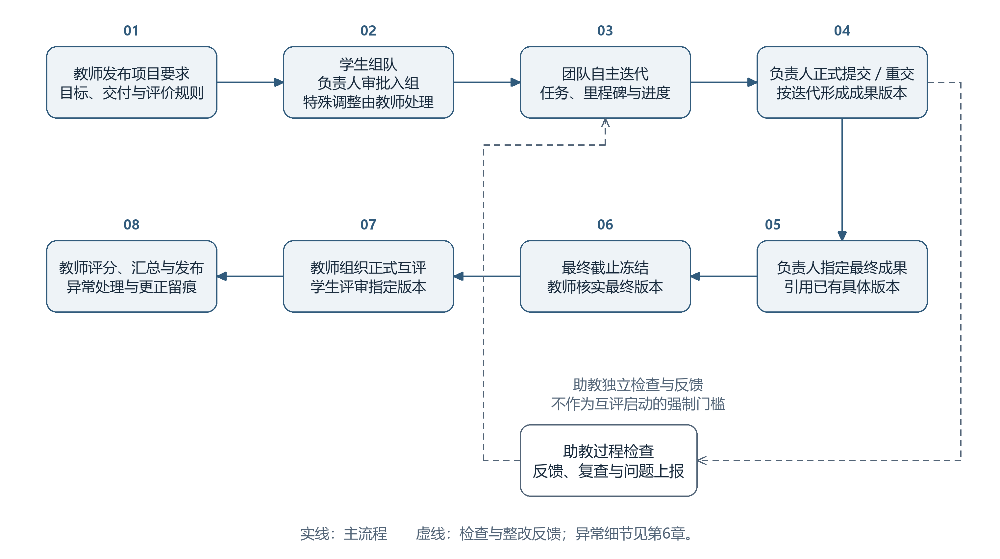

**图示说明**：本图展示常规业务主线，作为总体业务流程示意，不承担详细UML活动图的表达。实线为主流程，虚线为独立检查及整改反馈；助教检查通过不是互评启动的强制前置条件。截止前负责人可主动重新指定已有成果版本，重交不自动改变最终指定关系。单团队、截止未指定及授权补交等例外见第6章。

### 2.4.2 关键子流程

子流程一：项目要求发布与组队。教师创建并发布项目要求 → 学生查看规则并组队 → 负责人在开放期审批入组 → 系统校验资格、人数和唯一归属 → 截止后特殊调整交教师处理。

子流程二：团队自主迭代与里程碑。负责人创建迭代 → 创建归属该迭代的团队任务 → 设置里程碑 → 成员更新本人任务 → 负责人检查进度、手动结束迭代 → 未完成任务可转入后续迭代并保留调整记录。任务与迭代计划日期不自动触发延期。

子流程三：迭代成果与最终版本。成员上传待提交材料 → 负责人按迭代正式提交 → 系统按成功受理时间生成回执与版本 → 开放窗口内重交产生新版本 → 负责人指定某个已提交版本为最终成果 → 最终截止冻结。未指定时由教师核实；截止后仅教师可授权限时补交或整改，且新版本不自动替换已指定或已被评的版本。

子流程四：过程检查、互评与成绩。助教独立检查与反馈 → 教师确认最终被评版本并统一组织互评 → 学生按分配任务对指定版本评分 → 教师复核争议并决定是否重评 → 教师正式评分与成绩汇总 → 核对后发布，必要时按更正流程重新发布。

## 2.5 关键用例与用例图

### 2.5.1 用例清单

| 用例编号 | 用例名称 | 主要参与者 | 目标 | 优先级 | 状态 |
|---|---|---|---|---|---|
| UC-01 | 发布项目要求 | 教师 | 发布统一交付和评价要求 | 高 | 已确定 |
| UC-02 | 组队及成员管理 | 团队负责人、学生、教师 | 建立合法团队归属 | 高 | 已确定 |
| UC-03 | 自主迭代与团队任务管理 | 团队负责人、学生 | 安排迭代、分配任务、跟踪进度 | 高 | 已确定 |
| UC-04 | 设置里程碑与结束迭代 | 团队负责人 | 跟踪重要检查点并记录遗留事项 | 高 | 已确定 |
| UC-05 | 提交及重交迭代成果 | 团队负责人 | 正式保存迭代成果版本；普通成员另行准备材料 | 高 | 已确定 |
| UC-06 | 指定与冻结最终成果 | 团队负责人、教师 | 确定最终被评版本 | 高 | 已确定 |
| UC-07 | 过程检查与整改复查 | 助教、学生 | 形成独立检查反馈记录 | 高 | 已确定 |
| UC-08 | 组织并完成正式互评 | 教师、学生 | 对指定版本进行集中互评 | 高 | 已确定 |
| UC-09 | 复核与重评 | 教师、学生评审人 | 处理争议并保存评审历史 | 高 | 已确定 |
| UC-10 | 教师评分与成绩管理 | 教师 | 核对、发布、更正成绩 | 高 | 已确定 |

### 2.5.2 用例图

**图2-2 平台用例图**

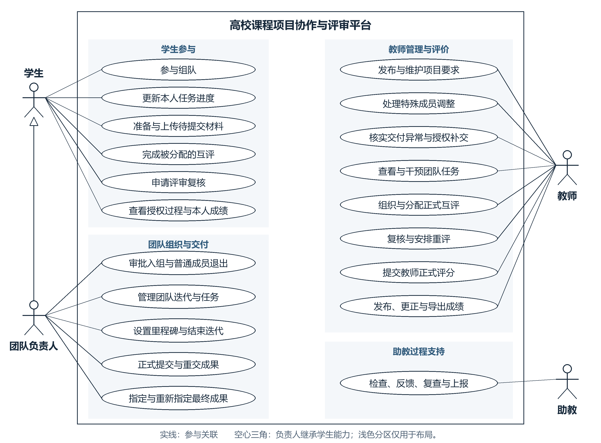

**图示说明**：参与者位于系统边界外，用例使用椭圆，实线表示参与关联。团队负责人是学生在团队中的职责，通过泛化继承学生能力，空心三角指向学生。教师组织互评与学生完成互评分开表示；普通成员更新本人任务、准备材料，负责人负责正式提交及最终指定。负责人审批限组队开放期，主动重新指定限项目最终截止前，负责人退出须完成交接；操作仍须校验对象归属、当前状态和窗口。教师处理成员及交付异常并执行正式评分和成绩管理，助教仅在授权范围内检查、反馈、复查及上报。浅色分区仅用于布局，不表示执行顺序或新增权限。

### 2.5.3 代表性详细用例

#### UC-01 发布项目要求

| 项目 | 内容 |
|---|---|
| 主要参与者 | 教师 |
| 触发条件 | 教师需要布置课程项目 |
| 前置条件 | 具有目标课程教师权限 |
| 基本流程 | 创建项目要求草稿；填写目标、交付、最终期限及评价规则；校验后发布；通知受影响人员 |
| 替代/异常流程 | 必填缺失或时间冲突时阻止发布；发布后仅允许授权修改或异常终止，不撤回草稿 |
| 后置条件 | 要求对相关课程学生可见；变更留痕 |
| 验收要点 | 教师要求与团队内部任务分离 |
| 状态 | 已确定 |

#### UC-02 组队及成员管理

| 项目 | 内容 |
|---|---|
| 主要参与者 | 团队负责人、普通学生、教师 |
| 触发条件 | 组队开放或需特殊成员调整 |
| 前置条件 | 学生具有课程参与资格 |
| 基本流程 | 学生创建或申请团队；负责人在开放期审批；系统核验人数、唯一有效归属并生效 |
| 替代/异常流程 | 人数超限、重复归属或截止后普通申请被拒；转组等特殊调整交教师处理 |
| 后置条件 | 团队成员关系可追溯 |
| 验收要点 | 同一项目同一学生最多一个有效团队 |
| 状态 | 已确定 |

#### UC-03 自主迭代与团队任务管理

| 项目 | 内容 |
|---|---|
| 主要参与者 | 团队负责人、普通成员、教师（查看干预） |
| 触发条件 | 团队开始新一轮工作 |
| 前置条件 | 团队已建立且项目要求可访问 |
| 基本流程 | 负责人设置迭代目标与计划时间；建立归属该迭代的团队任务并分配；成员更新本人任务；负责人手动结束迭代并记录遗留事项 |
| 替代/异常流程 | 任务无迭代归属不得创建；越权修改被拒；跨迭代调整保留记录 |
| 后置条件 | 团队任务状态及迭代记录可追溯 |
| 验收要点 | 不同团队无需同步；计划日期不自动关闭或标记逾期 |
| 状态 | 已确定 |

#### UC-04 设置里程碑与结束迭代

| 项目 | 内容 |
|---|---|
| 主要参与者 | 团队负责人 |
| 触发条件 | 出现重要交付检查点或迭代结束 |
| 前置条件 | 存在所属迭代 |
| 基本流程 | 设置里程碑目标日期和完成条件；更新完成情况；手动结束迭代并记录遗留事项 |
| 替代/异常流程 | 缺少迭代归属时拒绝设置；未完成任务可转入下一迭代并保留历史 |
| 后置条件 | 里程碑和迭代结果可查询 |
| 验收要点 | 里程碑不等于教师规定的项目最终截止时间 |
| 状态 | 已确定 |

#### UC-05 提交及重交迭代成果

| 项目 | 内容 |
|---|---|
| 主要参与者 | 团队负责人；普通成员准备材料 |
| 触发条件 | 某轮迭代需要正式交付 |
| 前置条件 | 存在有效迭代且提交窗口开放、成果未冻结 |
| 基本流程 | 成员准备材料；负责人提交迭代成果包；系统成功受理后生成回执；允许窗口内重交并生成新版本 |
| 替代/异常流程 | 不允许正式撤回；窗口关闭或无权操作被拒；最终截止后须教师授权特定补交窗口 |
| 后置条件 | 最新成功版本为该轮当前有效版本，历史版本保留 |
| 验收要点 | 按迭代提交而非按团队任务正式提交 |
| 状态 | 已确定 |

#### UC-06 指定与冻结最终成果

| 项目 | 内容 |
|---|---|
| 主要参与者 | 团队负责人、教师（异常核实） |
| 触发条件 | 项目临近最终交付 |
| 前置条件 | 已有成功提交的迭代成果版本 |
| 基本流程 | 负责人从已提交版本中指定一个最终版本；系统保存版本引用；到最终截止时冻结 |
| 替代/异常流程 | 未指定则标记未指定最终成果，由教师核实并记录原因；后续重交不自动改变指定关系 |
| 后置条件 | 冻结版本成为被评对象依据 |
| 验收要点 | 截止时刻等于期限视为按时，按成功受理时间判定 |
| 状态 | 已确定 |

#### UC-07 过程检查与整改复查

| 项目 | 内容 |
|---|---|
| 主要参与者 | 助教、学生 |
| 触发条件 | 出现迭代成果或需检查事项 |
| 前置条件 | 助教获得课程授权 |
| 基本流程 | 助教检查材料；记录反馈；学生整改准备；负责人在允许窗口内重交；助教复查或上报 |
| 替代/异常流程 | 材料不可访问或争议时上报教师；检查未通过不自动阻止教师组织互评 |
| 后置条件 | 检查与整改记录独立保存 |
| 验收要点 | 助教不执行正式评分 |
| 状态 | 已确定 |

#### UC-08 组织并完成正式互评

| 项目 | 内容 |
|---|---|
| 主要参与者 | 教师、学生评审人 |
| 触发条件 | 项目最终交付后教师决定启动互评 |
| 前置条件 | 被评具体版本已明确且可访问 |
| 基本流程 | 教师确认最终版本、分配评审任务与评分标准；学生按授权访问指定版本；填写维度得分和评语；系统校验并保存 |
| 替代/异常流程 | 材料缺失或无法访问时教师可暂停该成果评审；未授权、评分越界或评审逾期按规则处理 |
| 后置条件 | 评审任务与指定成果版本、标准版本关联 |
| 验收要点 | 不以助教检查通过为强制前置条件 |
| 状态 | 已确定 |

#### UC-09 复核与重评

| 项目 | 内容 |
|---|---|
| 主要参与者 | 教师、学生评审人 |
| 触发条件 | 互评存在争议或需重评 |
| 前置条件 | 存在评审任务和原评审记录 |
| 基本流程 | 教师标记待复核；确认原结果有效或批准重评；重评生成新记录；有效新结果替代当前计分来源 |
| 替代/异常流程 | 复核期间原结果暂不计分；必要评分未确定时阻止发布受影响成绩 |
| 后置条件 | 原记录留历史，当前有效结果可追溯 |
| 验收要点 | 同一评审任务可有多次评审记录 |
| 状态 | 已确定 |

#### UC-10 教师评分与成绩管理

| 项目 | 内容 |
|---|---|
| 主要参与者 | 教师 |
| 触发条件 | 需要形成或更正课程成绩 |
| 前置条件 | 教师具备评分权限，评分规则有效 |
| 基本流程 | 教师录入正式评分；系统汇总并识别异常；教师核对后发布；必要时填写更正原因、核对前后结果并重新发布 |
| 替代/异常流程 | 必要规则或评分缺失、争议未解决时转异常待处理；更正前保留原正式结果 |
| 后置条件 | 发布、更正均留历史，通知受影响学生 |
| 验收要点 | 无需另设第二人审批；只有教师发布与更正 |
| 状态 | 已确定 |

## 2.6 业务异常与已确定规则

| 编号 | 业务异常 | 预期处理 | 对应统一规则 | 状态 |
|---|---|---|---|---|
| EX-01 | 团队任务试图改变教师项目要求 | 拒绝越权变更，保留原要求 | R01、R06 | 已确定 |
| EX-02 | 团队任务没有迭代归属 | 拒绝创建，要求选择迭代 | R02—R04 | 已确定 |
| EX-03 | 团队任务跨迭代调整 | 记录原归属与新归属，保留历史 | R04、R21 | 已确定 |
| EX-04 | 组队人数超限、重复归属或截止后转组 | 校验并拒绝普通越权操作，特殊调整由教师处理 | R07 | 已确定 |
| EX-05 | 普通成员尝试正式提交或重交 | 拒绝正式提交，仅允许准备材料 | R08、R11 | 已确定 |
| EX-06 | 提交窗口内多次重交 | 每次成功受理产生新版本，保留历史，不提供撤回 | R12—R13、R19 | 已确定 |
| EX-07 | 重交后最终指定版本发生变化风险 | 保持原指定版本不变，必须明确重新指定 | R14 | 已确定 |
| EX-08 | 最终截止时未指定最终成果 | 标记“未指定最终成果”，教师核实并记录原因，不自动选择 | R15—R16 | 已确定 |
| EX-09 | 最终截止后申请补交或整改 | 仅教师可授权特定团队限时窗口，记录原因与期限 | R17 | 已确定 |
| EX-10 | 团队任务或迭代计划日期已过 | 不自动标记延期；仅按项目最终截止判断交付逾期 | R18—R19 | 已确定 |
| EX-11 | 项目发布后试图撤回草稿 | 拒绝撤回，允许按权限修改或异常终止 | R22—R24 | 已确定 |
| EX-12 | 助教检查未通过但教师决定组织互评 | 不因检查结论自动阻断互评；教师判断材料是否可评 | R25—R26 | 已确定 |
| EX-13 | 互评超期、取消、复核或重评 | 按评审任务状态处理，逾期单独标记；取消记录原因 | R27—R29 | 已确定 |
| EX-14 | 重评生成新评分记录 | 保存多次评审历史及各维度得分，仅有效结果用于汇总 | R28—R30 | 已确定 |
| EX-15 | 必要评分缺失或争议未解决 | 成绩标记异常待处理，阻止受影响成绩发布 | R29、R31 | 已确定 |
| EX-16 | 已发布成绩需更正 | 教师填写原因、核对前后结果、重新发布并通知学生 | R32—R34 | 已确定 |
| EX-17 | 项目异常终止 | 填写原因并通知，保留历史，停止新增提交、互评和评分 | R23—R24 | 已确定 |
| EX-18 | 关键期限或评分规则变更 | 权限校验、变更留痕并通知受影响人员 | R34—R35 | 已确定 |

业务参数责任：平台业务负责人确定通用必填项、权限及数据保护规则；任课教师配置团队人数、组队窗口、项目最终期限、具体评分维度及允许调整的成绩权重。互评分配、匿名方式等本版本规则按§2.7执行，不作为任意切换的课程参数。

---

## 2.7 业务配置与固定约束

课程参数由教师配置，系统按下表校验配置内容、授权范围和生效时机。

| 编号 | 事项 | 确定规则 |
|---|---|---|
| CFG-01 | 团队人数与组队 | 教师在开放组队前设置正整数人数上下限，下限不得超过上限；负责人计入人数，不设超限例外。学生可创建团队、申请加入，负责人审批；教师可人工分配，不提供邀请入组。开放期间允许人数暂不足，截止时不足下限的团队由教师调整。 |
| CFG-02 | 时间与成员变更 | 教师设置组队开放、截止及项目最终截止时间。组队窗口为开放时刻≤当前时间＜组队截止时刻；组队截止不晚于项目最终截止。截止后关闭学生创建、申请和负责人审批，未处理申请失效。开放期退出由负责人审批；移除、转组及截止后调整由教师处理。负责人退出前须完成交接。 |
| CFG-03 | 评分标准与成绩 | 教师发布项目前设置评分维度、满分、说明和权重；评分标准采用百分制。默认教师评分70%、互评30%，允许教师在正式互评开始前调整为非负且合计100%的权重；开始后冻结。互评取当前有效评审总分的算术平均值，计算中间值不舍入，最终成绩四舍五入保留两位小数。计分名单内团队成员同分，不采用个人贡献系数，助教检查不作为独立加权项。 |
| CFG-04 | 互评分配与复核 | 教师确认最终被评版本后，系统随机为每名学生分配2个不同的其他团队，不足2个时分配全部其他团队；禁止评审本人所属团队。兼顾各团队获得的评审数量，避免团队无人评审。只有1个有效团队时不开展互评，教师评分权重为100%。教师可在评审开始前调整分配；已有评审记录的任务需取消留痕后另行分配，不直接改写原任务。学生可在反馈开放后3个自然日内申请一次复核，教师决定处理；重评新增记录，争议结果暂停计分。 |
| CFG-05 | 匿名与成绩访问 | 对学生隐藏评审人身份，不承诺隐藏被评团队及成果作者身份；教师和授权检查范围内的助教可查看身份。助教不能查看未发布成绩、导出成绩、正式评分、发布或更正成绩。学生仅查看已向本人开放的成绩，不查看管理审计日志。 |
| CFG-06 | 性能负载与目标 | 验收基准为全平台1000个注册账号、10门活跃课程；单课程最多200名学生、50个团队；50名并发活跃用户，其中最多10个并发成果受理请求。在该负载下，查询P95≤2秒；完整材料到达系统至生成回执P95≤3秒；单课程成绩汇总≤5秒、导出≤10秒。文件传输耗时单独记录。验收时记录设备、网络、请求构成及实际历史数据量。 |
| CFG-07 | 数据留存与访问 | 课程结束后保留成果、评审、成绩、成员历史及关键记录2年；到期由平台业务负责人批准，管理员执行清理并留痕，未结争议相关数据暂缓清理。管理员默认不能浏览课程业务数据，故障处理访问须经批准并限定范围与期限。 |
| CFG-08 | 文件与提交 | 支持PDF、DOCX、PPTX、XLSX、TXT、MD、PNG、JPG/JPEG、ZIP；单文件≤50 MB，每个成果版本上传文件总量≤200 MB。外链采用HTTPS，代码链接注明提交编号或标签。负责人正式提交、重交及指定最终版本；截止前可主动重新指定并留痕，重交不自动改变指定关系。最终截止后补交须由教师批准，每次窗口最长7个自然日，保留迟交标记，不自动扣分。 |
| CFG-09 | 通知与更正 | 仅采用站内通知，不提供短信和邮件。按业务事件编号、接收人及通知类型去重；失败自动重试3次，仍失败转管理员处理。未完成的项目最终提交或互评任务，在截止前24小时和截止后各提醒一次。关键变更、更正及成绩发布按事件发送通知。教师评分修改和成绩更正保留前后内容与原因，不另设第二人审批。 |

| CFG-10 | 时间与故障补偿 | 平台展示、回执、通知和导出统一使用北京时间（Asia/Shanghai，UTC+8）。正式成果成功受理时间等于最终截止仍按时；组队窗口在组队截止时刻关闭。服务故障不自动延长截止，由教师按限时补交流程处理，不回填受理时间。 |
| CFG-11 | 备份恢复 | 恢复点目标RPO≤24小时，恢复时间目标RTO≤4小时；恢复后核对成果、评审、评分和成绩版本关联，无法确认的业务结果标记异常，不以旧备份冒充最新正式结果。 |
| CFG-12 | 团队名称 | 同一项目内团队名称不得重复，不同项目允许重名；名称变化不改变团队标识、成员历史、成果和成绩关联。 |

项目最终截止时保存计分成员名单，教师核对；成员变更不迁移或删除原团队成果及历史贡献。截止后的成员异常不自动改写计分名单，影响已发布成绩时执行教师更正流程。已终止项目按终止规则停止新增提交、互评和评分，上述配置不恢复被终止业务。

---

# 第 3 章 功能需求规格

## 3.1 功能需求组织方式与编号规则

为支撑课程项目从要求发布、团队协作、迭代交付到正式评审与成绩管理的全过程运行，平台需要提供课程项目管理、组队与成员管理、团队迭代、成果版本管理、同伴互评、助教过程检查、教师评分、成绩汇总、通知提醒和过程追溯等能力。各项需求均应对应明确的系统行为，并可通过测试、原型走查或业务记录核对进行验收。

### 3.1.1 功能模块划分

| 模块编号 | 功能模块 | 主要参与角色 | 功能范围 |
|---|---|---|---|
| FM-01 | 课程与项目要求发布 | 教师 | 建立课程项目与项目要求，校验发布信息并对相关人员开放 |
| FM-02 | 学生组队与成员管理 | 学生、团队负责人、教师 | 建立团队、维护成员关系并校验组队条件 |
| FM-03    | 迭代任务与里程碑管理 | 团队负责人、学生、教师；助教仅查看授权范围 | 支持团队自主规划迭代、管理团队任务和里程碑，并跟踪进度 |
| FM-04    | 项目成果提交         | 团队负责人、学生（准备材料）         | 按迭代正式提交成果包，校验提交信息并记录受理时间和版本 |
| FM-05    | 同伴互评             | 教师、学生                           | 由教师组织评审任务，支持学生完成互评并保留评审记录     |
| FM-06    | 助教过程检查         | 助教、学生、教师                     | 检查日常迭代成果，反馈问题、跟踪整改、复查并上报异常   |
| FM-07    | 教师评分             | 教师                                 | 按已确认的评分标准评价成果并记录评分依据               |
| FM-08    | 成绩汇总与导出       | 具有相应课程权限的教师               | 按已确认的成绩规则汇总结果、识别缺失项并受控导出       |
| FM-09    | 通知与状态提醒       | 系统、教师、助教、学生               | 围绕发布、截止、互评、整改和成绩等事件通知相关用户     |
| FM-10    | 项目过程记录         | 学生、教师、助教、系统               | 记录任务进展、提交、评审、反馈和关键操作的必要信息     |

### 3.1.2 编号、优先级与状态规则

- **需求编号**：
采用 `FR-001`、`FR-002`……的连续编号，整个第 3 章不重复。需求编号一旦被其他章节引用，原则上不随意重排；需求删除或合并时应在变更记录中说明。
- **优先级**：
“高”表示支撑核心业务闭环或权限/数据正确性所必需；“中”表示提升管理效率、可追溯性或操作体验；“低”表示可在核心流程完成后再考虑的增强能力。
- **状态**：
“已确认”表示本版业务规则与系统行为已形成需求基线，不表示程序已经实现或通过验收。课程日期、人数与具体评分维度由教师按已规定的配置规则录入。新增问题应记录责任方及影响范围，不将已确认规则重新列为未决。
- **需求验收**：
验收条件应能通过输入、操作、页面结果或业务记录判定是否满足。文件限制、成绩权重及性能负载采用§2.7的确认值；课程人数、具体日期和评分维度采用教师有效配置。

## 3.2 课程与项目任务发布

### 3.2.1 功能说明

为明确课程项目的统一交付依据，系统应支持教师创建、发布和维护项目要求，规定项目目标、交付内容、最终期限及评价要求，并向相关课程成员开放查看。发布前系统校验必要信息；发布后项目不能撤回为草稿，只能由有权限的教师按规则修改或异常终止，关键变更应留痕并通知受影响人员。团队负责人据此安排内部团队任务，但不得改变教师发布的项目要求。

### 3.2.2 功能需求

| 需求编号 | 需求描述 | 优先级 | 状态 |
|---|---|---|---|
| FR-001 | 系统应允许有课程权限的教师创建项目要求草稿，录入项目名称、所属课程、目标、交付要求、最终截止时间、评分标准及成绩权重；发布前上述信息必填，组队开放前须完成组队窗口和人数配置。 | 高 | 已确认 |
| FR-002   | 系统应在项目发布前检查必填信息和时间关系；存在缺项或截止时间早于开始时间等无效信息时，应阻止发布并指出需要修正的内容。 | 高     | 已确认 |
| FR-003   | 系统应允许有权限的教师在项目要求中明确交付任务、执行对象、最终期限和成果要求，并使相关课程成员能够查看；团队内部任务由团队负责人另行创建和管理。 | 高     | 已确认 |
| FR-004 | 系统应允许有权限的教师修改项目说明、交付要求，并在原截止到达前调整最终期限；涉及既有提交的交付变更须保留旧要求、明确影响范围和整改窗口并通知。已过截止不得通过改日期将补交改为按时。互评启动后评分标准和权重按冻结及重评规则处理；项目仅可按权限异常终止，不得撤回为草稿。 | 高 | 已确认 |

### 3.2.3 前置条件与基本流程

**前置条件**：
操作者已登录；账号状态允许使用；操作者具有目标课程的教师身份和相应管理权限；目标课程处于允许管理的状态。

**基本流程**：
1. 教师进入目标课程，选择创建课程项目要求。
2. 系统展示信息录入界面；教师填写项目名称、说明、起止时间、任务要求、交付内容等信息。
3. 教师保存草稿，系统保留草稿内容并允许继续编辑。
4. 教师发起发布，系统检查必填项、时间有效性及操作者权限。
5. 校验通过后，系统将项目要求置为已发布状态，并向具有相应访问权限的用户展示。
6. 系统记录发布人和发布时间；相关通知按通知规则触发。

### 3.2.4 替代流程与异常处理

- **信息缺失**：
系统指出缺少的字段，保持草稿状态，不发布不完整内容。
- **时间设置无效**：
系统提示开始时间和截止时间的冲突，要求修正后重新提交。
- **无权操作**：
系统拒绝创建、修改或发布操作，并提示权限不足；不得仅依靠界面隐藏按钮实现权限控制。
- **课程或项目不可用**：
当目标课程已关闭、项目已归档或状态不允许编辑时，系统应拒绝不符合状态规则的操作。
- **发布后调整**：
系统仅允许有权限的教师按规则修改或异常终止项目，不提供撤回为草稿的操作；影响安排或成绩的关键变更须通知受影响人员并保留记录。

### 3.2.5 业务规则与验收条件

**业务规则**：
项目必须归属于有效课程；发布人必须具有相应权限；项目发布所需必填项由平台业务规则明确，课程相关要求由教师配置；时间关系必须有效。项目发布后不能撤回为草稿，关键变更按权限执行、留痕并通知受影响人员。

**验收条件**：
1. 使用合法教师账号输入完整信息后，系统能够保存草稿并成功发布，相关课程成员能够查看已发布内容。
2. 缺少必填信息或时间关系无效时，系统拒绝发布，明确显示错误项，且不会产生已发布记录。
3. 使用无权账号尝试发布或编辑时，系统拒绝操作且不改变原有数据。
4. 教师按FR-004修改项目要求后，系统保留前后内容和原因，并通知目标项目的受影响学生、教师及授权助教；涉及既有提交时展示适用要求及整改窗口，不改变原受理时间和已固定评审引用。

## 3.3 学生组队与成员管理

### 3.3.1 功能说明

系统支持学生创建团队、申请加入、负责人审批和教师人工分配，不提供邀请入组。同一学生在同一项目中最多属于一个有效团队，同一项目内团队名称不得重复，不同项目可重名。教师配置人数上下限和组队窗口，系统不允许超限例外；开放期间允许团队暂未达到人数下限。组队截止后关闭学生创建、申请及负责人审批，未处理申请失效；人数不足、转组和其他特殊调整由教师处理。

### 3.3.2 功能需求

| 需求编号 | 需求描述                                                     | 优先级 | 状态   |
| -------- | ------------------------------------------------------------ | ------ | ------ |
| FR-005   | 系统应向符合项目参与条件的学生展示可参与的项目及其组队规则、组队开放状态和截止信息。 | 高     | 已确认 |
| FR-006 | 系统应在组队窗口内支持学生创建团队、申请加入及负责人审批；创建者自动成为负责人并计入人数。教师可人工分配和调整，不支持邀请入组。 | 高 | 已确认 |
| FR-007   | 系统应在建队及成员关系生效前校验学生资格、团队人数限制、组队时间、项目内团队名称唯一性及其在该项目中的现有有效成员关系。 | 高     | 已确认 |
| FR-008 | 系统应展示授权范围内的成员关系，支持开放期普通成员申请退出并由负责人审批；移除、转组及截止后变更由教师决定。负责人交接须由接任者接受，截止后由教师处理；全部生效变更保留时间、原因和历史记录。 | 中 | 已确认 |

### 3.3.3 前置条件与基本流程

**前置条件**：学生已登录且具备课程参与资格；组队窗口和人数规则已配置；操作者具有对应权限。

**基本流程**：
1. 学生查看项目组队规则，在开放窗口创建团队或申请加入；创建者自动成为负责人。
2. 系统校验资格、人数上限、项目内团队名称唯一性及唯一团队归属。创建时允许人数暂不足下限。
3. 负责人审批入组申请；批准时再次校验窗口、人数和学生归属，拒绝时记录结果。
4. 开放期普通成员申请退出，由负责人审批；移除和转组由教师决定。转组同时解除原关系、建立目标关系，失败时保留原关系。
5. 负责人发起交接，由本团队另一成员接受后生效；无人接任、唯一成员退出、截止后交接或原负责人无法操作时由教师处理，不删除团队历史。
6. 到达组队截止时关闭学生组队操作、使未处理申请失效；不足下限的团队标记“组队未完成”，交教师调整。所有变更记录操作者、原因和时间，并通知受影响成员。
7. 离组成员失去原团队日常协作及非公开材料访问权；历史成果和个人操作记录不迁移、不删除，未完成任务由负责人重新分配。最终截止时记录计分名单，由教师核对。

### 3.3.4 替代流程与异常处理

- **人数已满或重复归属**：拒绝新增成员；教师操作也不能绕过上限和唯一归属限制。
- **组队尚未开放或已经截止**：拒绝学生创建、申请和负责人审批。教师在权限范围内处理后续调整。
- **重复申请**：展示已有待处理申请，不生成重复有效关系。
- **退出、移除或转组**：按FR-008授权处理；拒绝无权直接移除或转组。审批前成员关系不变。
- **负责人尚未交接**：拒绝负责人直接退出；由教师处理无接任者或无法正常交接的情况。
- **并发修改**：生效前重新校验成员数和唯一归属，仅保留符合规则的结果；转组失败时不能留下双重有效关系。
- **截止后的计分归属调整**：不得自动迁移历史成绩；教师核实并记录，已发布成绩按更正流程处理。

### 3.3.5 业务规则与验收条件

**业务规则**：按BR-009—BR-016及§2.7 CFG-01—02执行。普通成员退出、移除和转组分别适用已规定的处理权限；成员变更不改写原团队成果及操作历史。

**验收条件**：
1. 学生可在开放期创建团队或申请加入，负责人批准后生效；不存在邀请入口。
2. 团队达到上限、学生重复归属或窗口已关闭时，冲突操作被拒绝；开放期人数不足下限不阻止建队，截止时标记组队未完成。
3. 负责人不能直接移除成员；普通成员退出经审批生效，转组由教师处理并保持唯一归属。
4. 负责人交接、成员退出与转组均可追溯，离组成员不能继续访问原团队非公开材料；原团队成果和历史操作者不变。

## 3.4 迭代任务与里程碑管理

### 3.4.1 功能说明

为支持各团队按照自身进度开展协作，系统应允许团队负责人自主设置迭代目标和计划时间，并在迭代内创建、分配和调整团队任务，设置关联该迭代的里程碑。每项团队任务必须归属一轮迭代，并关联相应项目要求；普通成员只能更新分配给自己的任务进度，教师可以查看和干预，相关操作应留痕。不同团队无需同步迭代，计划日期不自动关闭迭代或产生延期标记。

### 3.4.2 功能需求

| 需求编号 | 需求描述                                                     | 优先级 | 来源/依据                                  | 状态   |
| -------- | ------------------------------------------------------------ | ------ | ------------------------------------------ | ------ |
| FR-009 | 系统应允许团队负责人在项目要求范围内自主创建迭代，并记录迭代目标、计划时间和迭代顺序；不同团队的迭代安排相互独立。 | 高 | BR-004、BR-007—008；R02—R03 | 已确认 |
| FR-010 | 系统应允许团队负责人在某轮迭代内创建、分配和调整团队任务；每项任务必须关联一轮迭代及对应项目要求，并记录任务目标、执行成员、状态和必要的计划信息。 | 高 | BR-008；R01、R04、R06 | 已确认 |
| FR-011 | 系统应允许普通成员更新分配给本人的团队任务进度；任务状态统一为“未开始、进行中、已完成”，返工时可回到“进行中”并记录原因。 | 高 | R06、R20；§6.2 | 已确认 |
| FR-012 | 系统应展示迭代内任务状态、里程碑目标日期、完成条件及完成情况，并支持团队负责人手动结束迭代、记录完成情况和遗留事项；未完成任务转入后续迭代时应保留原归属及调整记录。 | 高 | R04—R05、R21；§6.2 | 已确认 |

### 3.4.3 前置条件与基本流程

**前置条件**：
项目要求已发布；操作者具有对应项目的访问权限；团队已建立；团队负责人具有任务、迭代和里程碑管理权限。

**基本流程**：

1. 团队负责人根据教师发布的项目要求创建一轮迭代，填写迭代目标和计划时间。
2. 负责人在该迭代内创建团队任务，关联对应项目要求，明确任务内容并分配给成员。
3. 负责人设置与该迭代关联的里程碑，填写目标日期和完成条件。
4. 系统校验任务归属和操作者权限，保存迭代、任务及里程碑信息。
5. 普通成员查看分配给自己的任务并更新任务状态；系统记录更新内容和时间。
6. 负责人查看迭代进展，手动确认迭代结束并记录完成情况和遗留事项；必要时将未完成任务转入后续迭代。

### 3.4.4 替代流程与异常处理

- **任务未关联迭代**：
系统拒绝创建或保存该团队任务；不得创建直接挂在项目下、没有迭代归属的团队任务。
- **时间冲突**：
迭代或任务时间不符合项目规则时，系统提示冲突并要求修正。
- **无权更新任务**：
系统拒绝越权修改；学生只能更新允许其操作的任务信息。
- **计划日期已过**：
团队任务和迭代计划日期仅用于计划展示，不自动生成延期标记；项目交付是否逾期仅依据教师规定的项目最终截止时间判断。
- **迭代结束**：
计划结束日期不自动关闭迭代；只有团队负责人执行手动结束操作后，迭代才进入结束状态。
- **进度数据不完整**：
汇总视图应区分未知、未更新和已完成，不得将缺失状态直接当作完成。

### 3.4.5 业务规则与验收条件

**业务规则**：
不设置独立的“阶段”管理层级，统一使用“迭代”；迭代由团队自主安排，团队任务必须归属一轮迭代并关联项目要求。任务状态为“未开始、进行中、已完成”；迭代由团队负责人手动结束，计划结束日期不自动关闭迭代。对应第4章团队任务和迭代对象、BR-007—008、R04—R06、R18、R20—R21。

**验收条件**：

1. 团队负责人能够创建迭代、在迭代内关联团队任务并设置里程碑，系统能正确展示任务归属、负责人和计划信息。
2. 学生只能修改权限范围内的进展信息；未经授权的任务修改被拒绝。
3. 更新任务状态后，任务详情和迭代进度汇总显示一致。
4. 任务或迭代计划日期已过时，系统不会自动生成延期标记；迭代只有在负责人手动结束后才改变结束状态。

## 3.5 项目成果提交

### 3.5.1 功能说明

为形成可追溯的项目交付记录，系统应支持团队负责人按迭代正式提交成果包。成果包可包含报告、文件和代码链接等材料；普通成员可以准备或上传待提交材料，但正式提交和重交由团队负责人执行。系统应记录所属团队、实际提交人、成功受理时间和版本。提交窗口开放且成果未冻结时允许重交，每次成功重交生成新版本并保留历史；正式成果不提供撤回。

### 3.5.2 功能需求

| 需求编号 | 需求描述                                                     | 优先级 | 来源/依据                                   | 状态   |
| -------- | ------------------------------------------------------------ | ------ | ------------------------------------------- | ------ |
| FR-013 | 系统应允许普通成员准备或上传待提交材料，并允许团队负责人按迭代将材料汇总为一个正式成果包提交；团队任务不设置任务级正式成果提交。 | 高 | BR-017—018、BR-021；R08、R11 | 已确认 |
| FR-014   | 系统应在提交前校验提交主体资格、目标对象状态、必填信息及经确认的文件类型、大小和链接规则。 | 高     | 第 5 章 BR-017、BR-018、BR-023              | 已确认 |
| FR-015 | 系统应在成功受理正式提交后记录所属团队、实际提交人、所属迭代、受理时间、版本及提交状态，并向用户提供可查询的提交回执。 | 高 | BR-019、BR-021—022、BR-026 | 已确认 |
| FR-016 | 系统应按项目最终截止和成功受理时间判断交付是否逾期；开放窗口内负责人可重交留版、不提供撤回，并可在最终截止前主动指定或重新指定本团队已提交版本为最终成果。截止时冻结指定版本；未指定由教师核实，补交由教师授权且不自动改变旧评审引用。 | 高 | BR-019—024；R12—R19 | 已确认 |

### 3.5.3 前置条件与基本流程

**前置条件**：
用户已登录并属于目标课程；团队已建立；操作者为该团队负责人，或普通成员仅执行待提交材料准备操作；对应迭代有效，提交窗口开放且成果尚未冻结。

**基本流程**：

1. 普通成员准备并上传待提交材料，供团队负责人汇总。
2. 团队负责人进入目标迭代的成果提交页面，核对成果包内容及项目要求。
3. 系统校验负责人权限、所属团队、迭代归属、必填信息、文件或链接限制、提交窗口及成果冻结状态。
4. 校验通过后，系统成功受理正式提交，以受理时间作为提交时间，并生成版本和可查询回执。
5. 系统记录所属团队和实际提交人，展示当前有效版本，并按通知规则提醒相关人员。
6. 在提交窗口开放且成果未冻结时，负责人可以重交；每次成功重交均生成新版本，历史版本继续保留。
7. 最终截止前负责人从本团队已提交版本中指定或主动重新指定最终成果，记录前后引用和时间；重交不自动改变该引用。
8. 到达项目最终截止时，按成功受理时间判断交付，等于截止时刻仍算按时；随后关闭普通提交和负责人更换指定入口，冻结指定版本。尚未指定时标记“未指定最终成果”，由教师核实版本并记录原因，不自动选择。
9. 截止后负责人可申请补交或整改，由教师针对具体团队批准窗口并记录原因，每次最长7个自然日；保留真实受理时间及迟交标记，不自动扣分，也不临时新增扣分项，仍按既定标准评分。新版本不自动替换已有被评版本，需要重评由教师安排。

### 3.5.4 替代流程与异常处理

- **缺少必要材料或说明**：
系统指出缺失内容，不将不完整提交登记为有效完成。
- **文件不符合限制或链接不可接受**：
系统支持PDF、DOCX、PPTX、XLSX、TXT、MD、PNG、JPG/JPEG、ZIP；单文件≤50 MB，每个成果版本上传文件总量≤200 MB。外链采用HTTPS，代码链接注明提交编号或标签。格式、大小或链接格式不合要求时拒绝提交，保留原有效版本；链接在评审时无法访问的，由教师暂停对应成果评审并安排整改。
- **无权提交、提交窗口关闭或项目状态不允许提交**：
系统拒绝操作，保留原有提交记录。
- **项目最终截止后**：
系统关闭普通提交；负责人提出申请，教师可针对具体团队开放每次最长7个自然日的补交或整改窗口，记录原因和期限并站内通知团队。已终止项目不开放此类新增提交。
- **重交或撤回请求**：
提交窗口开放且成果未冻结时允许负责人重交，每次成功重交生成新版本，最新成功版本为该轮成果当前有效版本；系统不提供正式成果撤回。重交不会自动改变已指定的最终成果版本。
- **网络或服务错误**：
系统向用户说明提交未能确认成功，并提供可核查的结果状态；重复请求不得产生多条相互矛盾的有效记录。故障不自动延长截止，教师按限时补交流程处理；所有受理和展示统一使用北京时间。

### 3.5.5 业务规则与验收条件

**业务规则**：
正式成果按迭代提交，每轮迭代形成一个成果包；团队任务不另设正式提交。普通成员可准备材料，负责人执行正式提交和重交。系统以成功受理时间作为提交时间并提供回执；截止时刻等于期限也视为按时。正式成果不提供撤回，重交生成新版本并保留历史；最终截止后普通提交关闭，补交须由教师授权。对应BR-017—026、R08、R11—R19及§2.7 CFG-08。

**验收条件**：

1. 本团队负责人提供完整材料后，系统成功受理并展示团队、实际提交人、迭代、版本及回执；普通成员只能准备材料，正式提交被拒绝。
2. 对缺少必填信息、无权限或不符合文件限制的提交，系统拒绝登记为有效提交并说明原因。
3. 系统以成功受理时间判断是否按时；受理时间等于截止时刻时视为按时，不能以用户点击提交的时间替代受理时间。
4. 允许重交时产生新版本且历史保留；重交不自动替换最终指定关系。正式撤回被拒绝。
5. 单文件50 MB、版本总量200 MB以内且其他条件有效时可受理；任一上限超出时拒绝；无效外链格式不能成为有效提交。
6. 负责人截止前主动重新指定保留历史；截止后不能自行更换。未指定由教师核实，系统不自动选取。
7. 教师授权窗口最长7个自然日，未授权补交被拒绝；有效补交保留真实时间和迟交标记，不自动扣分或改写旧评审引用。

## 3.6 同伴互评

### 3.6.1 功能说明

为在统一评价规则下形成可核查的同伴反馈，系统应支持教师在项目最终交付后确认各团队被评的最终成果版本并统一分配互评任务。每项评审任务固定引用一个具体成果版本，向获分配的学生展示该成果和适用评分标准，并记录各维度得分、评语、评分标准版本及评审状态。助教检查通过不是启动互评的强制前置条件；材料缺失或无法访问时，教师可暂停对应成果评审。

### 3.6.2 功能需求

| 需求编号 | 需求描述                                                     | 优先级 | 来源/依据                                  | 状态   |
| -------- | ------------------------------------------------------------ | ------ | ------------------------------------------ | ------ |
| FR-017 | 系统应在教师确认最终版本后，随机为每名学生分配2个不同的其他团队，不足2个时分配全部其他团队，禁止本团队自评并兼顾各团队获得评审数量；向评审人展示指定版本、截止时间和标准。只有1个有效团队时不启动互评，采用教师评分100%。 | 高 | BR-027—029；§2.7 CFG-04 | 已确认 |
| FR-018 | 系统应对学生隐藏评审人身份，不承诺隐藏被评团队和成果作者身份；教师及授权范围内的助教可查看评审身份。未获分配或无相应授权的用户不能访问受限成果。 | 高 | BR-025、BR-028、BR-030；§2.7 CFG-05 | 已确认 |
| FR-019 | 系统应校验评审资格、任务状态、全部评分维度及非空白总体评语；维度得分必须在适用标准范围内。已取消或逾期且未获延长的任务不能提交。 | 高 | BR-028—033；§2.7 CFG-04—05 | 已确认 |
| FR-020 | 系统应在评审提交后记录各维度得分、评语、评分标准版本、提交时间及任务状态；同一评审任务可有多条评审记录，重评新增记录且保留历史，逾期按评审任务自身期限单独标记。 | 高 | BR-027—028、BR-031—036；R27—R30 | 已确认 |

### 3.6.3 前置条件与基本流程

**前置条件**：
课程项目已启用同伴互评；评审任务及评审对象已经建立；评审人具备相应资格；评分标准已经确认并对评审人开放。

**基本流程**：

1. 项目最终交付后，教师确认各团队被评的最终成果版本，并按已确认规则创建和分配评审任务。
2. 系统为每项评审任务固定关联具体成果版本、评审人、截止时间及适用的评分标准版本。
3. 学生打开本人被分配的评审任务，查看获授权访问的指定成果和评分标准。
4. 学生按评分维度填写得分及必要评语。
5. 系统校验评审资格、评分范围、必填项和任务状态，并保存评审记录。
6. 评审任务状态更新为“已完成”；若结果进入复核，按规则暂不作为正式计分依据；获准重评后回到“待评审”，新结果通过校验后成为当前有效结果。

### 3.6.4 替代流程与异常处理

- **没有分配评审任务**：
系统不允许提交评审，并提示当前用户没有对应权限。
- **评审任务已取消或已逾期**：
已取消任务拒绝继续提交；超过评审期限的任务单独标记逾期并提醒教师，不自动取消或计零。教师可记录原因延长期限，或取消后重新分配；延长前拒绝逾期提交，不自动扣分。
- **评分超出范围或必填项缺失**：
系统指出无效评分或缺失字段，不保存为已完成的有效评审。
- **匿名信息泄露风险**：
系统应按匿名策略隐藏相应信息，并限制通过评审详情或其他入口越权查看身份。
- **尝试评审自己或本团队成果**：
分配时和提交时均校验评审人与被评团队关系，禁止评审本人所属团队，不设自评例外。
- **重复提交评审**：
同一次请求重试只产生一份记录；已完成任务不能自行重复评分。学生可在反馈开放后3个自然日内申请一次复核并说明理由，同一结果已有未结申请时不重复受理；教师也可主动发起。确认原结果有效则恢复“已完成”，批准重评则回到“待评审”，新增记录并保留历史，新结果有效前原争议结果暂停计分。

### 3.6.5 业务规则与验收条件

**业务规则**：
教师统一组织正式互评并确认被评版本；助教检查通过不是互评启动的强制前置条件。评审任务状态为“待评审、评审中、已完成、待复核、已取消”，逾期单独标记；取消须记录原因。复核或重评期间原结果暂不计分，重评新增记录且保留历史，各维度得分关联所用评分标准版本。对应BR-025—036、R25—R30及§2.7 CFG-04—05。

**验收条件**：

1. 评审人只能查看和提交自己获分配的评审任务。
2. 系统展示评分标准；超范围、空白总体评语、已取消或未获延期的逾期提交被拒绝。本团队自评分配和提交均被拒绝。
3. 评审提交成功后，评审记录可追溯，任务状态变为完成，重复操作不会产生冲突记录。
4. 学生的页面、通知及可下载记录不显示评审人身份；教师及授权检查范围内助教可查看，成果团队身份不承诺匿名。
5. 仅1个有效团队时不生成互评；至少2个团队时按规则分配不同的其他团队，并检查各团队获得评审。反馈开放后3个自然日内可申请一次复核，重评保留旧记录并暂停争议结果计分。

## 3.7 助教过程检查

### 3.7.1 功能说明

为保证团队迭代过程中的问题能够及时发现和闭环处理，系统应支持助教在授权范围内检查日常迭代成果、记录检查结论、反馈问题、跟踪整改、复查整改结果并向教师上报异常。助教只负责过程检查和反馈，不负责正式评分、最终成绩发布或更正。助教检查与正式互评分开管理，检查通过不是启动互评的强制前置条件。对于项目最终截止时仍未提交的情况，系统按统一规则提醒，助教可记录缺交情况并按授权上报教师；团队任务和迭代计划日期不自动生成延期标记。

### 3.7.2 功能需求

| 需求编号 | 需求描述                                                     | 优先级 | 来源/依据                      | 状态   |
| -------- | ------------------------------------------------------------ | ------ | ------------------------------ | ------ |
| FR-021   | 系统应仅向助教展示其被分配或获授权管理的课程、项目、团队、提交和进度信息，并提供待检查事项列表。 | 高     | 第 5 章角色权限原则            | 已确认 |
| FR-022   | 系统应允许助教按照检查清单记录材料完整性、检查结论和文字反馈；该功能不得将助教检查记录直接作为教师评分或最终成绩。 | 高     | 第 4 章评审/操作记录对象       | 已确认 |
| FR-023 | 助教反馈需整改问题后，普通成员准备整改材料，负责人在允许窗口内正式重交；助教复查并记录结论，关联原版本、整改版本及反馈。 | 高 | R08—R09、R17、R25—R26；§3.7.3 | 已确认 |
| FR-024   | 系统应根据提交时间和提交状态提示迟交或缺交事项，允许助教记录迟交/缺交状态，并支持助教按授权将需要处理的事项上报教师。 | 高     | 第 5 章 BR-019、BR-020、BR-048 | 已确认 |

### 3.7.3 前置条件与基本流程

**前置条件**：
助教已登录并获得相应课程或项目授权；目标迭代成果、整改事项或缺交事项处于可检查范围；助教不具有默认的正式评分和成绩管理权限。

**基本流程**：

1. 助教打开待办检查列表，查看授权范围内的迭代成果、整改事项和需核实的缺交事项。
2. 助教依据检查要求检查成果材料，记录检查结论及问题说明。
3. 检查通过时，系统保存检查记录；检查未通过时，助教反馈具体问题并将事项标记为需整改。
4. 学生根据反馈整改材料；团队负责人在提交窗口开放且成果未冻结时正式重交整改版本，系统按规则生成新版本并保留历史。
5. 助教对整改版本复查，记录复查结论；未通过时可再次反馈整改。
6. 整改仍未解决、材料不可访问或需要教师决策时，助教按授权上报教师，并记录原因和处理状态。
7. 对项目最终截止时仍未提交的成果，系统产生提醒；助教核实并记录缺交情况，必要时上报教师。

### 3.7.4 替代流程与异常处理

- **学生未提交或提交逾期**：
系统根据截止时间和提交状态向相关学生产生提醒；助教可记录迟交或缺交情况，并按授权上报教师。补交须教师授权，保留真实受理时间和迟交标记；系统不自动扣分，也不临时新增扣分项，教师仍按既定标准评分。
- **成果检查不通过**：
助教填写可理解的问题说明并反馈学生；系统将该事项置为需整改或对应状态，不直接改为教师评分结果。
- **整改后仍不通过**：
助教记录复查结论。复查后同一问题仍未解决、材料无法访问、存在检查争议、需截止后补交或需更改被评版本时，立即上报教师处理；助教不能自行延长期限或更换评审对象。
- **无法访问成果**：
系统提示权限不足或材料不可用，不允许助教通过非授权方式获取文件；可记录问题并通知相关负责人。
- **助教无相应授权**：
系统拒绝查看或更改不在负责范围内的项目、提交或学生信息。
- **学生对检查结论有异议**：
系统保留原检查意见和后续沟通/上报记录，由教师核实并记录处理结果；不由助教直接更改正式评分。
- **禁止越权评分**：
助教检查结论、整改状态和迟交记录与教师评分、最终成绩分开存储和展示，不提供助教发布最终成绩的默认操作。

### 3.7.5 业务规则与验收条件

**业务规则**：
助教仅在授权范围内执行过程检查、反馈、复查和问题上报，不执行正式评分、成绩发布或更正。检查记录应关联原成果版本、反馈、整改版本和复查结论。团队任务及迭代计划日期不自动生成延期标记；项目交付逾期仅按最终截止时间判断，同伴互评逾期按其自身评审期限单独标记。对应BR-017、BR-019—020、BR-048及R08—R09、R17—R18、R25—R26。

**验收条件**：

1. 助教能够查看授权范围内的待检查事项，但不能访问未授权课程或团队的信息。
2. 助教能够记录通过/需整改结论和文字反馈；检查结论不会直接生成教师评分或最终成绩。
3. 对需整改成果，成员准备材料、负责人正式重交后，助教能够进行复查，系统保留首次检查、整改提交和复查结论之间的关联。
4. 对项目最终截止后仍缺交或经授权补交的团队成果，系统能按规则提醒；助教能记录迟交/缺交状态，并按授权上报教师。
5. 对需要教师决策的事项，系统能记录上报状态与处理结果，便于追踪未完成问题。

## 3.8 教师评分

### 3.8.1 功能说明

为形成正式、可追溯的课程评价结果，系统应支持具有相应课程权限的教师依据已确认的评分标准开展正式评分，记录各评分维度得分、评价依据和所用标准版本。助教的过程检查与反馈不替代教师评分；成绩默认教师70%、互评30%，权重仅可在正式互评开始前由教师调整；本版本采用计分名单内团队成员同分，不提供个人贡献系数。具体评分维度由教师在项目发布前确定。

### 3.8.2 功能需求

| 需求编号 | 需求描述                                                     | 优先级 | 来源/依据                                                | 状态   |
| -------- | ------------------------------------------------------------ | ------ | -------------------------------------------------------- | ------ |
| FR-025   | 系统应允许具有评分权限的教师查看待评分成果、适用评分标准及相关的提交记录和过程信息。 | 高     | 第 4 章评分标准与成绩对象                                | 已确认 |
| FR-026   | 系统应提供按评分标准录入各评分项结果和评价意见的能力，并检查分值范围、必填项及评分对象有效性。 | 高     | 第 5 章 BR-032、BR-037、BR-038                           | 已确认 |
| FR-027 | 系统应保存教师评分、所用标准版本和依据，使用“草稿、已提交”两种评分状态；草稿不参与正式汇总。成绩发布前教师修改本人评分须填写原因、保留前后版本并使原汇总失效；发布后按成绩更正流程处理。 | 高 | BR-033、BR-037、BR-041—042、BR-048 | 已确认 |

### 3.8.3 前置条件与基本流程

**前置条件**：
成果已提交并达到可评分状态；教师具有对应课程和成果的评分权限；适用评分标准和评分规则已确认。

**基本流程**：

1. 教师进入待评分列表，选择目标项目或成果。
2. 系统展示成果内容、提交记录、适用评分标准及必要的过程记录。
3. 教师按评分项录入分数和评价意见。
4. 系统检查评分对象、权限、分值范围及必要字段。
5. 校验通过后，教师保存或提交评分，系统记录评分状态、操作人和时间。
6. 后续成绩汇总模块依据已确认的规则读取有效评分；是否立即发布给学生由成绩发布规则控制。

### 3.8.4 替代流程与异常处理

- **评分标准缺失或未确认**：
系统阻止提交正式评分，并提示有课程权限的教师完善、确认标准。标准采用百分制，维度得分范围和总分校验必须通过。正式互评启动后标准及权重冻结；标准确需变更时新建版本、通知受影响人员，并统一安排受影响评审重评，不直接改写旧标准和旧评分。
- **分值超出范围**：
系统指出不符合要求的评分项，不将其作为有效评分保存。
- **无评分权限**：
系统拒绝操作，不泄露受限评分信息。
- **成果尚未提交或状态不允许评分**：
系统提示当前状态和允许的后续操作。
- **评分内容不完整**：
系统要求补齐必要字段后再提交。
- **评分提交后修改**：
正式成绩发布前，有课程权限的教师可修改本人评分，填写原因并保留前后内容、操作者和时间，原汇总结果失效。正式成绩发布后涉及成绩变化的，由教师核对、确认重新发布，新建成绩版本并通知学生；重新发布前原正式结果继续有效，无需另一人审批。助教不得执行。

### 3.8.5 业务规则与验收条件

**业务规则**：
正式评分、最终成绩发布和更正仅由具有相应课程权限的教师执行；评分结果应关联被评成果版本、评分标准版本及评分维度得分。必要评分缺失或争议未解决时，受影响成绩不得发布。对应第 5 章 BR-029—BR-033、BR-037—BR-043。

**验收条件**：

1. 有权限的教师能够针对符合评分条件的成果查看评分标准、录入评分并保存。
2. 对无权限、评分项超范围、评分标准未生效或必要内容缺失的操作，系统拒绝将其保存为有效评分，并说明原因。
3. 有效评分能关联到对应成果及评分标准；未经发布的成绩不会因完成评分而自动对所有学生公开。
4. 发生评分修改时，能够根据已确认的规则保留必要变更记录。

## 3.9 成绩汇总与导出

### 3.9.1 功能说明

为形成来源清晰、结果可核对的课程成绩，系统应按已确认的成绩组成和计算规则汇总有效评分，展示组成项、评分来源、计算依据及缺失或异常情况。成绩配置无效或必要评分尚未形成有效结果时，系统不得静默生成正式成绩或默认将缺失评分按零分计算。教师核对并确认后发布成绩；已发布成绩的更正由任课教师执行并保留历史。成绩采用§2.7 CFG-03的权重和计算规则；计分名单内团队成员同分。成绩导出仅限有相应课程权限的教师，助教不能查看未发布成绩或导出成绩。

### 3.9.2 功能需求

| 需求编号 | 需求描述                                                     | 优先级 | 来源/依据                               | 状态   |
| -------- | ------------------------------------------------------------ | ------ | --------------------------------------- | ------ |
| FR-028 | 系统应按有效教师评分与互评分数计算团队成绩；默认权重70%和30%，教师仅可在正式互评开始前调整为非负且合计100%的权重。互评取全部当前有效总分的算术平均值、不自动去除最高最低值，中间值不舍入、最终成绩四舍五入保留两位小数；单团队项目教师评分100%。教师核对确认后发布，名单内成员同分。 | 高 | BR-037—042、BR-045；§2.7 CFG-03 | 已确认 |
| FR-029 | 系统应识别正权重必要来源中的缺失、无效和待复核评分，标记异常并阻止受影响成绩发布；不得自动补零、调整权重或按分数高低剔除评分。教师组织补评或重评，有效后重新汇总。 | 高 | BR-035—039、BR-041；R29、R31 | 已确认 |
| FR-030 | 系统应仅允许有课程权限的教师导出授权范围内的CSV或XLSX成绩表，字段为项目、团队、学号、姓名、评分分项、权重、最终成绩和发布状态；记录操作者、时间、范围和结果，助教及学生不能导出全班成绩。 | 中 | BR-040、BR-043—044、BR-048；§2.7 CFG-05 | 已确认 |

### 3.9.3 前置条件与基本流程

**前置条件**：
相关评分已录入；成绩组成、权重、换算及缺失值处理规则已经确认；操作者具有查看或导出相应成绩的权限。

**基本流程**：

1. 教师进入成绩汇总页面，选择课程或项目及汇总范围。
2. 系统读取有效教师评分和互评结果，按§2.7 CFG-03计算；助教过程检查不作为独立加权来源。
3. 系统计算汇总结果，并展示组成项、计算依据和缺失/异常情况。
4. 教师核查结果，按规则处理缺失或异常数据；规则未定义的情况不得直接自动推断。
5. 在完成必要检查后，有权限的教师可按规定发布成绩或发起导出。
6. 系统根据导出权限和范围生成导出文件，并记录必要的操作信息。

### 3.9.4 替代流程与异常处理

- **成绩配置缺失或无效**：
系统指出缺失或无效的评分维度、权重及适用版本，阻止正式汇总发布；教师补齐合法配置。不能通过缺省值覆盖既有已冻结规则。
- **评分来源缺失**：
系统显示缺失的正权重必要评分及对象，阻止受影响成绩发布，由教师组织补评或重评；不自动计零、剔除或调整权重。
- **评分超范围或来源无效**：
系统标记异常来源，不应将异常评分无提示地纳入汇总。
- **无权查看或导出**：
系统拒绝请求，并确保导出接口与界面遵循相同权限检查。
- **导出范围过大或字段超出权限**：
系统仅为有课程权限的教师生成授权范围内数据，字段和格式按FR-030执行。越权请求被拒绝，不通过先生成全量文件再隐藏字段控制权限。
- **发布后更正**：
由具有相应课程权限的教师填写更正原因、核对更正前后结果并确认重新发布，无需另一人审批；系统建立新版本，保留原正式结果并通知受影响学生。

### 3.9.5 业务规则与验收条件

**业务规则**：
成绩状态统一为“待汇总、异常待处理、待发布、已发布”。必要规则或评分缺失、存在未解决争议时进入“异常待处理”；待发布结果的评分来源发生变化后必须重新汇总。教师发布前核对明细并确认，不另设第二人审批；已发布成绩更正由任课教师填写原因、核对前后结果并确认重新发布，保留原正式结果、建立新版本并通知受影响学生。对应第 5 章 BR-037—BR-045。

**验收条件**：

1. 使用符合已确认规则的样例评分数据汇总时，结果与人工核对结果一致，并能查看各组成项的来源。
2. 缺失或无效评分存在时，系统能显示对应异常，不会在未定义的情况下自动将其按零分计入。
3. 无导出权限的用户无法通过界面或直接请求导出成绩；有权限用户导出的数据范围与获授权范围一致。
4. 对成绩更正和导出保留前后版本、操作者、原因及范围等必要记录；助教不能查看未发布成绩或导出成绩。
5. 教师80分、有效互评平均90分且采用默认权重时，最终成绩为83.00；单团队项目教师80分时最终成绩为80.00，均按计分名单对应到个人。
6. 必要评分缺失或待复核时阻止发布；发布前来源变更使汇总失效，发布后来源变更不得自动改写正式结果。

## 3.10 通知与状态提醒

### 3.10.1 功能说明

为减少项目协作中的信息遗漏，系统应围绕项目要求发布及关键变更、团队任务分配、项目最终截止、成果提交、互评待办、助教整改反馈、缺交情况和成绩发布等业务事件，向受影响且有权接收信息的用户发送通知或生成待办提醒。通知接收范围应依据课程、团队、任务和评审关系确定，且通知不能赋予额外数据访问权限。

### 3.10.2 功能需求

| 需求编号 | 需求描述                                                     | 优先级 | 来源/依据                       | 状态   |
| -------- | ------------------------------------------------------------ | ------ | ------------------------------- | ------ |
| FR-031   | 系统应在已配置的关键业务事件发生时生成通知或待办提醒，包括项目要求发布、截止时间临近、逾期或缺交、互评待办、整改反馈和成绩发布等事件。 | 中     | 第 5 章 BR-046、BR-047          | 已确认 |
| FR-032   | 系统应根据课程成员、团队成员、任务分配、评审任务和成绩归属等业务关系确定通知接收人，避免向无关或无权用户发送受限信息。 | 高     | 第 4 章通知对象；第 5 章 BR-047 | 已确认 |
| FR-033 | 系统应仅通过站内通知记录类型、接收人、生成时间、发送及已读状态，提供通知和待办列表；按业务事件编号、接收人、通知类型去重，失败自动重试3次后转管理员处理；不提供短信和邮件。 | 中 | BR-046—047；§2.7 CFG-09 | 已确认 |

### 3.10.3 前置条件与基本流程

**前置条件**：
相应业务事件发生；通知规则和接收对象识别依据已配置；目标接收人具有有效的课程或项目关系。

**基本流程**：

1. 项目发布、任务变更、截止时间到达、提交状态变化、互评分配、助教反馈或成绩发布等事件发生。
2. 系统识别事件类型和受影响的课程、团队、任务或用户。
3. 系统依据通知规则计算接收对象，并检查接收对象的业务关联与权限范围。
4. 系统生成通知或待办提醒，记录时间和发送/生成状态。
5. 用户通过通知列表查看相关内容，并可进入其有权访问的业务对象。
6. 若站内通知失败，系统记录失败状态并自动重试3次；仍失败则转管理员处理，不将失败显示为成功，也不回滚已成功业务。

### 3.10.4 替代流程与异常处理

- **无法确定接收对象**：
系统不向不确定或无权的用户广播敏感信息，并记录待处理问题。
- **用户不再具备课程或团队资格**：
系统依据当前有效关系重新校验接收范围，避免向已失去访问权限的用户暴露受限信息。
- **通知发送失败**：
系统保留失败状态并自动重试3次；仍失败则形成管理员待处理事项。失败不回滚已成功业务，不标记为发送成功；补发沿用原事件编号，避免重复通知。
- **重复事件**：
按业务事件编号、接收人、通知类型识别重复，同一事件重复处理不生成额外通知；新成果版本、重新发布成绩和新的关键变更属于不同事件，分别通知。
- **链接指向无权页面**：
通知内容不应绕过业务权限；用户打开通知后仍需执行访问校验。
- **提醒频率与渠道**：
仅采用站内通知。未完成的项目最终提交和互评任务，在截止前24小时及截止后各提醒一次；创建时距截止不足24小时的立即提醒一次。项目提交提醒负责人，互评提醒被分配学生，截止后同时通知教师。完成、取消或项目终止后停止相应待办提醒。关键变更、反馈、分配和成绩发布按业务事件通知；任务和迭代计划日期不触发自动延期提醒。

### 3.10.5 业务规则与验收条件

**业务规则**：
接收人由业务关系与事件类型确定；通知本身不能赋予接收人额外访问权限；采用站内通知、事件去重、失败重试3次和截止前后提醒规则；关键变更必须通知受影响人员。对应第 5 章 BR-046—BR-050。

**验收条件**：

1. 配置的关键业务事件发生后，系统能为符合条件的接收人生成对应通知或待办。
2. 不属于接收范围的用户不会收到包含受限信息的通知，且无法通过通知链接绕过权限。
3. 通知记录能显示类型、时间和状态；发送失败时可以识别失败结果。
4. 同一事件对同一接收人的同类通知只生成一份；重试3次失败后显示待处理。截止前24小时和截止后按未完成状态各提醒一次，完成或终止后停止提醒，不发送短信或邮件。

## 3.11 项目过程记录

### 3.11.1 功能说明

为保障项目协作、成果交付、评审和成绩处理过程可追溯，系统应记录团队任务及迭代变化、成果提交和版本、助教检查与整改、同伴互评、教师评分、成绩更正及关键管理操作。记录应关联相应业务对象，明确必要的操作者、时间、结果和变更信息，并按角色、课程及团队范围控制查看权限；不得收集与课程业务无关的敏感凭据。

### 3.11.2 功能需求

| 需求编号 | 需求描述                                                     | 优先级 | 来源/依据                                           | 状态   |
| -------- | ------------------------------------------------------------ | ------ | --------------------------------------------------- | ------ |
| FR-034   | 系统应记录团队任务状态更新、迭代结束、里程碑进展及相关时间，使有权限的用户能够查看项目过程。 | 中     | 第 1 章 G-02—G-04                                   | 已确认 |
| FR-035   | 系统应将迭代成果提交、版本变化、助教检查反馈、学生整改、复查及评审记录与对应团队、迭代或成果版本关联，便于追溯。 | 高     | 第 4 章迭代成果、评审记录对象                       | 已确认 |
| FR-036   | 系统应对评分标准修改、成绩更正、截止时间调整和权限变更等关键操作记录操作者、时间、对象及必要的变更摘要，并限制记录的查看范围。 | 高     | 第 4 章操作记录对象；第 5 章 BR-042、BR-048、BR-049 | 已确认 |

### 3.11.3 前置条件与基本流程

**前置条件**：
项目及相关业务对象已创建；操作者具有对应操作权限；系统已明确需要保留的过程信息及可查看范围。

**基本流程**：

1. 用户执行任务状态更新、成果提交、助教检查、整改复查、互评或评分等业务操作。
2. 系统保存业务结果及必要追踪记录，记录时间、操作者、对象关联和结果；关键操作只有两者均保存成功后才能反馈成功。
3. 对关键管理操作，系统记录变更前后信息或必要的变更摘要及操作原因（如适用）。
4. 具有权限的用户从项目、任务、成果或管理记录入口查看相关过程信息。
5. 系统依据访问权限和数据保留规则控制记录的查看、导出、归档或清理。

### 3.11.4 替代流程与异常处理

- **业务操作失败**：
未成功生效的操作不得被记录为已成功完成；如需要保留失败审计记录，应与成功记录区分。
- **记录写入失败**：
成果受理、成员变更、评分修改、权限调整、成绩发布及更正等关键操作，必须同时保存业务结果和必要追踪记录；必要记录无法保存时不确认本次操作成功，保留操作前有效状态，并提供可查询结果，避免用户盲目重复操作。
- **用户无权查看记录**：
系统拒绝查看或导出请求，并避免通过记录摘要泄露其他课程或用户的受限信息。
- **记录信息过多或包含敏感内容**：
系统仅保存业务追踪所必需的信息，不记录密码、访问令牌等敏感凭据。
- **数据达到保留期限**：
成果、评审、成绩、成员历史及关键记录自课程结束起保留2年；到期由平台业务负责人批准清理，管理员执行并记录范围、时间和结果。未结复核、成绩争议或故障调查相关数据暂缓清理。
- **过程记录与业务状态不一致**：
系统标记不一致并保留原记录；课程业务由有权限的教师核实，技术故障由管理员在批准范围内处理。纠正记录依据、原因和前后结果，不覆盖历史；涉及正式成绩变化时执行教师更正流程。

### 3.11.5 业务规则与验收条件

**业务规则**：
关键过程应可追溯；记录须关联正确的业务对象；记录查看遵循角色、课程和团队范围权限；不得记录不必要的敏感凭据；留存期为课程结束后2年，到期经平台业务负责人批准、管理员执行清理，未结事项相关数据暂缓。学生仅查看本团队业务过程及授权反馈，不查看管理审计日志；管理员故障访问须批准并限定范围和期限。对应第 4 章数据生命周期及第 5 章 BR-048、BR-049。

**验收条件**：

1. 完成任务更新、成果提交、助教检查与复查等操作后，系统能查询到与对应对象关联的过程记录。
2. 对成绩更正、评分标准变更或截止时间调整等关键操作，记录能够识别操作者、时间、对象和必要的变更摘要。
3. 无权用户不能查看或导出受限的过程记录。
4. 记录中不包含密码、访问令牌等敏感认证信息；课程结束未满2年的正式历史不得自行清理；满2年且无未结事项时，须经批准由管理员清理并留痕。

---

# 第 4 章 领域模型与数据需求

## 4.1 分析目标与原则

为保证功能需求、业务流程、验收设计和后续技术设计使用同一套业务概念，需先明确平台的核心业务对象、对象关系、关键业务信息及数据访问约束。领域模型以以下规则为基础：

1. **区分项目要求与团队任务**： 项目要求由教师发布；团队任务由团队负责人创建，用于团队内部工作分配和跟踪，并关联项目要求，不能改变教师要求。
2. **统一使用“迭代”**： 不再设置“项目阶段”这一管理层级；团队按自身节奏规划迭代，不要求不同团队同步。
3. **明确任务归属**： 每项团队任务必须归属一轮迭代；跨迭代调整保留原归属和调整记录。
4. **区分迭代成果与最终成果**： 正式成果按迭代提交并形成版本；最终成果是团队负责人从已提交的迭代成果版本中指定的具体版本。
5. **保留评审和评分历史**： 同一评审任务可以有多次评审记录；评分标准、评分维度得分、成绩发布及更正过程应可追溯。
6. **权限受控、技术中立**： 数据可见范围由角色、课程关系、团队关系、任务分配和对象状态共同决定；这里描述业务信息，不规定数据库物理实现。

## 4.2 统一术语表

| 术语 | 业务定义 | 说明或边界 |
|---|---|---|
| 用户 | 使用平台的账号主体 | 权限由角色及业务关系共同决定 |
| 角色 | 用户在平台中的职责与权限类别 | 课程角色为学生、教师或助教，同一课程内互斥；跨课程可不同。平台管理员不自动获得课程权限 |
| 课程 | 教师组织教学活动的课程单元 | 可包含多个课程项目 |
| 课程成员关系 | 用户参与某门课程的业务关系 | 用于确定课程内身份及参与状态 |
| 项目 | 课程中需要组织、协作或评审的教学项目 | 归属于一门课程；发布后不能撤回为草稿 |
| 项目要求 | 教师发布的项目目标、交付内容、最终期限及评价要求 | 团队任务应与其关联，不得改变项目要求 |
| 团队 | 为完成项目而组成的学生协作单位 | 同一学生在同一项目中最多属于一个有效团队 |
| 团队成员关系 | 学生加入团队的业务关系 | 用于判断当前成员资格和操作权限，并保留重要变更记录 |
| 迭代 | 团队自主规划的一轮工作周期 | 由团队自行设置目标与计划时间；由负责人手动确认结束 |
| 团队任务 | 团队为落实项目要求而拆分的内部工作项 | 由团队负责人创建、分配和调整；必须归属一轮迭代 |
| 里程碑 | 某轮迭代中的重要交付检查点 | 由团队负责人设置并关联迭代，记录目标日期、完成条件及完成情况 |
| 迭代成果 | 团队针对某轮迭代正式提交的成果包 | 每轮迭代可形成一个成果包；成功重交生成新版本并保留历史 |
| 最终成果 | 团队负责人从已提交的迭代成果版本中指定的项目最终交付版本 | 指向具体版本，不重复上传；后续重交不会自动改变指定关系 |
| 附件/成果链接 | 与迭代成果版本相关的文件或外部成果地址 | 访问仍受业务权限控制 |
| 评分标准 | 用于评价成果的一组维度、满分和说明 | 应记录标准版本；具体评分政策由有权人员确定 |
| 评分维度 | 评分标准中独立定义的评价项 | 维度定义与每次评审的维度得分分别记录 |
| 评审任务 | 分配给评审人的评审工作 | 关联指定的最终成果版本、评审人、截止时间和状态 |
| 评审记录 | 评审人一次实际提交的评价结果 | 同一评审任务可以有多条历史记录；新结果生效后旧记录保留 |
| 成绩 | 依据已确认的计分来源和规则形成的课程考核结果 | 由教师核对、确认和发布；更正应保留版本与原因 |
| 通知 | 向用户传达业务事件或待办的信息 | 接收范围由业务关系和事件类型决定 |
| 操作记录 | 对重要业务操作的必要记录 | 用于追溯关键变更，不收集不必要的敏感信息 |

## 4.3 核心业务对象与关键业务属性

下表整理的是**需求层面的业务信息**，用于说明系统需记录或判断的内容，并非最终数据库字段清单。字段命名、数据类型、表拆分和存储方案留待后续技术设计确定。

| 业务对象 | 关键业务属性（示例） | 业务用途与约束 |
|---|---|---|
| 用户 | 显示名称、账号状态、平台角色（如适用） | 识别用户并判断其是否可使用平台；认证凭据由安全方案处理 |
| 课程 | 课程名称、开课学期、课程状态 | 组织项目并确定课程范围 |
| 课程成员关系 | 所属课程、关联用户、课程内身份、参与状态 | 同一用户在不同课程可有不同身份；同一课程内最多一个有效课程角色 |
| 项目 | 名称、说明、所属课程、负责人、开始时间、最终截止时间、状态 | 最终截止时间不得早于开始时间；关键变更按规则留痕；发布后不能撤回为草稿 |
| 项目要求 | 项目目标、交付内容、最终期限、评价要求 | 由教师发布；团队任务只能关联和落实要求，不得覆盖或修改要求 |
| 团队 | 团队名称、所属项目、团队状态 | 归属于一个项目；项目内名称唯一，不同项目可重名，名称变化不改变团队标识 |
| 团队成员关系 | 关联学生、所属团队、加入与退出生效时间、负责人职责、成员状态、变更原因 | 同一学生在同一项目中只能属于一个有效团队 |
| 迭代 | 所属团队、迭代目标、计划开始与结束时间、结束确认情况、完成情况、遗留事项 | 各团队自主安排；计划结束日期不自动关闭迭代 |
| 团队任务 | 名称、说明、关联项目要求、所属迭代、负责人/执行成员、状态、计划信息 | 必须归属一轮迭代；状态为未开始、进行中、已完成；不因任务或迭代计划日期自动标记逾期 |
| 里程碑 | 所属迭代、目标日期、完成条件、完成情况 | 用于重要交付检查点和进度跟踪，不替代项目最终截止时间 |
| 迭代成果 | 所属团队、所属迭代、成果说明、成功受理时间、提交人、版本、当前有效版本标识 | 按迭代正式提交；每次成功重交形成新版本，保留历史；提交时间以系统成功受理时间为准 |
| 最终成果指定 | 所属团队、被指定的迭代成果版本、指定人、指定时间、冻结情况 | 指向本团队本项目的已提交版本；截止前可主动重新指定并留痕，重交不自动替换；截止时冻结，未指定由教师核实 |
| 附件/成果链接 | 所属成果版本、文件或链接位置、文件名称、文件类型 | 格式、50 MB单文件及200 MB版本总量限制按BR-023执行；HTTPS代码链接须注明提交编号或标签 |
| 评分标准 | 标准名称、适用范围、评价说明、生效状态、版本 | 已使用的标准变更时应能追溯 |
| 评分维度 | 所属评分标准、维度名称、说明、满分 | 维度定义与某次评审的实际得分分开记录 |
| 评审任务 | 被评最终成果版本、评审人、评审类型、截止时间、状态、逾期标记 | 评审固定引用具体版本；评审逾期按评审期限单独处理 |
| 评审记录 | 对应评审任务、所用标准版本、各维度得分、文字意见、提交时间、结果有效性 | 同一评审任务可有多条记录；新结果校验通过后成为当前有效结果，旧记录保留 |
| 成绩 | 所属团队、计分成员名单、状态、当前正式版本 | 团队统一成绩对应名单内学生；来源可追溯，更正不覆盖旧正式版本 |
| 成绩版本 | 分项得分、权重、规则版本、总分、发布人和时间、更正原因 | 默认教师70%、互评30%；保留每次正式发布依据，更新前原版本有效 |
| 计分成员名单 | 所属团队、名单版本、学生、确认人和时间 | 项目最终截止时记录，由教师核对；成员变动不自动改写已发布成绩 |
| 教师评分记录 | 教师、成果版本、标准版本、维度得分、草稿或已提交、历史 | 正式评分仅由课程教师执行，草稿不计分，修改须留痕 |
| 补交授权 | 团队、申请理由、授权教师、起止时间、处理状态 | 每次窗口最长7个自然日；保留原截止及真实受理时间，不自动扣分 |
| 通知 | 业务事件编号、接收对象、通知类型、内容摘要、发送与已读状态、时间、重试次数 | 只向符合事件规则的用户发送通知 |
| 操作记录 | 操作类型、操作对象、操作时间、操作者、变更摘要、原因（适用时） | 对任务跨迭代调整、提交、最终版本指定、评分标准变更、截止调整及成绩更正等重要操作留痕 |

> **业务信息边界**： 本表回答“系统需要记录或判断哪些业务信息”。需求阶段不指定 `VARCHAR`、`BIGINT`、`UUID`、`DATETIME` 等具体类型，也不决定数据库主键、外键、索引、物理表拆分或存储引擎。

## 4.4 领域模型及对象关系

### 4.4.1 主要业务关系

- 一门课程可以包含多个项目；每个项目归属于一门课程。
- 每个项目由教师发布项目要求，要求包括项目目标、交付内容、最终期限及评价要求。
- 一个项目可以组织多个团队；同一学生在同一项目中最多属于一个有效团队。
- 一个团队可以规划多轮迭代；迭代目标与计划时间由团队自行安排，不要求不同团队同步。
- 每项团队任务必须关联项目要求并归属于一轮迭代；任务跨迭代调整时保留原归属和调整记录。
- 一轮迭代可以关联多个团队任务和里程碑；迭代由团队负责人手动确认结束，记录完成情况与遗留事项。
- 每轮迭代可形成一个正式迭代成果包；成果成功重交产生新版本，保留历史版本。
- 团队负责人从本团队已提交的迭代成果版本中指定一个作为项目最终成果；最终成果指定关系归属于该团队并指向具体版本，后续重交不会自动改变它。
- 项目最终截止时冻结已指定的最终成果版本；若截止时未指定，标记未指定最终成果，由教师核实并记录原因，不由系统自动选择。
- 评审任务固定引用指定的最终成果版本；一个评审任务可以对应多条评审记录，以支持复核和重评。
- 评分标准由多个评分维度组成；每条评审记录保存所用标准版本及各维度得分，维度定义与得分记录分开。
- 成绩依据已确认的有效评分来源和计算规则形成；必要评分未确定或存在未解决争议时，应阻止受影响成绩发布。
- 通知和操作记录应关联相应用户或业务事件，不得成为绕过权限的途径。

### 4.4.2 概念类图（Mermaid）

课程角色、团队成员与内部工作归属如下。一个用户在不同课程的角色独立，团队负责人的身份由有效团队成员关系确定。

**图4-1 课程、团队与任务领域类图**

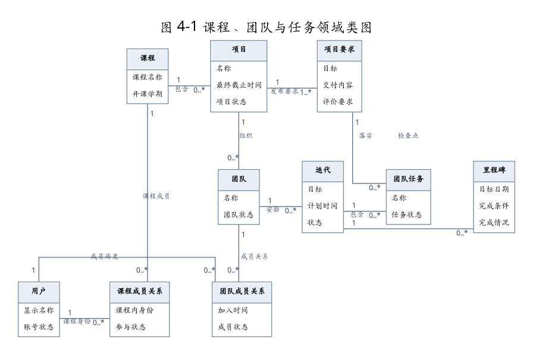

**图示说明**：本图展示课程、项目、项目要求、团队、迭代、团队任务、里程碑及相关成员关系之间的领域关联。课程成员关系用于记录用户在课程中的身份，团队成员关系用于记录用户在团队中的参与情况。项目要求由教师发布，团队任务须关联相应项目要求并归属于一轮迭代；里程碑关联迭代，用于记录阶段性目标及完成情况。成员关系可以保留历史，但应遵守有效成员关系及团队归属约束。

同一用户与课程最多存在一个有效课程成员关系；同一项目中同一学生最多属于一个有效团队。成员关系可保留多条历史，但有效期不能产生冲突。活动团队通过有效成员关系确定一名负责人；唯一成员退出后保留团队历史并停止新增业务。

### 4.4.3 成果、评审与成绩关系

**图4-2 成果版本与评审领域类图**

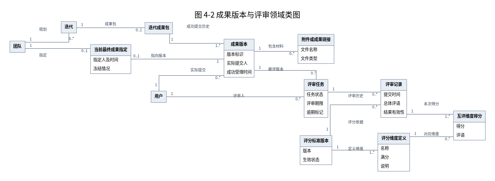

**图示说明**：本图展示迭代成果包、成果版本、最终成果指定、附件或成果链接、评审任务、评审记录及评分标准等对象之间的关系。每次成功提交形成新的成果版本，历史版本予以保留；最终成果指定引用一个具体的已提交版本，后续重交不会自动改变该指定关系。评审任务关联被评版本，同一评审任务可以保留多条历史评审记录；评审记录应关联实际使用的评分标准版本，维度得分与评分维度定义分别记录。

**图4-3 成绩来源与计分名单领域类图**

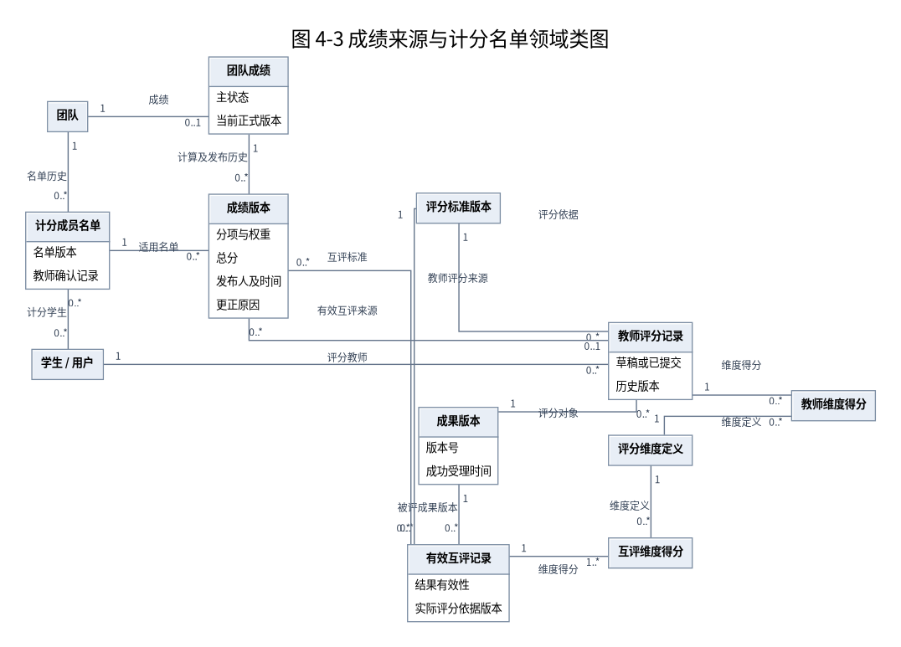

**图示说明**：本图展示团队成绩、成绩版本、计分成员名单、教师评分记录、有效互评记录及维度得分等对象之间的关系。成绩版本应固定对应的计分名单和计算依据，并保留版本历史。教师评分与互评是不同的成绩来源，评分记录须关联实际使用的评分标准版本，维度得分须关联对应的评分维度。草稿、待复核或无效评分不能作为有效计分依据；必要评分来源缺失时，不得将缺失结果直接按零分处理或擅自调整权重。

最终成果指定关系只表示当前引用，历次重新指定通过操作记录保留。版本可以从未被指定，因此并非每个版本都必须对应指定关系。指定版本、评审对象与团队须属于同一项目；学生评审人不能是被评团队成员。评审记录与教师评分分别引用实际标准版本，得分须对应该版本中的维度。正式成绩采用已提交的有效来源；草稿评分、待复核或无效结果不能作为必要计分依据。教师权重为正时，每个成绩版本须关联一份教师确认的有效教师评分来源；权重为零时可不关联。互评权重为正时，该团队本批次未取消的评审任务须均有当前有效结果，否则视为必要来源缺失；单团队项目无互评来源。成绩版本固定名单和计算依据，重算、成员变动不自动覆盖正式结果。

## 4.5 业务数据字典

本节进一步解释关键业务数据的含义和使用边界，不涉及数据库字段类型。具体必需性应结合相应功能场景确认。

| 业务数据项 | 所属对象 | 含义 | 需求层面的约束 |
|---|---|---|---|
| 用户显示名称 | 用户 | 平台中展示的用户名称 | 应有可识别的显示名称；展示范围受权限控制 |
| 账号状态 | 用户 | 表示账号是否可正常使用 | 禁用账号不得执行受保护操作 |
| 课程名称 | 课程 | 课程的可读名称 | 创建课程时应提供 |
| 课程内身份 | 课程成员关系 | 用户在课程中的身份 | 同一用户在同一课程内仅有一个有效课程角色；跨课程分别校验 |
| 项目名称 | 项目 | 项目的可读名称 | 发布前必须填写 |
| 项目要求 | 项目要求 | 教师规定的目标、交付内容、最终期限和评价要求 | 由教师发布；团队任务不能改变该要求 |
| 项目最终截止时间 | 项目 | 项目交付的最终截止时刻 | 以系统成功受理时间判断是否按时；等于截止时刻视为按时 |
| 项目状态 | 项目 | 项目当前业务状态 | 发布后不能撤回为草稿；正常结束与异常终止分开 |
| 迭代目标与计划时间 | 迭代 | 团队对本轮工作的目标及计划安排 | 由团队自主设置；计划结束日期不自动关闭迭代或产生逾期标记 |
| 迭代结束确认 | 迭代 | 团队负责人手动确认迭代结束的记录 | 记录完成情况和遗留事项 |
| 团队任务所属迭代 | 团队任务 | 任务归属的迭代 | 每项团队任务必须归属一轮迭代；跨迭代调整保留原归属和调整记录 |
| 团队任务状态 | 团队任务 | 任务当前进展 | 使用未开始、进行中、已完成；返工时回到进行中并记录原因 |
| 里程碑目标日期 | 里程碑 | 迭代中重要交付检查点的目标日期 | 关联某轮迭代，不替代项目最终截止时间 |
| 成果提交时间 | 迭代成果版本 | 系统成功受理成果的时间 | 用于判断是否按时；不能用用户点击提交的时间代替 |
| 成果版本 | 迭代成果版本 | 区分同一迭代成果的不同成功提交版本 | 每次成功重交生成新版本，历史版本保留 |
| 最终成果指定版本 | 最终成果指定 | 团队负责人选定的具体成果版本 | 不重复上传；后续重交不会自动改变指定关系；截止时冻结 |
| 评审任务状态 | 评审任务 | 评审任务当前进展 | 使用待评审、评审中、已完成、待复核、已取消；逾期单独标记 |
| 评审记录 | 评审记录 | 某次评审或重评的实际结果 | 同一任务可以有多条记录；旧记录保留为历史 |
| 评分标准版本 | 评分标准 | 某次评审采用的评分标准版本 | 评审记录应关联实际使用的标准版本 |
| 维度得分 | 维度得分 | 某次评审对一个评分维度给出的分数 | 与评分维度定义分开记录，并符合适用范围 |
| 成绩发布状态 | 成绩 | 成绩是否已向授权对象公开 | 未发布成绩不得向无权用户展示；更正应保留版本和原因 |
| 操作时间 | 操作记录 | 重要业务操作发生时间 | 以北京时间展示；自课程结束起保留2年，未结争议数据暂缓清理 |

### 4.5.1 数据完整性与访问约束

以下约束用于说明业务必须满足的条件，具体技术实现手段由后续设计决定。

**关联与完整性**
- 项目必须归属于有效课程；项目要求由教师发布并归属于相应项目。
- 团队必须归属于相应项目；团队成员必须符合项目参与资格。
- 每项团队任务必须关联项目要求并归属于一轮迭代；不得创建无迭代归属的团队任务。
- 里程碑必须关联某轮迭代。
- 迭代成果必须关联所属团队和迭代；每次成功重交应形成可追溯的新版本。
- 最终成果指定必须引用一个已提交的具体成果版本；评审任务固定引用指定的被评版本。
- 评审记录必须对应有效评审任务，并关联所用评分标准版本及各维度得分。
- 成绩必须能追溯至已确认的有效评分来源和计算规则。

**唯一性与重复操作**
- 同一项目内团队名称唯一，不同项目可重名；以稳定团队标识关联历史，不以名称关联成绩。
- 同一学生在同一项目中只能属于一个有效团队。
- 同一评审任务允许存在多条评审记录，以支持复核与重评；只有校验通过并被确认为有效的结果作为当前计分依据，历史记录不得覆盖删除。
- 正式成果不提供撤回操作；窗口内重交生成新版本，历史版本保留。
- 后续重交不自动改变已指定的最终成果版本，也不自动改变评审任务引用的版本。
- 提交版本编号、重复请求的技术处理方式由后续设计细化，但业务上不得产生无法解释的重复有效提交。

**访问与隐私**
- 用户只能访问有权访问的课程、项目、团队、迭代、任务、成果、评审和成绩信息。
- 学生只能查看本人有权访问的团队任务、提交版本、助教反馈、整改记录及授权开放的互评反馈。
- 被分配互评任务的学生只能访问对应指定成果版本；匿名互评时，不得通过查询、文件链接或其他展示内容泄露受保护的评审人身份。
- 教师只能管理自己负责或被授权的课程项目；助教只能执行明确授权的过程检查、反馈、复查及问题上报。
- 未发布成绩、成绩更正记录和管理审计日志仅向获授权人员开放。
- 文件下载和成绩导出同样需要检查业务权限；平台运维权限不自动等同于查看所有课程内容和成绩的业务权限。

**数据生命周期**
- 项目最终截止后，项目正常进入“已结束”，普通提交关闭；教师授权的补交、互评和成绩处理可以继续。相关事项办结后再归档，常规业务只读。
- 异常终止的项目保留全部历史，停止新增提交、互评和评分；已发布成绩保留，后续更正仍按教师更正流程处理。
- 应保留必要的提交版本、任务跨迭代调整、团队成员变更、评审历史、评分依据和成绩修改记录。
- 删除成果文件前，应检查其与评审、成绩等业务记录的关联。
- 成果、评审、成绩、成员历史及关键记录自课程结束起保留2年；到期经平台业务负责人批准，由管理员清理并留痕，未结事项相关数据暂缓。日志不记录密码或令牌。备份恢复须达到RPO≤24小时、RTO≤4小时，具体备份技术由设计阶段选择。

## 4.6 需求阶段与技术设计阶段的边界

| 需求文档需要明确 | 留待技术设计决定 |
|---|---|
| 业务对象及其含义，包括项目要求、迭代、团队任务、里程碑、迭代成果版本和最终成果指定 | 数据库产品与版本 |
| 关键业务属性及用途 | 物理表结构、字段命名和字段类型 |
| 对象间业务关系、版本引用和历史记录要求 | 主键、外键的具体实现 |
| 业务必填项与有效性规则 | 索引、查询优化和存储方案 |
| 用户可见范围和操作权限 | 权限校验的具体架构与实现位置 |
| 提交、迭代、评审、评分和成绩的业务状态 | 事务边界、并发控制、幂等技术方案 |
| 需要留痕的关键事件 | 日志基础设施、备份实现和部署方案（须满足已确定恢复目标） |

---

# 第 5 章 业务规则与角色权限分析

## 5.1 业务规则说明

本章汇总平台必须遵守的业务约束。表中“必须”表示本版本固定规则；可配置项同时规定操作者、取值约束和生效时机。具体课程日期、团队人数和评分维度由教师录入，不构成业务规则未决。系统执行规则时，同时校验课程角色、对象归属、团队关系、当前状态及业务窗口。

## 5.2 业务规则清单

### 5.2.1 课程与项目规则

| 编号 | 规则名称 | 规则描述 | 状态 |
|---|---|---|---|
| BR-001 | 项目课程归属 | 每个项目必须归属于一门有效课程。 | 必须 |
| BR-002 | 项目发布权限 | 仅具有相应课程权限的教师可以发布项目；助教和平台管理员不因自身角色取得发布权限。 | 必须 |
| BR-003 | 项目发布完整性 | 项目名称、所属课程、目标、交付要求、最终截止、评分标准及权重必填；组队时间和人数规则在开放组队前完成配置。 | 必须 |
| BR-004 | 项目时间有效性 | 最终截止不得早于项目开始；组队开放早于组队截止，组队截止不晚于最终截止。时间统一为北京时间；团队迭代自主安排，无需跨团队同步。 | 必须 |
| BR-005 | 已发布项目变更 | 教师可修改说明、交付要求，并在原截止到达前调整最终期限；涉及既有提交须保留旧要求、说明影响及整改窗口并通知。已过截止不得改日期将补交变成按时。项目不撤回草稿；互评启动后的标准与权重遵守冻结及重评规则。 | 必须 |
| BR-006 | 项目结束与归档 | 到达项目最终截止时间后，项目正常进入“已结束”，关闭普通提交；补交、互评和成绩处理仍可按授权继续。相关事项办结后再归档，归档后常规业务只读。 | 必须 |
| BR-007 | 统一迭代概念 | 项目管理中统一使用“迭代”，不另设“项目阶段”管理层级。 | 必须 |
| BR-008 | 项目要求与团队任务 | 项目要求由教师发布，团队任务由团队负责人创建并关联对应项目要求；团队任务必须归属一轮迭代，不能改变教师发布的项目要求。 | 必须 |

### 5.2.2 组队与成员规则

| 编号 | 规则名称 | 规则描述 | 状态 |
|---|---|---|---|
| BR-009 | 组队资格 | 只有符合课程和项目参与条件的学生可以加入团队。 | 必须 |
| BR-010 | 组队方式 | 支持学生创建团队、申请加入、负责人审批和教师人工分配；创建者成为负责人，不支持邀请入组或自动组队。 | 必须 |
| BR-011 | 团队人数限制 | 教师配置正整数人数上下限，下限不大于上限，负责人计入人数，不设超限例外。开放期可不足下限，截止时不足的标记组队未完成，由教师调整。 | 必须 |
| BR-012 | 单项目团队归属 | 同一学生在同一项目最多属于一个有效团队；同一项目内团队名称唯一，不同项目可重名，改名不改变团队标识和历史关联。 | 必须 |
| BR-013 | 成员变更权限 | 开放期负责人审批入组及普通成员退出；主动移除、转组及截止后调整由教师处理。负责人交接须接任者接受，截止后或无法交接时由教师指定；无人接任不能直接退出。 | 必须 |
| BR-014 | 组队截止规则 | 组队窗口为开放时刻≤当前时间＜截止时刻。截止后关闭学生创建、申请和负责人审批，未处理入组申请失效；后续调整由教师记录原因和生效时间并通知。 | 必须 |
| BR-015 | 截止后的成员约束 | 组队截止后学生不能自行改变成员关系，教师调整仍遵守人数和唯一归属。转组同时解除原关系并建立新关系；失败保留原关系。唯一成员退出须教师处理，保留团队历史并停止新增业务。 | 必须 |
| BR-016 | 成员历史与计分名单 | 成员变更保留生效起止时间、操作者及原因，不迁移删除原成果。离组失去原团队非公开材料权限。最终截止记录名单并由教师核对，名单内成员同分；截止后归属异常不自动改写成绩。 | 必须 |

### 5.2.3 任务与成果提交规则

| 编号 | 规则名称 | 规则描述 | 状态 |
|---|---|---|---|
| BR-017 | 提交资格 | 正式成果提交和重交由团队负责人执行；普通成员可以准备、上传待提交材料。系统应校验团队、项目和当前业务状态。 | 必须 |
| BR-018 | 提交完整性 | 所属迭代、成果说明及交付要求规定的文件或链接必填；团队、实际提交人、成功受理时间和版本由系统记录。个人材料汇入团队迭代成果包，不另设个人或任务级正式提交。 | 必须 |
| BR-019 | 截止时间判断 | 以系统成功受理成果的时间作为提交时间；成功受理时间等于截止时刻也视为按时，不能用用户点击提交的时间代替。 | 必须 |
| BR-020 | 最终截止与逾期判断 | 只依据教师规定的项目最终截止时间判断项目交付是否逾期。团队任务和迭代日期仅用于计划展示，不自动生成延期标记。 | 必须 |
| BR-021 | 迭代成果版本 | 正式成果按迭代提交，每轮形成一个成果包。提交窗口开放且成果未冻结时，负责人可以重交；每次成功重交生成新版本并保留历史，最新成功版本为该轮成果的当前有效版本。 | 必须 |
| BR-022 | 提交记录与回执 | 系统应记录所属团队、实际提交人、成功受理时间和成果版本；成功受理后应提供可查询的提交回执。 | 必须 |
| BR-023 | 文件和链接限制 | 支持PDF、DOCX、PPTX、XLSX、TXT、MD、PNG、JPG/JPEG、ZIP。单文件≤50 MB，每版本上传文件总量≤200 MB；HTTPS外链及代码链接须符合要求，代码注明提交编号或标签。超限拒绝，不破坏原有效版本。 | 必须 |
| BR-024 | 正式成果修改与补交 | 不提供正式撤回，开放窗口内负责人重交留版；最终截止前可主动重新指定已有版本并留痕。最终截止后仅教师按申请授权特定团队每次最长7个自然日窗口，记录原因与期限，不自动改写最终指定和旧评审引用。保留迟交标记，不自动扣分或临时增加扣分项。 | 必须 |
| BR-025 | 成果可见范围 | 学生只能访问本人有权访问的成果。被分配互评任务的学生可以访问对应的指定成果版本；其他团队成果的可见范围按授权规则控制。 | 必须 |
| BR-026 | 提交失败与重复请求 | 提交失败时应清楚说明原因；重复请求不得造成无法解释的重复有效提交。系统成功受理后应返回可查询回执。 | 必须 |

### 5.2.4 评审与互评规则

| 编号 | 规则名称 | 规则描述 | 状态 |
|---|---|---|---|
| BR-027 | 评审任务分配 | 教师在最终交付后确认被评版本，系统随机为每名学生分配2个不同的其他团队，不足则分配全部其他团队，兼顾各团队获得评审。教师可在评审开始前调整；已产生记录需取消留痕后另建任务。仅1个有效团队时不互评，教师评分100%。 | 必须 |
| BR-028 | 评审人资格 | 仅被分配的学生可提交该互评；按课程、成员和任务校验，访问仅限任务引用的具体版本，不向教师或助教开放代学生提交互评的权限。 | 必须 |
| BR-029 | 禁止自评 | 分配和提交均禁止评审本人所属团队的成果，不设自评例外。 | 必须 |
| BR-030 | 互评匿名策略 | 对学生隐藏评审人身份；不承诺隐藏被评团队及成果作者身份。教师及授权检查范围内的助教可查看身份。页面、通知和可下载记录遵守同一规则。 | 必须 |
| BR-031 | 评审完整性 | 每个评分维度及总体评语必填，评语不得仅包含空白；无效评分不保存为已完成的有效结果。 | 必须 |
| BR-032 | 评分范围 | 每项维度得分必须符合本次评审所采用评分标准版本规定的范围。 | 必须 |
| BR-033 | 评分标准版本 | 教师发布项目前设置百分制评分标准，维度满分合计100分，记录版本。互评启动后冻结；确需变更时新建标准、说明原因并通知，对受影响计分批次统一重评，保留旧标准及记录。 | 必须 |
| BR-034 | 复核与重评 | 反馈开放后3个自然日内学生可申请一次复核并说明理由，存在未结申请不重复受理；教师可主动复核。原结果有效恢复已完成，批准重评回到待评审，新记录校验通过后生效，旧记录保留。 | 必须 |
| BR-035 | 互评缺失处理 | 截止前提醒，截止后单独标记逾期并通知教师；教师可说明原因延长期限或取消后重新分配。未获延长不能逾期提交，不自动取消、扣分或将缺失评审计零。 | 必须 |
| BR-036 | 评审质量异常 | 教师应能按规则复核明显无效或不完整的评审。复核或重评期间，原结果暂不作为正式计分依据；必要评分未确定时，应阻止受影响成绩发布。 | 必须 |

### 5.2.5 成绩计算与发布规则

| 编号 | 规则名称 | 规则描述 | 状态 |
|---|---|---|---|
| BR-037 | 成绩来源可追溯 | 成绩应能追溯至已确认的有效评分来源、适用评分标准版本及计算规则。 | 必须 |
| BR-038 | 成绩计算规则 | 默认最终成绩=教师评分×70%+互评均分×30%；两来源均为百分制。教师可在互评开始前调整非负且合计100%的权重，开始后冻结。互评取全部当前有效总分平均，不自动剔除最高最低分；中间不舍入，最终四舍五入保留2位小数。 | 必须 |
| BR-039 | 缺失或无效评分处理 | 正权重必要评分缺失、无效或存在未结争议时阻止受影响成绩发布；不自动补零或调整权重。教师安排补评、重评后重新汇总，不按分数高低自动剔除。零权重项不作为发布必要来源；互评权重为正时，被评团队本批次未取消评审任务均须有当前有效结果，任务全部取消且未补充分配时仍视为缺失。 | 必须 |
| BR-040 | 教师评分与成绩权限 | 正式评分、核对、发布及更正仅由相应课程教师执行。助教不能查看未发布成绩、正式评分、导出、发布或更正成绩。教师评分记录使用草稿、已提交两种状态，草稿不计分。 | 必须 |
| BR-041 | 发布前核对 | 教师发布成绩前应核对成绩明细、必要评分是否缺失及是否存在未解决异常；不另设由另一人执行的审批环节。 | 必须 |
| BR-042 | 已发布成绩更正 | 任课教师更正已发布成绩时，应填写原因、核对更正前后结果并确认重新发布。更正另建版本，重新发布前保留原正式结果；保存历史并通知受影响学生。 | 必须 |
| BR-043 | 成绩可见范围 | 学生只能查看已向本人开放的成绩；未发布成绩、成绩更正记录及管理审计日志不得向无权用户开放。 | 必须 |
| BR-044 | 成绩导出 | 仅课程教师可按授权范围导出CSV或XLSX，字段为项目、团队、学号、姓名、分项、权重、最终成绩及发布状态。记录操作者、时间、范围和结果，助教、学生无全班成绩导出权限。 | 必须 |
| BR-045 | 团队与个人成绩 | 采用团队统一成绩，最终计分名单内学生同分，不设贡献系数，过程检查不作为独立加权项。单团队项目教师评分100%并记录互评不适用，不伪造互评结果。 | 必须 |

### 5.2.6 通知与操作追溯规则

| 编号 | 规则名称 | 规则描述 | 状态 |
|---|---|---|---|
| BR-046 | 通知事件与渠道 | 仅站内通知。项目发布、关键要求与期限变更、分配、整改、成绩发布更正须通知受影响人员；不改变原意的文字纠错只留记录。不提供短信和邮件。 | 必须 |
| BR-047 | 通知接收与重复处理 | 接收人按有效业务关系确定；按事件编号、接收人、通知类型去重。失败自动重试3次，仍失败转管理员处理，不回滚已成功业务；最终提交和互评未完成时截止前24小时及截止后各提醒一次，完成、取消或终止后停止相应提醒。 | 必须 |
| BR-048 | 关键操作与留存 | 关键操作保留操作者、时间、对象、原因及必要前后内容；关键业务结果与记录均保存后才反馈成功。成果、评分及操作历史自课程结束保留2年，到期经平台业务负责人批准由管理员清理，未结事项暂缓。 | 必须 |
| BR-049 | 日志最小化 | 操作记录只保留业务追溯所需信息，不得记录密码、访问令牌等敏感凭据。 | 必须 |
| BR-050 | 操作失败反馈 | 因权限不足、对象状态不允许或信息不完整导致操作失败时，应清楚说明原因，且不得造成业务数据部分生效。 | 必须 |

## 5.3 角色定义与职责边界

| 角色 | 可执行的业务 | 权限边界 |
|---|---|---|
| 普通成员 | 开放期建队、申请加入或退出，准备材料、更新本人任务，完成被分配互评，查看本团队授权过程和本人成绩 | 不能正式代表团队提交或更换最终版本，不能创建分配团队任务、查看管理审计日志或未发布成绩 |
| 团队负责人 | 兼具学生能力；审批开放期入组与普通成员退出，安排迭代、任务、里程碑，正式提交、重交、指定及截止前重新指定最终版本，申请成员移除或补交 | 不能改变教师项目要求，不能直接移除或转组，不能绕过截止、人数、冻结和评分权限；退出前完成交接 |
| 教师 | 发布与维护本课程项目，处理成员异常、查看干预任务、授权补交、确认被评版本、组织复核重评、正式评分、发布更正及导出 | 不跨课程越权，不回填受理时间，不覆盖正式历史；关键操作记录原因并通知，发布更正无需另一人审批 |
| 助教 | 查看授权过程材料与进度，检查、反馈、复查、上报，发送与检查事项相关的提醒 | 不能发布项目、审批成员、调整团队任务、管理正式互评分配、批准重评、查看未发布成绩、正式评分、导出或发布更正成绩 |
| 平台管理员 | 维护账号、平台配置及运行状态，处理通知失败；在批准的范围和期限内排查课程数据故障，执行批准的数据清理 | 默认无权浏览课程内容、成果、评审或成绩，不具有业务评分及成绩发布权，故障访问和导出须记录 |

同一用户在同一课程仅具备一种有效课程角色，跨课程分别校验。负责人是团队成员职责，不独立授予跨团队权限。平台业务负责人负责通用权限、必填项、数据访问及清理政策的批准，不因批准责任而默认取得教师操作权限。

## 5.4 角色权限矩阵

符号“√”表示在所属课程、团队、任务及有效窗口内允许；“△”表示仅满足行内说明的特定情形允许；“—”表示不允许。管理员的故障访问批准不授予教学业务决定权。

| 操作 | 普通成员 | 团队负责人 | 教师 | 助教 | 平台管理员 |
|---|:---:|:---:|:---:|:---:|:---:|
| 查看参与课程及项目要求 | √ | √ | √ | √ | — |
| 发布、修改或终止项目要求 | — | — | √ | — | — |
| 开放期创建团队、申请入组或退出 | √ | △交接后退出 | √人工分配 | — | — |
| 开放期审批入组及普通成员退出 | — | √ | √人工处理 | — | — |
| 申请移除成员、申请限时补交 | — | √ | √处理 | — | — |
| 决定移除、转组及截止后成员调整 | — | — | √ | — | — |
| 查看本团队任务、迭代与进度 | √ | √ | √ | √授权检查 | — |
| 创建、分配和调整团队任务 | — | √ | △有记录干预 | — | — |
| 更新本人任务进度 | √ | √ | △有记录干预 | — | — |
| 准备或上传待提交材料 | √ | √ | — | — | — |
| 正式提交或重交迭代成果 | — | √ | — | — | — |
| 截止前指定或主动重新指定最终版本 | — | √ | △异常核实 | — | — |
| 截止后核实被评版本、授权补交 | — | — | √ | — | — |
| 检查、反馈、复查与上报 | — | — | √ | √授权范围 | — |
| 组织、分配、取消互评或批准重评 | — | — | √ | — | — |
| 查看被分配的指定成果 | √被分配时 | √被分配时 | √ | △授权检查 | — |
| 提交被分配的学生互评 | √ | √ | — | — | — |
| 查看互评人身份 | — | — | √ | △授权检查 | — |
| 配置标准及互评开始前的成绩权重 | — | — | √ | — | — |
| 正式评分、查看课程成绩含未发布 | — | — | √ | — | — |
| 核对、发布、更正或导出成绩 | — | — | √ | — | — |
| 查看本人已开放成绩 | √ | √ | — | — | — |
| 发送业务通知 | — | — | √ | △本人检查事项 | — |
| 查看本团队授权业务过程 | √ | √ | √ | △授权检查 | — |
| 查看权限调整、成绩更正等管理审计 | — | — | △本课程管理 | — | △批准的故障范围 |
| 故障处理访问课程受限数据 | — | — | — | — | △批准范围及期限 |
| 执行到期数据清理 | — | — | — | — | △经批准 |
| 管理平台账号与系统配置 | — | — | — | — | √ |

### 5.4.1 权限校验要求

每次操作同时校验账号状态、目标课程角色、课程与团队关系、任务分配、对象状态和窗口。普通成员离组后，不能继续访问原团队非公开材料；被分配互评时仅开放对应版本所需信息。页面隐藏按钮不替代实际访问检查，通知和导出不能扩大权限。关键业务结果与必要记录同时保存后才能反馈成功。

## 5.5 关键业务场景规则

### 5.5.1 组队与成员调整

1. 学生进入开放组队的课程项目，系统先检查课程成员资格和项目参与条件。
2. 开放期学生创建团队或申请加入，负责人审批；教师可人工分配。创建者为负责人，不提供邀请入组。
3. 组队开放期内，由团队负责人审批入组。系统校验参与资格、团队人数限制，并确保同一学生在同一项目中最多属于一个有效团队。
4. 组队截止后，或涉及转组等特殊调整时，由教师处理并保留必要记录。
5. 操作成功后更新成员关系并反馈结果；失败时说明原因，不得造成互相矛盾的有效成员关系。

**常见异常**： 项目未开放组队、学生不具备资格、团队人数已满、重复申请、组队已截止，或学生已经属于该项目中的另一个有效团队。

### 5.5.2 团队迭代、任务与成果提交

1. 教师发布项目要求、交付内容、评价要求和项目最终截止时间。
2. 团队负责人根据项目要求自主安排本团队的迭代、里程碑和团队任务。每项团队任务必须归属一轮迭代，并关联相应项目要求；团队任务不能改变教师要求。
3. 团队成员执行分配给自己的任务、更新进度，并可准备或上传待提交材料。团队负责人负责正式提交迭代成果。
4. 提交前，系统检查负责人权限、成果要求、文件或链接限制、提交窗口及相关状态。
5. 系统成功受理后记录实际提交人、受理时间和成果版本，并提供可查询回执。成功重交形成新版本，历史版本保留。
6. 团队负责人从本团队已提交版本中指定最终成果；最终截止前可主动重新指定并记录前后引用和时间，后续重交不自动改变指定关系。
7. 到达项目最终截止时间时，系统关闭普通提交并冻结已指定的最终成果版本。若截止时尚未指定最终成果，应标记“未指定最终成果”，由教师核实被评版本并记录原因，系统不得自动替团队选择。
8. 最终截止后负责人可申请补交或整改，教师每次开放最长7个自然日的团队窗口并记录原因；保留迟交标记，不自动扣分，不临时增加扣分项。新版本不自动替换既有评审引用，需要重评由教师安排；已终止项目不恢复新增提交。

**常见异常**： 无权提交、任务未归属迭代、材料不完整、文件或链接不符合要求、提交窗口关闭、重复请求、未指定最终成果、最终截止后申请补交或整改。

### 5.5.3 助教过程检查与正式互评

1. 助教在授权范围内检查日常迭代成果，反馈问题、跟踪整改并记录复查结果；发现异常时向教师上报。
2. 助教检查与正式互评分开管理。助教检查通过不是启动互评的强制前置条件，是否启动互评由教师决定。
3. 项目最终交付后，教师确认各团队需要被评审的最终成果版本，并组织正式互评。
4. 每项评审任务固定引用一个具体成果版本，并明确评审人、截止时间和适用评分标准。被分配的评审人只能访问完成该任务所需的指定成果。
5. 评审人提交评分时，系统检查评审资格、评分维度、得分范围和必要信息。评审任务使用“待评审、评审中、已完成、待复核、已取消”五种状态；逾期按评审期限单独标记。
6. 复核期间，原结果暂不作为正式计分依据。批准重评后回到“待评审”；重评产生新的评审记录，原记录保留为历史。新结果提交并通过校验后，才可作为当前有效结果。
7. 若被评材料缺失或无法访问，教师可以暂停该成果的评审，并记录处理原因。

**常见异常**： 评审人未获分配、成果无法访问、评分超出范围、评审任务逾期、评审被取消、结果待复核或需要重评。

### 5.5.4 成绩汇总、发布与更正

1. 成绩计算应使用已确认的评分来源、评分标准版本和课程计算规则。
2. 系统检查必要评分是否缺失、是否存在无效结果或未解决争议；受影响成绩存在未解决问题时，不得进入正式发布。
3. 教师核对成绩明细并确认发布，不另设必须由另一人完成的审批环节。成绩状态统一使用“待汇总、异常待处理、待发布、已发布”。
4. 待发布成绩的评分来源发生变化后，必须重新汇总。学生只能查看已经向本人开放的正式成绩。
5. 已发布成绩需要更正时，由任课教师填写原因、核对更正前后结果并确认重新发布。更正另建版本，重新发布前保留原正式结果；历史记录应可追溯，并通知受影响学生。

**常见异常**： 必要评分缺失、互评结果待复核、评分来源无效、成绩配置缺失或无效、无权发布成绩或已发布成绩需要更正。

## 5.6 业务状态与操作约束

为避免各章节、流程图和验收条件状态名称不同，以下对象状态应按已确认规则统一表达。这里列出的是业务状态及操作约束。

| 对象 | 已确认的状态或状态规则 | 操作约束 |
|---|---|---|
| 项目 | 发布后不能撤回为草稿；最终截止后正常进入“已结束”；异常终止使用“已终止”，与正常结束区分；相关事项办结后可归档 | “已结束”后关闭普通提交，但可继续处理教师授权补交、互评和成绩；“已终止”后停止新增提交、互评和评分，保留历史并通知参与者 |
| 团队成员关系 | 有效成员关系需满足参与资格和单项目唯一归属规则 | 同一学生在同一项目中最多属于一个有效团队；开放期内入组由团队负责人审批，截止后及转组等特殊调整由教师处理 |
| 团队任务 | “未开始、进行中、已完成” | 返工时回到“进行中”并记录原因；任务计划日期不自动产生延期标记；每项任务必须归属一轮迭代 |
| 迭代 | 由团队负责人手动确认结束，记录完成情况和遗留事项 | 计划结束日期不自动关闭迭代；未完成任务可转入后续迭代并保留记录 |
| 迭代成果 | 成果包及其历史版本；最新成功版本为该轮成果的当前有效版本 | 开放窗口内可重交；正式成果不提供撤回；成功受理时间作为提交时间；最终截止时关闭普通提交 |
| 最终成果指定 | 指定关系指向一个具体的迭代成果版本 | 后续重交不会自动改变指定版本；最终截止时冻结已指定版本；未指定时由教师核实，不由系统自动选择 |
| 评审任务 | “待评审、评审中、已完成、待复核、已取消”，逾期单独标记 | 任务固定引用指定成果版本；取消须记录原因；原结果确认有效后恢复“已完成”；批准重评后回到“待评审” |
| 评审记录 | 同一评审任务可以有多条记录 | 重评新增记录，不覆盖历史；新结果校验通过后成为当前有效结果；复核或重评期间原结果暂不作为正式计分依据 |
| 成绩 | “待汇总、异常待处理、待发布、已发布” | 必要规则或评分缺失、存在未解决争议时进入异常待处理；评分来源改变后重新汇总；发布和更正由有相应权限的教师执行 |
| 项目终止 | “已终止”表示异常终止，不等同于正常结束 | 必须填写终止原因并通知参与者；保留历史，停止新增提交、互评和评分；已发布成绩保留，后续更正仍走教师更正流程 |

团队任务和迭代的计划日期仅用于安排和进度展示，不自动生成延期标记。互评任务的逾期状态则依据其自身评审期限单独处理。

## 5.7 业务配置与例外处理约束

课程参数由教师在本节规定范围和时机内配置；平台通用必填项、权限边界、历史记录和数据保护要求不得通过课程配置关闭。例外操作由规定角色处理并留痕。

### 5.7.1 角色、组队与成员管理

#### 角色与兼任

一个账号可以在不同课程担任不同角色；同一课程内，学生、助教、教师身份互斥。团队负责人属于学生的团队职责，不构成独立业务角色。管理员身份不自动获得课程业务权限。平台在每次业务操作时，均按当前课程及项目中的实际角色和成员关系校验权限，不因用户在其他课程中的身份而自动授予权限。

#### 团队人数

教师按项目设置团队人数下限和上限，两者均为正整数，且下限不得超过上限。团队负责人计入团队人数，不设置超限例外。组队开放期间，团队人数可以暂时低于下限；组队截止时仍不足下限的团队标记为“组队未完成”，由教师调整。创建团队、申请加入、审批入组及成员调整时均校验人数上限，不得以教师人工操作绕过人数上限。

#### 组队方式与时间

平台支持学生创建团队、申请加入团队、由团队负责人审批入组，以及教师人工分配或调整团队。创建者自动成为团队负责人。不提供邀请入组和自动组队功能。

教师设置组队开放时间和截止时间，开放时间必须早于截止时间，组队截止时间不得晚于项目最终截止时间。组队窗口为“开放时刻≤当前时间＜截止时刻”。截止后关闭学生创建团队、提交入组申请和负责人审批操作，尚未处理的申请失效；后续调整由教师处理，记录原因、生效时间并通知受影响成员。

#### 成员变更

| 场景 | 统一处理规则 |
|---|---|
| 普通成员退出 | 组队开放期内由成员提出申请、团队负责人审批，批准后生效；截止后由教师处理。 |
| 主动移除成员 | 团队负责人填写理由并提交申请，由教师决定；负责人不能直接移除成员。 |
| 转组 | 由教师统一处理，并校验目标团队人数及学生参与资格。一次处理同时解除原团队关系、建立新团队关系；处理失败时保留原关系，避免学生同时归属两个有效团队。 |
| 负责人更换或退出 | 开放期内可由原负责人发起交接，由本团队另一名成员接受后生效；截止后或原负责人无法操作时，由教师指定。负责人不能在无人接任时直接退出。 |
| 唯一成员退出 | 由教师处理；保留团队历史，团队停止接收新的业务操作，不通过删除团队清除历史。 |
| 历史成果与贡献 | 已有任务操作、成果提交、过程检查和评审记录保留原团队及实际操作者，不随成员变动迁移、删除或改写。 |
| 访问权限 | 成员离组后失去原团队日常协作及非公开材料的访问权限；个人成绩仍按成绩开放规则查看。教师保留历史核查权限。 |
| 计分成员名单 | 项目最终截止时记录计分成员名单。截止前转组的学生按最终有效团队归属计分，由教师确认各团队计分名单；截止后不自动调整成绩归属，异常由教师处理并留痕。涉及已发布成绩时，按成绩更正流程处理。 |

成员变动后，未完成任务由团队负责人重新分配；历史执行记录不改写。同一学生在同一项目中最多属于一个有效团队。教师进行成员调整时仍须遵守团队人数上限。

### 5.7.2 成果提交、版本与文件管理

#### 提交主体与版本

团队按迭代提交成果。普通成员可以准备或更新材料，由团队负责人完成正式提交；提交记录关联团队、提交人、迭代和成果版本。个人工作材料可作为团队成果包内容，正式提交仍以团队迭代为单位，不新增个人正式提交入口。

在提交窗口开放且成果未冻结时允许重交；每次成功重交形成新版本并保留历史，不提供正式成果撤回。首版不设置重交次数上限。负责人应明确指定作为最终成果的具体版本，后续重交不会自动改变已指定版本。

最终截止前，负责人可以将最终成果重新指定为本团队另一个已正式提交的版本；系统记录指定前后版本及操作时间。重新提交本身不触发最终成果重新指定。最终截止后，负责人不能自行更换最终成果版本，由教师按异常核实或授权补交流程处理。

#### 最终截止后的补交或整改

最终截止后普通提交关闭。负责人提出补交或整改申请并说明原因，由教师决定是否批准。适用情形包括上传故障、材料无法访问或教师要求整改等。教师针对具体团队设置补交窗口的起止时间，每次窗口最长为7个自然日；再次开放时须重新记录原因。系统通知团队负责人及本团队成员。

补交形成新版本，不覆盖原始受理时间、原有文件或历史评审所引用的版本。新版本不会自动替换最终成果指定版本；教师须明确确认被评版本，必要时安排重评。提交记录须标明该次提交属于截止后授权提交，不得将其改写为按时提交。保留迟交标记，不由系统自动扣分或临时增加扣分项，教师仍按既定评分标准评分。

#### 文件格式、大小与外部链接

| 项目 | 统一规则 |
|---|---|
| 支持的文件格式 | PDF、DOCX、PPTX、XLSX、TXT、MD、PNG、JPG/JPEG、ZIP。源代码可通过 ZIP 文件或代码仓库链接提交。 |
| 文件大小 | 单个文件不超过50 MB；每个成果版本上传文件总量不超过200 MB。提交页面提前展示限制；超限时拒绝本次提交并说明原因。 |
| 外部链接 | 支持 HTTPS 成果链接或代码仓库链接。提交者须确保评审期间可访问；代码链接应注明提交编号或标签。 |
| 链接记录 | 系统保存提交时的链接文本及版本说明，但不保证外部内容永久不变，也不要求解析外部网站内容。 |
| 文件保留 | 正式提交成功后保留对应版本文件，按统一数据留存规则处理；重交不得覆盖历史文件。 |

### 5.7.3 同伴互评与评分标准

#### 自评限制与互评分配

禁止学生评审本人或本人所属团队的成果。系统在分配评审任务时排除本人及本团队，并在提交评审时再次校验，不设例外。

教师确认最终成果版本后，由系统随机分配互评任务，教师可在评审开始前人工调整。每名学生默认评审2个不同的其他团队；可评团队不足2个时，分配全部可评团队。分配时应兼顾各团队获得的评审数量，避免有团队完全未获分配，但不要求实现复杂的轮换或公平性优化算法。

只有一个有效团队时不启动同伴互评，由教师评分形成最终成绩，并记录互评环节不适用的原因，不得伪造互评分数。已产生评审记录的任务需要调整时，不直接改写原任务的评审人或成果版本；应取消原任务并记录原因，必要时另建任务。

#### 匿名方式

对学生隐藏评审人身份；被评团队名称及成果内容不作匿名承诺。教师可查看完整评审人身份，以处理争议和核查评审；助教仅在获得明确授权且履行相关职责时查看。学生在提交评审前应能看到上述身份可见规则。

#### 评分标准变更

正式互评启动后，本批次评分标准冻结，不直接修改已经开始的评审所引用的标准。确需调整时，由教师建立新的评分标准版本、说明原因并通知受影响人员；同一计分批次统一安排重评。原评分标准和原评审记录均予以保留，不自动覆盖或改写历史记录。

#### 未完成互评任务

系统在互评截止前提醒尚未完成任务的学生。截止后，任务标记为逾期并通知教师；逾期标记与任务状态分开管理，逾期本身不自动关闭任务。教师可延长该任务期限，或取消原任务并重新分配，操作均须保留原因。学生逾期提交前须先由教师明确延长期限。系统不自动扣除学生成绩，也不自动将缺失评审计为零分。

#### 复核与重评

学生可在评审反馈开放后的3个自然日内申请一次复核，并说明理由；同一结果存在未结复核申请时，不得重复申请。教师也可主动发起复核。教师确认原结果有效时，评审任务恢复为“已完成”；批准重评时，任务回到“待评审”，并新增评审记录。重评不得覆盖原记录。

复核或重评期间，原争议结果暂停作为正式计分依据；如影响成绩发布，则暂缓发布受影响成绩。任务状态按既定规则使用“待评审、评审中、已完成、待复核、已取消”，逾期单独标记；取消任务须记录原因。

### 5.7.4 成绩计算、发布与更正

#### 成绩组成及权重

教师评分和同伴互评均按百分制计算。默认最终成绩为：

> 最终成绩 = 教师评分 × 70% + 互评成绩 × 30%

教师可在正式互评开始前调整教师评分和互评成绩的权重；两项权重均不得为负数，且合计必须为100%。正式互评开始后禁止改权重；评分标准确需变更时仅按新标准版本和受影响评审重评流程处理，不据此修改权重。团队互评成绩取该团队收到的当前有效评审总分的算术平均值，不自动剔除最高分或最低分。系统先按未舍入数值完成计算，最终成绩四舍五入保留两位小数。

助教过程检查提供反馈和证据，不作为独立加权成绩项。单团队项目无法形成互评时，教师评分权重为100%，并记录互评不适用的原因。

#### 团队成绩与个人成绩

采用团队统一成绩，计分成员名单中的学生获得相同项目成绩，不设置个人贡献系数。个人操作和过程记录仍须保留，团队统一成绩不代表平台不记录个人工作。成员变更按生效时间和最终计分成员名单处理，不自动追溯改写已发布成绩；确需纠正名单归属错误时，由教师核实并按成绩更正流程处理；不据此引入个人贡献加减分。

#### 缺失、无效或异常评分

正权重的必要评分缺失、无效或仍处于复核过程中时，阻止发布受影响成绩；不得默认补零，也不得自动调整权重。教师应安排补评或重评，相关结果有效后重新汇总。互评权重为正时，必须等待该团队本批次未取消评审任务均有有效结果，不能仅使用已完成的部分结果提前发布；全部取消且未补充分配时视为评分缺失。超出评分范围或缺少必填项的评审不能作为有效结果。对敷衍、明显无关等评审质量问题，由教师复核决定，不仅依据分数高低由系统自动判定无效。

处理决定及原因须留痕。首版不实现自动异常值识别。学生未完成被分配的互评任务，与成绩计算所需的评分缺失、无效或异常分别处理：前者按互评任务规则提醒并由教师处理，后者按成绩异常规则决定是否阻止成绩发布。

#### 成绩发布与更正

成绩状态按“待汇总、异常待处理、待发布、已发布”管理。必要规则或评分缺失、存在未解决争议时，受影响成绩进入“异常待处理”；来源发生变化时重新汇总。教师在发布前核对确认，不另设第二审批人。

已发布成绩需要更正时，由具有相应课程权限的教师填写更正原因，核对原值、新值及评分依据并确认重新发布。系统生成新成绩版本，保留旧版本及更正记录；重新发布成功前，原正式成绩继续有效。系统通过站内通知告知受影响学生。成绩来源发生变化时，不自动改写已发布成绩，须由教师按上述更正流程处理。

### 5.7.5 助教、管理员与数据留存

#### 助教权限与成绩导出

助教负责过程检查、反馈和整改跟踪，不执行正式评分、最终成绩发布或成绩更正。权限边界如下：

| 操作 | 助教权限 |
|---|---|
| 查看授权团队的过程材料、记录检查和复查、上报问题 | 允许 |
| 发送与本人检查事项相关的整改提醒 | 允许 |
| 发布项目要求、审批成员变更、调整团队任务 | 不允许 |
| 分配或取消正式互评、批准重评 | 不允许 |
| 查看未发布成绩、导出成绩 | 不允许 |
| 正式评分、发布或更正成绩 | 不允许 |

教师可以导出其有权限访问的本课程成绩，格式为 CSV、XLSX；导出字段包括项目、团队、学号、姓名、评分分项、权重、最终成绩及发布状态。导出记录保留操作者、时间、范围和结果。学生只能查看本人成绩，不提供全班成绩导出。

#### 管理员数据访问

管理员默认无权浏览课程成果、评审和成绩。故障处理确需访问时，由平台业务负责人批准，限定课程、数据范围、用途和有效期；访问与导出行为留痕。管理员不能修改业务评分或发布成绩，也不能代替教师作出成绩决定。

#### 数据留存

项目成果、评审、成绩、成员历史和关键操作记录，自课程结束起保留2年；如外部留存要求改变，应按第9.3节变更流程更新，不静默缩短现有记录期限。归档后，常规业务操作为只读，教师和学生按各自权限查询。用户不能自行删除正式成果、评审或成绩历史。

数据到期后，由平台业务负责人批准清理，管理员执行并记录清理范围、时间和结果。存在未结复核、成绩争议或故障调查的相关数据暂缓清理，待事项关闭后再处理。不开发复杂的自动分级删除机制。

### 5.7.6 必填信息与配置责任

以下是平台固定要求与教师可配置的内容：

| 对象 | 统一要求 |
|---|---|
| 项目发布 | 项目名称、项目目标、交付要求、最终截止时间、评分标准及成绩权重必填；组队时间和团队人数规则须在开放组队前配置完成。 |
| 正式成果 | 所属迭代、成果说明，以及交付要求规定的文件或链接必填；团队、实际提交人、受理时间和版本号由系统记录。 |
| 同伴评审 | 所有评分维度的得分及总体评语必填；评语不得仅包含空白字符。 |
| 关键人工处理 | 成员移除或转组、授权补交、取消评审、批准重评、项目终止及成绩更正均须填写原因。 |
| 决策责任 | 平台业务负责人规定通用必填项与权限边界；教师在允许范围内配置课程参数，不能关闭通用权限校验、历史保留和审计要求。 |

文件限制采用本节“成果提交、版本与文件管理”中的统一文件规则，避免重复维护。

### 5.7.7 通知、时间与恢复约束

仅采用站内通知。按业务事件编号、接收人、通知类型去重，失败自动重试3次，仍失败转管理员处理；通知失败不回滚已经成功的主体业务。未完成的最终提交或互评任务在截止前24小时、截止后各提醒一次；创建时距截止不足24小时的立即提醒，完成、取消或项目终止后停止相应提醒。普通团队任务和迭代计划不自动生成延期提醒。

回执、页面、通知和导出统一显示北京时间（Asia/Shanghai，UTC+8）。项目成果按成功受理时间判断，等于最终截止仍按时；组队窗口在组队截止时刻关闭。服务故障不自动改变截止，由教师按每次最长7个自然日的授权补交流程处理，保留真实时间。

备份覆盖成果、评审、评分、名单、成绩版本及必要记录，恢复目标为RPO≤24小时、RTO≤4小时，具体解释和验收见§7.3。

### 5.7.8 配置边界与例外处理原则

1. 教师可配置的内容限于本节明确允许配置的课程参数，包括团队人数上下限、组队时间、最终期限、具体评分维度及正式互评开始前的成绩权重；配置在对应窗口开放或发布前具备合法值，后续变更按BR-005及标准、权重冻结规则处理。
2. 教师对成员调整、截止后授权补交、评审取消或重评、成绩异常及成绩更正等事项进行人工处理时，须记录原因和必要的处理信息；涉及已发布成绩时必须走成绩更正流程。
3. 平台通用权限校验、同一学生在同一项目中最多属于一个有效团队、正式成果及评审历史保留、成绩发布与更正留痕等约束，不得通过课程配置关闭。
4. 本项目采用简单配置、随机分配、教师人工处理和必要历史记录，不实现自动组队算法、个人贡献度算法、自动异常值识别或多级审批流程。
5. 本节规则用于后续需求规格、设计、实现和验收；课程参数按上述边界配置，业务例外按明确的教师处理流程执行。

# 第 6 章 业务行为与状态分析

## 6.1 核心业务活动

基于第2章确定的角色权限、项目最终期限及版本管理规则，将原端到端大流程拆分为“成果提交与最终版本确认”和“互评、评分与成绩发布”两张 UML 活动图。前者以已发布的项目要求和已建立的团队为输入，后者以教师确认的可访问被评版本及计分名单为输入。两图衔接，但助教过程检查不构成互评的必经审批环节。

### 6.1.1 成果提交与最终版本确认

**图6-1 成果提交与最终版本确认活动图**

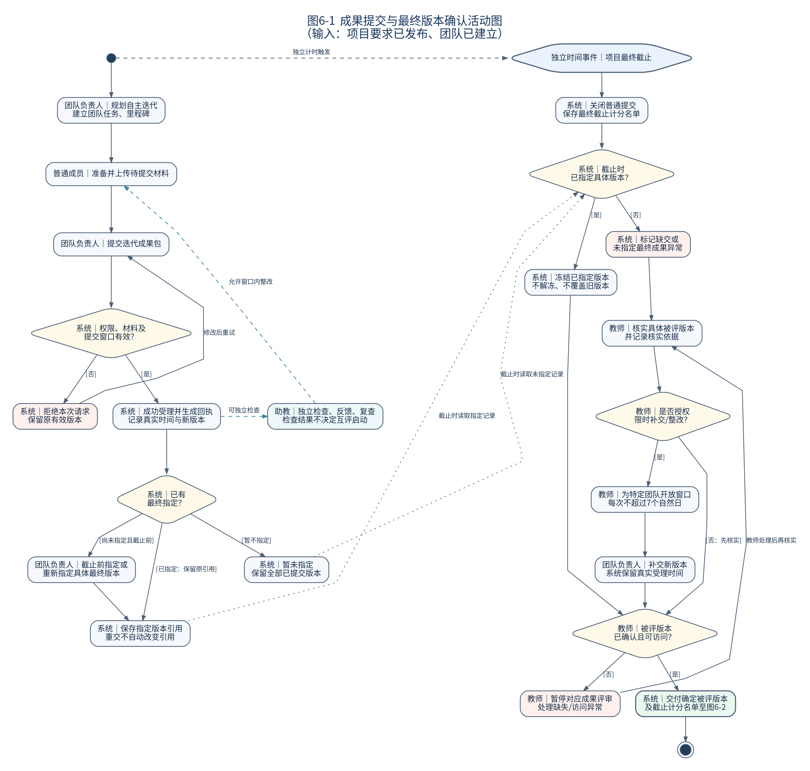

**图示说明**：采用教师、团队负责人、普通成员、助教、系统泳道。团队自主创建迭代、任务及里程碑，普通成员准备材料，团队负责人在有效窗口正式提交或重交迭代成果；校验失败须拒绝并保留原有效版本。助教可以独立检查、反馈与复查，检查结论不作为最终版本冻结或正式互评的强制前提。负责人在截止前从已成功提交的具体版本中指定或重新指定最终成果；重交不会自动变更指定关系。

项目最终截止为独立时间事件，不以是否提交或指定为触发条件。截止到达时关闭普通提交窗口、冻结已有指定，并对缺交、未指定或材料不可访问分别记录异常。教师核实具体版本或授权特定团队限时补交（每次不超过7个自然日），系统保留真实受理时间和旧版本；补交不自动解除冻结或替换已被评版本。仅在教师确认可访问的具体被评版本，并核对项目最终截止时的计分名单后，才向图6-2提供输入；未解决的异常不得直接视为已完成。

### 6.1.2 互评、评分与成绩发布

**图6-2 互评、评分与成绩发布活动图**

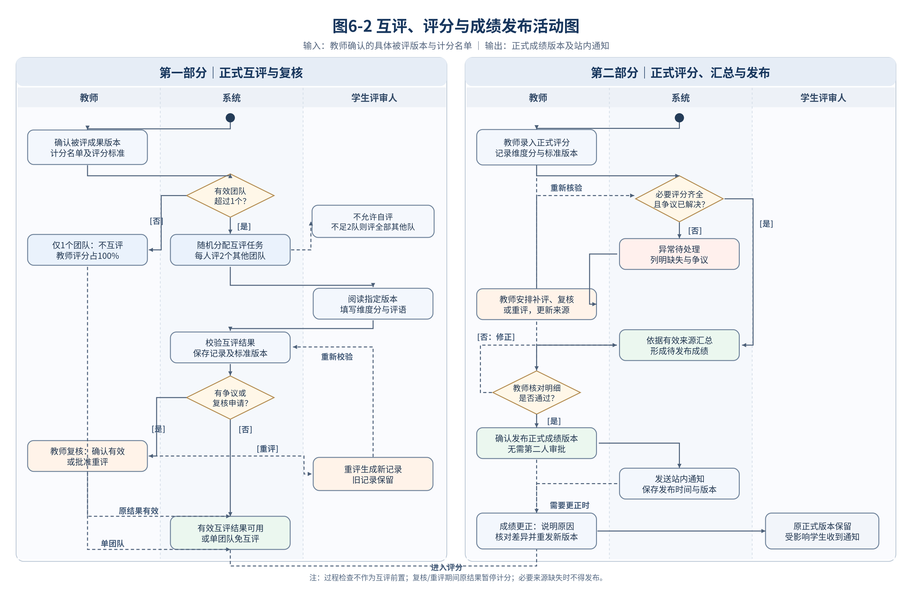

**图示说明**：采用教师、学生评审人、系统泳道，必要时将教师评分与成绩核对分别列为动作。教师确认图6-1输出的最终成果版本及计分名单后统一组织互评，系统依据有效团队数量分支处理：仅有1个有效团队时不开展互评，教师评分权重为100%；存在多个团队时，为每名学生随机分配2个不同的其他团队，不足2个时分配全部其他团队，禁止自评。评审任务固定关联被评成果版本及评分标准版本，评审人完成维度评分和评语。

互评争议由教师复核：确认原结果有效则恢复计分，批准重评则保留旧记录、建立新记录并等待有效重评结果。教师完成正式评分后，系统检查正权重必要来源、有效计分名单、评分标准及争议处理结果；不完整时进入“异常待处理”，由教师补评、复核或重评后重新汇总，不得补零或自动调整权重。校验通过后计算成绩并展示来源明细，教师核对确认后发布正式成绩版本并触发站内通知。已发布成绩的更正由教师填写原因、形成新版本并重新发布，保留原正式版本，无须第二人审批。项目异常终止时停止新增互评和评分并保留历史。

## 6.2 项目、迭代与团队任务状态

项目要求由教师维护，团队任务用于执行分工，两者不共用任务状态。团队负责人可创建、分配和调整本团队任务；普通成员更新分配给自己的任务，教师可查看并干预，相关操作留痕。

### 6.2.1 项目与迭代

| 对象 | 当前状态 | 事件与条件 | 后续状态 | 操作约束 |
|---|---|---|---|---|
| 项目 | 草稿 | 教师发布，必填信息和时间关系有效 | 已发布 | 校验失败仍为草稿；发布后不能撤回为草稿。 |
| 项目 | 已发布 | 满足项目开始条件 | 进行中 | 教师规定总体要求和最终期限，团队自主安排迭代。 |
| 项目 | 进行中 | 到达项目最终截止时间 | 已结束 | 关闭普通提交，冻结已指定最终版本；继续处理授权补交、互评和成绩。 |
| 项目 | 已结束 | 评审、异常和成绩处理办结，教师归档 | 已归档 | 常规业务只读，保留历史及授权查询、导出。 |
| 项目 | 已发布/进行中/已结束 | 教师说明原因并终止项目 | 已终止 | 通知参与者，保留历史，停止新增提交、互评和评分。未完成事项标明因终止而关闭，不伪记为完成。已发布成绩保留，更正仍由教师按更正流程处理。 |
| 团队迭代 | 未开始 | 负责人开始本轮工作 | 进行中 | 归属于确定团队及项目，记录目标和计划时间。 |
| 团队迭代 | 进行中 | 负责人确认结束并记录完成及遗留情况 | 已结束 | 计划结束日期不自动关闭迭代；遗留任务可调整至后续迭代并保留历史。 |

各团队迭代不要求同步。里程碑由团队负责人设置并关联一轮迭代，记录目标日期、完成条件和完成情况，用于跟踪关键交付检查点，不另设阶段管理层级，也不自动产生正式成绩。

### 6.2.2 团队任务

| 当前状态 | 触发事件 | 后续状态 | 条件及记录 |
|---|---|---|---|
| 未开始 | 负责人或获分配成员开始执行 | 进行中 | 任务属于本团队一轮迭代，并关联对应项目要求。 |
| 进行中 | 有权限人员确认工作完成 | 已完成 | 保留完成时间及进展说明；任务完成不等于最终成果已通过评审。 |
| 已完成 | 有权限人员重新打开任务 | 进行中 | 项目允许相应操作，记录返工原因，保留原完成记录。 |

团队任务不得脱离迭代直接挂在项目下。跨迭代调整保留原归属、操作者、时间及调整记录。任务和迭代日期仅作计划展示，不自动生成延期标记；项目交付逾期与互评逾期分别依据相应正式期限判定。

## 6.3 成果提交状态、版本与异常处理

正式提交对象由“团队＋迭代”确定，一轮迭代对应一个成果包，包内可包含报告、文件及代码链接。同一成果包下每次成功重交产生新版本，最新成功版本为本轮当前有效版本。正式成果不提供撤回；修正通过允许窗口内重交完成。

### 6.3.1 提交转换与最终成果指定

| 当前状态/事项 | 事件与条件 | 结果 | 保持的约束 |
|---|---|---|---|
| 未提交 | 负责人在有效窗口内提交，材料和权限校验通过 | 已提交 | 保存团队、迭代、实际提交人、版本及成功受理时间，返回可查询回执。 |
| 已提交 | 窗口开放且成果未冻结，负责人重交 | 已提交，新版本生效 | 保留所有历史；同一次请求重试不能形成重复版本。 |
| 最终成果未指定 | 最终截止前负责人选择本团队已提交版本 | 已指定，建立具体引用 | 不重复上传，不自动跟随本轮当前有效版本变化。 |
| 已指定且未冻结 | 截止前负责人主动选择另一个本团队已提交版本 | 已指定，引用更新 | 记录前后版本、人和时间；重交本身不触发更换。 |
| 已指定最终成果 | 到达项目最终截止时间 | 已冻结 | 固定指定版本，关闭普通重交及更换。 |
| 截止时仍未指定 | 已有提交但没有最终成果引用 | 标记“未指定最终成果” | 系统不自动选择最后提交版本；由教师核实后确认被评版本并记录原因。 |
| 截止后补交/整改 | 教师为特定团队开放限时窗口 | 允许负责人形成新版本 | 每次最长7个自然日，记录授权教师、原因及起止时间；保留迟交标记，不自动扣分。原冻结版本及评审引用保留，替换或重评由教师明确安排；不解冻改写旧版本。 |

“本轮当前有效版本”“项目最终成果版本”“评审引用版本”分别记录。最新重交只更新本轮当前有效版本，不改变另外两项。教师核实指定或安排重评时，必须能够定位具体版本及其完整材料。

### 6.3.2 检查与整改

助教检查使用“待检查、需整改、待复查、检查完成”描述检查事项：发现问题后记录需整改及意见；负责人获准重交整改版本后进入待复查；复查满足要求进入检查完成，否则继续记录整改意见。每次检查关联确定成果版本，保存助教、时间、结论与反馈。

检查状态与提交状态分开。助教反馈不会自动解冻成果或扩大提交权限；项目最终截止后的整改须由教师开放窗口。助教检查不生成教师正式评分，也不作为启动正式互评的统一必要条件。

### 6.3.3 时间与异常处理

平台统一使用北京时间（Asia/Shanghai，UTC+8）。正式提交时间为系统成功受理时间，不能使用用户点击时间或文件开始上传时间替代。成功受理时间等于项目最终截止时刻，仍按时处理。团队任务和迭代计划日期不用于自动判定延期；互评任务仍按其独立评审期限判断逾期。

| 异常 | 系统行为 | 数据约束 |
|---|---|---|
| 普通成员尝试正式提交 | 拒绝正式提交，允许其在授权范围准备材料 | 不产生有效交付记录。 |
| 材料不全、无权、窗口关闭或未获有效补交授权 | 说明原因并拒绝本次请求 | 原有效版本与冻结引用不变。 |
| 传输或保存失败、响应不确定 | 返回失败或可查询的实际受理状态 | 不完整材料不能产生成功回执；重试不重复受理。 |
| 截止后未提交/未指定 | 区分缺交与未指定最终成果，交由教师处理 | 已有提交不能因未指定而被删除；系统不擅自选版本或扣分。 |
| 授权补交 | 记录真实受理时间、原截止依据和补交授权 | 不回填时间伪装按时，不自动扣分或临时增加扣分项，按既定标准评分。 |
| 材料或外链不可访问 | 助教记录问题，教师可暂停该成果评审 | 链接被保存不等于内容已核验。 |

## 6.4 评审与成绩状态

### 6.4.1 同伴评审任务

教师在最终交付后统一组织正式互评，任务关联评审人、具体最终成果版本、评分标准版本、评审期限及匿名策略。助教过程检查与此独立。尚未确定被评版本的成果不能直接生成有效互评安排。

| 当前状态 | 事件 | 后续状态 | 记录与计分约束 |
|---|---|---|---|
| 待评审 | 指定评审人开始填写 | 评审中 | 校验分配关系、窗口及访问范围。 |
| 待评审/评审中 | 提交并通过评分项校验 | 已完成 | 保存本次评审记录、各维度得分、时间及标准版本。 |
| 已完成 | 教师发起复核 | 待复核 | 保留原结果，暂停其正式计分；必要来源未确定时阻断受影响成绩发布。 |
| 待复核 | 教师确认原结果有效 | 已完成 | 保存复核结论，恢复有效计分并重新汇总。 |
| 待复核 | 教师批准重评 | 待评审 | 设定重评期限，原记录继续作为历史保存，不计入当前正式结果。 |
| 待评审/评审中/已完成/待复核 | 教师取消分配 | 已取消 | 记录原因，检查是否仍满足必要评分来源；项目终止导致取消时明确记录终止原因。 |

同一评审任务可产生多次评审记录。重评结果成功提交且校验通过后成为当前有效结果，原结果保留为历史。评审逾期单独标记，不增加“已逾期”主状态。已取消任务拒绝提交，逾期任务须教师延长期限后才能提交；3个自然日内学生可申请一次复核，教师可主动复核。尚未完成重评时，不以旧结果继续发布受影响成绩。

评分标准的维度定义可供多次评审复用；每份评审记录分别保存各维度的实际得分和必要评语，并关联相应标准版本，不能将共享维度定义直接当作某次评审得分。

### 6.4.2 教师评分

正式评分仅由相应课程教师执行。评分记录仅使用“草稿、已提交”两种状态；待评分是尚无有效已提交记录的列表条件，不另设第三种评分记录状态。草稿不计分，提交须通过维度和总分校验。教师发布前修改本人已提交评分须填写原因、保留前后内容并使原汇总失效；发布后按教师成绩更正流程处理。助教不评分、不查看未发布成绩或导出成绩。

### 6.4.3 成绩汇总与发布

| 当前状态 | 事件与条件 | 后续状态 | 约束 |
|---|---|---|---|
| 待汇总 | 规则不完整、必要评分缺失或存在未解决争议 | 异常待处理 | 列出异常对象及原因，阻断受影响成绩发布。 |
| 待汇总/异常待处理 | 必要来源有效、规则完整且计算成功 | 待发布 | 展示分项、换算、权重、舍入和来源。 |
| 待发布 | 评分来源、规则或归属变化 | 待汇总 | 原计算失效，重新汇总。 |
| 待发布 | 教师核对明细并确认发布 | 已发布 | 保存正式版本、依据、发布人和时间；不另设另一人审批。 |
| 已发布 | 教师发起更正 | 保持原正式版本，同时建立更正版本 | 填写原因，核对前后值；无需另一人审批。 |
| 更正版本待发布 | 教师确认重新发布 | 正式版本更新 | 保留历史，通知受影响学生；重新发布前仍显示原正式结果。 |

成绩主状态统一为待汇总、异常待处理、待发布、已发布。“更正”是版本变化，不增加已更正主状态。复核或重评期间原评审暂停计分，必要评分未确定时阻断发布；已发布成绩不因重新计算而被静默覆盖。正权重必要评分缺失不得补零或自动调权；教师安排补评、重评。团队默认教师70%、互评30%，成员按教师核对的名单同分；互评均分和最终舍入按BR-038执行，正权重互评须等待本批次未取消的任务均形成有效结果。

## 6.5 状态转换图与一致性约束

### 6.5.1 项目、迭代与任务

**图6-3 项目状态图**

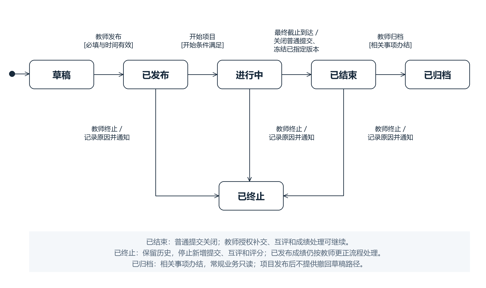

**图示说明**：黑色实心圆表示初始伪状态，圆角矩形表示项目状态，带箭头实线表示转换。项目依次经历草稿、已发布、进行中、已结束及已归档；教师可从已发布、进行中或已结束状态终止项目。正常结束与异常终止分别处理，不提供发布后撤回草稿的路径。图中事件、条件和动作分别使用“事件 [条件] / 动作”表达；未改变原有六状态及转换规则。

**图6-4 迭代状态图**

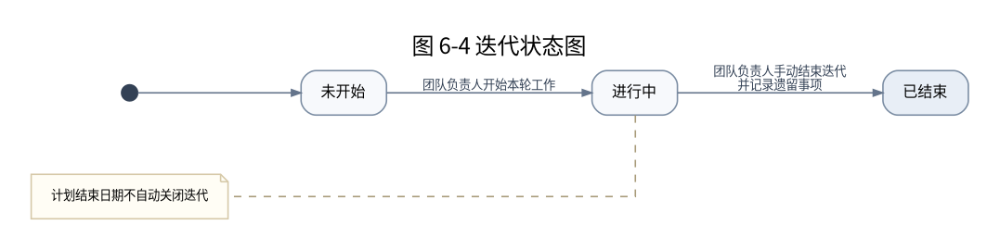

**图示说明**：黑色实心圆表示初始伪状态，圆角矩形表示迭代状态，带箭头的实线表示状态转换。迭代包括“未开始、进行中、已结束”三种状态。团队负责人开始本轮工作后，迭代由“未开始”进入“进行中”；迭代结束须由团队负责人手动确认，并记录遗留事项后进入“已结束”。计划结束日期仅用于计划安排，不会自动关闭迭代，也不会自动产生逾期标记。

**图6-5 团队任务状态图**

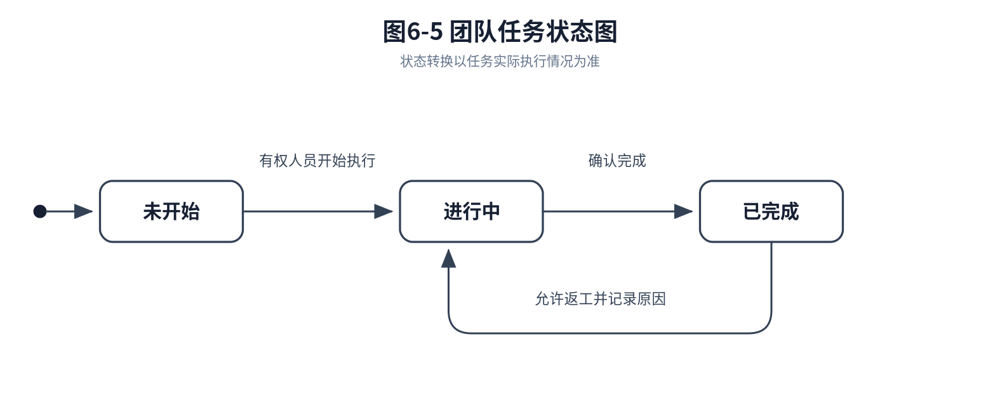

**图示说明**：黑色实心圆表示初始伪状态，圆角矩形表示任务状态，带箭头实线表示状态转换。任务依次经历“未开始、进行中、已完成”三种状态；有权人员开始执行任务后，任务由“未开始”进入“进行中”，确认完成后进入“已完成”。任务完成后如获准返工，可返回“进行中”，并记录返工原因。返工不新增任务状态，所有状态转换均须符合相应权限及业务条件。

### 6.5.2 成果提交

成果包是否已提交与最终指定是否冻结是两个维度，分别建模。所有正式提交版本均保留，不原地覆盖。

**图6-6 迭代成果提交状态图**

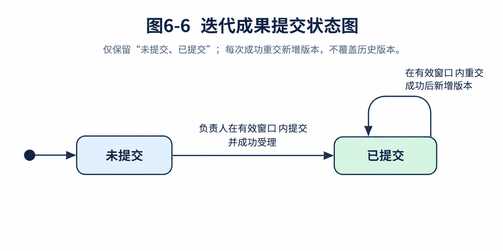

**图示说明**：成果包初始处于“未提交”状态，由团队负责人在有效提交窗口内正式提交并成功受理后，进入“已提交”状态。在有效窗口内重新提交时，状态仍保持为“已提交”，但平台须新增提交版本并保留历史记录，不得直接覆盖原版本。普通成员可以在授权范围内准备材料，但不能代替负责人完成正式提交。本图仅描述成果包的提交状态，不表示最终成果指定或助教检查状态。

**图6-7 最终成果指定状态图**

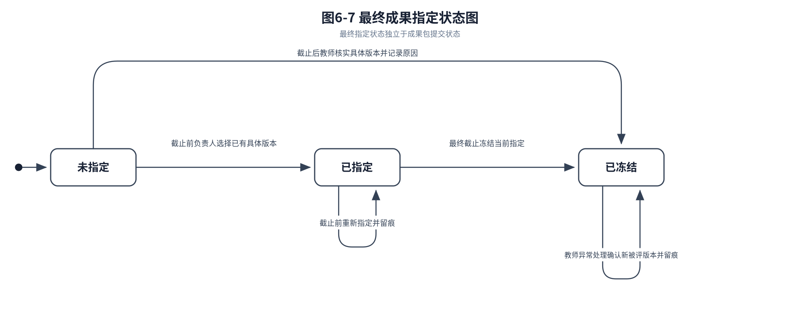

**图示说明**：最终成果指定依次涉及“未指定、已指定、已冻结”三种状态。截止前，团队负责人可以从已成功提交的版本中选择具体版本作为最终成果，也可以在截止前重新指定其他已有版本，并保留操作记录。最终截止时，已有指定将被冻结；若截止时仍未指定，平台不得自动选择版本，而应记录“未指定最终成果”异常，由教师核实具体版本并记录处理原因后完成冻结。冻结后如需处理异常，须由教师确认具体版本并留痕；新增提交版本不会自动改变已有最终成果指定，也不会自动改变既有评审所引用的版本。

### 6.5.3 助教检查

**图6-8 助教检查状态图**

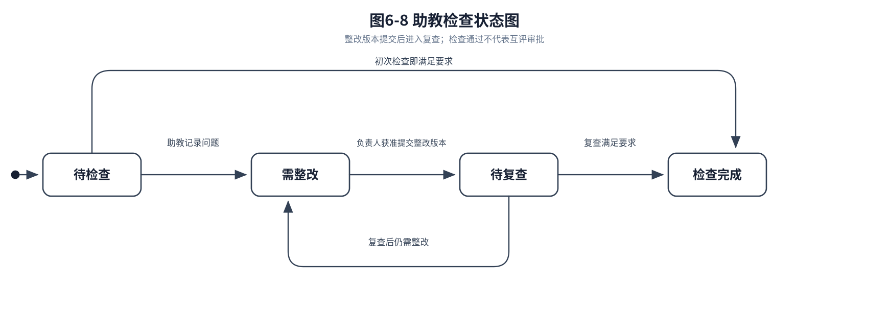

**图示说明**：检查事项初始处于“待检查”状态。助教发现问题并记录整改意见后，进入“需整改”；负责人获准提交整改版本后，进入“待复查”。复查满足要求时进入“检查完成”，仍不满足要求时返回“需整改”，继续记录问题和整改意见。每次检查和复查均应关联具体成果版本，并保存检查人员、检查时间、结论及反馈。截止后整改须由教师开放相应窗口；助教检查状态与成果提交状态相互独立，检查通过不代表成果自动成为最终版本，也不是启动正式同伴评审的必要前提。

### 6.5.4 同伴评审

**图6-9 同伴评审状态图**

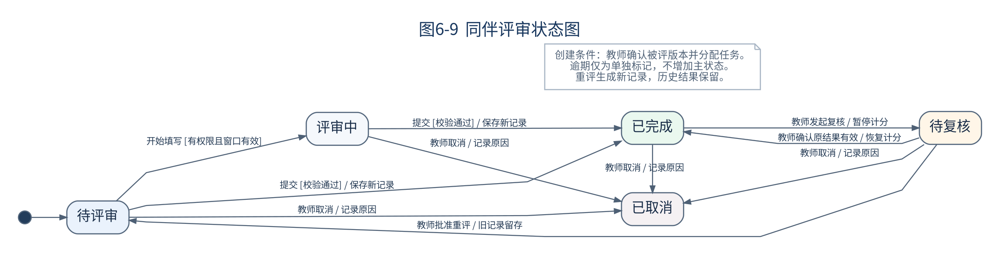

**图示说明**：初始伪状态直接指向“待评审”，创建条件是教师确认被评版本并完成任务分配，初始连线不标注普通触发事件。五种主状态为待评审、评审中、已完成、待复核、已取消。待评审或评审中提交且校验通过可进入已完成；已完成由教师发起复核进入待复核并暂停计分；教师确认原结果有效后回到已完成，批准重评后回到待评审，原记录保留。教师可取消评审任务并记录原因；逾期为独立标记，不增加主状态。

### 6.5.5 成绩

**图6-10 成绩状态图**

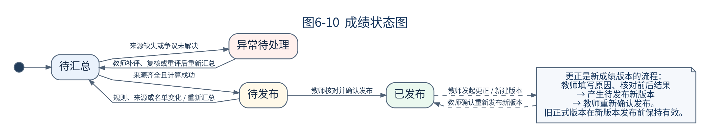

**图示说明**：四种主状态为待汇总、异常待处理、待发布、已发布。规则或正权重必要来源不完整、争议未解决时由待汇总进入异常待处理；教师补评、复核或重评使来源恢复有效后重新汇总；计算成功且来源有效进入待发布，来源变化返回待汇总；教师核对并确认后进入已发布。已发布成绩更正表现为保留原正式成绩版本、创建待核对的新版本，并由教师确认重新发布，不增加“已更正”主状态，不设置第二人审批。

所有操作同时校验角色、对象归属、当前状态及窗口。项目终止优先限制新增业务；未完成检查等事项保留原处理进展并标明因项目终止而关闭，互评待办按已取消处理，不能伪记完成。归档后常规业务只读。并发更新须反馈冲突，同一次业务请求重试不得重复形成有效结果。

# 第 7 章 非功能需求与质量要求

## 7.1 性能要求

高峰负载集中在截止前成果提交和成绩发布后查询。性能指标分别衡量普通交互、文件受理和批量计算，避免用文件上传耗时掩盖业务受理时间，也避免只报告平均值而忽略慢请求。

验收基准为全平台1000个注册账号、10门活跃课程；单课程最多200名学生、50个团队；50名并发活跃用户，其中最多10个并发成果受理请求。下面指标在该负载下验收，文件传输耗时不计入材料完整到达后的业务受理时长。

验收方案应固定并记录设备、网络、请求构成、任务及历史版本数量、评分记录数量和上传文件大小，使用同一数据集比较结果。批量汇总与导出以单课程200名学生、50个团队为规模边界，不能以空数据或小样例替代。

| 编号 | 使用情境 | 要求与目标 | 验证方法 |
|---|---|---|---|
| NFR-PER-01 | 查询项目、团队任务、评审待办和通知 | 在批准负载下，95% 的查询请求在 2 秒内返回可用结果；结果须符合权限和分页条件。 | 记录请求开始至可用结果返回的时长、P95、错误比例及请求量，分别报告各类查询。 |
| NFR-PER-02 | 文件完成传输后提交成果 | 从完整材料到达系统至生成提交回执，95% 的正常请求在 3 秒内完成；文件传输时长单独记录。 | 分开测量上传和受理阶段，核对回执与有效提交记录。 |
| NFR-PER-03 | 课程成绩汇总与导出 | 在批准的单课程数据规模下，汇总在 5 秒内完成，成绩导出在 10 秒内生成；无法完成时提供明确状态与原因。 | 使用确定的课程、团队、评分数和导出字段计时，核对结果数和计算内容。 |
| NFR-PER-04 | 截止前集中提交 | 在批准并发量下，不因请求拥塞静默丢失已受理提交；同一次请求重复发送只能产生一个有效受理结果。 | 对不同主体并发提交，并对部分请求重试；逐一核对回执、版本及受理时间。 |

## 7.2 安全与隐私要求

| 编号 | 要求 | 验收依据 |
|---|---|---|
| NFR-SEC-01 | 每次受限访问均校验用户身份、课程角色、对象归属及授权范围；直接请求受限资源也须执行同样校验。 | 教师、助教、学生及无授权账号分别访问页面、材料、成绩和导出资源，无权访问不得返回受限内容。 |
| NFR-SEC-02 | 课程、项目和团队之间的数据默认隔离；学生可查看本团队过程记录及授权互评信息，管理审计日志不向学生开放。评审授权仅开放指定成果及所需信息。平台运维身份不自动取得课程评分权限。 | 跨课程、跨团队及非指定评审人访问均受控；按第 5 章授权矩阵核对。 |
| NFR-SEC-03 | 对学生隐藏评审人身份，教师及授权检查范围内助教可查看；不承诺隐藏被评团队或作者身份。页面、通知和可下载记录一致。 | 分别以学生、教师和助教检查页面、通知及可下载记录，核对身份字段及访问边界。 |
| NFR-SEC-04 | 成绩导出权限同时限定操作人、课程、对象、字段和结果版本；导出文件不得通过无权限的下载地址取得。 | 无权用户无法发起或取得文件；授权导出仅包含请求范围与授权范围交集内的数据。 |
| NFR-SEC-05 | 成绩更正、规则修改、权限调整、截止时间变化和重要导出均可追溯；普通业务用户不能改写或删除审计历史。 | 核对操作者、时间、对象、动作、结果及必要前后值；核对记录访问权限。 |
| NFR-SEC-06 | 仅保存完成课程业务所需的身份和过程数据；日志与错误信息不得输出密码、认证令牌等凭据。 | 核对字段清单、日志、错误消息和导出字段，排除非业务必需信息。 |
| NFR-SEC-07 | 按BR-023格式和单文件50 MB、版本总量200 MB校验；说明、评语和链接展示不得引发越权操作或凭据泄露。 | 检查大小边界、未支持格式和不合要求链接的拒绝结果，确认原有效版本不变。 |

## 7.3 可靠性与数据完整性

| 编号 | 要求 | 验收依据 |
|---|---|---|
| NFR-REL-01 | 成果材料、提交对象、版本与受理时间一致保存后才能确认成功；失败不产生不完整的有效版本。 | 在材料保存、信息校验和结果返回阶段分别构造失败，核对提交记录及用户可见结果。 |
| NFR-REL-02 | 同一次提交或评分确认的重复请求不得形成重复业务结果；并发修改不得静默覆盖。 | 对同一操作重试并从两个会话修改同一对象，检查有效结果数量和冲突反馈。 |
| NFR-REL-03 | 评分与汇总结果能追溯到评分对象、成果版本、评分标准及计算规则；相同有效输入应产生相同结果。 | 独立复算包含满分、零分、小数和舍入边界的样例；与成绩明细及导出对照。 |
| NFR-REL-04 | 成绩发布将结果和发布依据作为同一正式版本保存。来源变更使待发布计算失效，已发布结果只能通过更正发布更新。 | 在待发布和已发布两个阶段分别修改评分，检查失效标识、更正版本和学生可见内容。 |
| NFR-REL-05 | 站内通知失败不撤销已成功业务；按事件编号、接收人及类型去重，自动重试3次后转管理员处理。 | 构造通知失败及重复事件，检查主体结果保留、重试次数、去重结果与失败状态。 |
| NFR-REL-06 | 备份覆盖成果、版本、评分标准、评审、教师评分、名单、成绩及关键记录。恢复点目标RPO≤24小时，恢复时间目标RTO≤4小时；恢复后关联一致。 | 在独立环境从可用备份恢复，记录恢复点、故障和服务恢复时间，核对材料、名单及成绩依据。 |

项目归档后关联仍有效。课程结束后2年内保留成果、评审、成绩、成员历史及关键记录；到期经平台业务负责人批准由管理员清理，存在未结复核、争议或调查的相关数据暂缓。管理员故障访问须限定范围和期限。

RPO表示灾难恢复时允许的最大数据回退窗口，RTO表示故障发生至恢复服务的最长时间。恢复后应依据备份、受理回执和必要来源核对数据；无法确认的提交或成绩标记异常并由教师核实，不将旧备份结果冒充最新正式结果。普通请求失败、拥塞和重试仍须遵守不重复受理、不中途宣告成功及不覆盖历史的约束。

## 7.4 易用性与可访问性

| 编号 | 要求 | 验收依据 |
|---|---|---|
| NFR-USE-01 | 用户进入项目后能够识别当前迭代、待办、截止时间及自己的提交/评审状态。 | 以学生、助教和教师身份分别走查当前任务、待检查及待发布成绩的定位过程。 |
| NFR-USE-02 | 发布、提交和评分表单说明必填项、分值范围、材料限制和时间要求；失败信息指出原因及可采取的处理动作。 | 缺项、越界、关闭、冻结和无权限场景均有与原因一致的反馈。 |
| NFR-USE-03 | 提交、评审确认及成绩发布后显示业务对象、结果和时间；响应不确定时能够查询实际受理结果。 | 在正常返回和响应丢失场景下，用户能够判断是否需要重试，且不会误把失败视为成功。 |
| NFR-USE-04 | 同一对象在列表、详情、通知和导出中使用一致的状态及版本含义，团队任务和迭代不自动标记延期；未发布成绩不能以正式成绩呈现。 | 对照第 6 章状态定义逐项检查各入口展示。 |
| NFR-ACC-01 | 关键状态和错误同时提供文字，不能仅依赖颜色或图标；表单控件与主要操作具有可识别标签。 | 使用键盘访问主要操作，并检查不依赖颜色时状态和错误仍可理解。 |

## 7.5 可维护性要求

| 编号 | 要求 | 验收依据 |
|---|---|---|
| NFR-MNT-01 | 团队人数、组队窗口、最终期限和互评开始前的成绩权重可由课程教师维护；本团队迭代由负责人维护。固定自评、匿名、文件、权限和历史规则不得通过课程配置关闭。 | 为两个课程分别配置人数和期限，核对相互隔离；检查冻结后调权、越权及关闭固定约束均被拒绝。 |
| NFR-MNT-02 | 已使用规则的历史含义可恢复；更新规则不得覆盖历史评审与成绩所引用的规则版本。 | 修改评分规则后分别复查旧、新结果，二者均能显示正确依据。 |
| NFR-MNT-03 | 关键业务记录可按课程、项目、主体、对象和时间定位，并能够重建提交—检查—评审—评分—成绩的关联。 | 从一条正式成绩反查评分、成果版本和必要操作记录，检查缺失或断链。 |

## 7.6 质量目标与业务取舍

提交确认、权限隔离和成绩可追溯是基本约束。系统不能以提高响应速度为由跳过权限或完整性校验，也不能在异常未处理时先发布“近似成绩”。

提醒允许重试和延后处理，业务记录不依赖通知渠道可用。文件上传的耗时受材料大小与网络条件影响，因此文件传输和成果正式受理分别计量。批量导出以明确的课程和成绩版本为边界，导出过程中新增的评分不得混入同一结果文件。

质量验收分别执行性能测量、权限检查、故障恢复和角色任务走查。性能负载、恢复目标和留存期采用本章及§2.7的确定值。实际测量与恢复记录在系统验收时形成，单次操作成功不能替代相应质量目标的验证。

# 第 8 章 验收与需求验证

## 8.1 代表性详细用例与验收场景

验收证据包括操作输入、操作者范围、业务状态变化、结果内容及必要历史记录。用例出现拒绝结果时，还须确认原有效数据未被改变。

### 8.1.1 AC-01 发布课程项目

| 项目 | 内容 |
|---|---|
| 关联需求 | FR-001—FR-004；BR-001—BR-006。 |
| 前置条件 | 有效课程存在，操作者为具有目标课程发布权限的教师。 |
| 操作 | 创建项目草稿，录入名称、目标、交付要求、最终截止、评分标准及权重；检查后执行发布。 |
| 预期结果 | 项目由草稿转为已发布，相关学生可查看要求；系统保存发布人和时间。 |
| 异常场景 | 分别使用缺失必填信息、结束时间早于开始时间及无权账号执行发布。 |
| 通过条件 | 合法发布成功；异常发布均被拒绝且草稿状态不变；关键要求或时间修改能够追溯到前后值及操作者。 |

### 8.1.2 AC-04 成果提交与重交

| 项目 | 内容 |
|---|---|
| 关联需求 | FR-013—FR-016；BR-017—BR-026。 |
| 前置条件 | 提交团队、迭代和负责人身份明确，项目及提交窗口允许操作；教师交付要求有效，文件格式及50 MB/200 MB限制按BR-023生效。 |
| 操作 | 负责人提交首版、查询回执并重交；指定最终成果后再次重交，检查指定引用不变；重复发送同一次请求。 |
| 预期结果 | 每次主动成功提交有可区分版本和实际受理时间；同一次请求重试不增加重复版本。 |
| 异常场景 | 普通成员尝试正式提交、项目终止、窗口关闭、冻结后无授权重交、材料缺失、文件超限、截止瞬间、受理失败及响应丢失。 |
| 通过条件 | 合法提交有团队、迭代、负责人、版本及受理时间；截止时刻受理仍算按时；失败和重试不破坏有效记录；最终指定及评审引用不随重交改变；不存在撤回操作；授权补交每次不超过7个自然日、保留迟交标记且不自动扣分。 |

### 8.1.3 AC-05 助教检查与整改

| 项目 | 内容 |
|---|---|
| 关联需求 | FR-021—FR-024；提交资格、修改限制和角色权限规则。 |
| 前置条件 | 助教被分配到对应课程/项目，已有成果及检查事项。 |
| 操作 | 助教记录需整改意见；在允许的重交窗口内由团队负责人提交整改版本；助教完成复查。 |
| 预期结果 | 检查事项按“待检查—需整改—待复查—检查完成”变化，每条意见指向具体成果版本。 |
| 异常场景 | 无关课程助教访问、学生未获重交授权、整改提交失败、再次复查不通过。 |
| 通过条件 | 完整保留反馈与整改版本；未获授权不能绕过冻结；未通过事项可继续处理；检查不直接生成教师评分，也不是互评启动的强制前置条件。 |

### 8.1.4 AC-06 同伴互评

| 项目 | 内容 |
|---|---|
| 关联需求 | FR-017—FR-020；BR-027—BR-036。 |
| 前置条件 | 评审人、成果版本、评分标准、开放窗口和匿名策略已确定。 |
| 操作 | 指定评审人查看任务并填写评审；提交后由教师对一项异常评审发起复核。 |
| 预期结果 | 合法评审进入已完成；复核保留原始记录及原因并暂停正式计分；有效重评形成新记录；评语、分数和时间关联指定成果及标准版本。 |
| 异常场景 | 未分配用户访问、被禁止的本团队自评、分数越界、评审过期、重复确认和身份字段泄露。 |
| 通过条件 | 所有权限及内容校验正确；同一次请求重试不重复产生记录，主动重评产生新记录并保留历史；每份记录关联评分标准版本和独立维度得分；对学生隐藏评审人身份，教师及授权检查范围内助教可查看；学生3个自然日内可申请一次复核。单团队不分配互评；复核期间阻断依赖该项的成绩发布。 |

### 8.1.5 AC-07 成绩汇总、发布与更正

| 项目 | 内容 |
|---|---|
| 关联需求 | FR-025—FR-030；BR-032—BR-045。 |
| 前置条件 | 教师有评分及发布权限，按默认教师70%、互评30%准备有效来源；名单已由教师核对，成员同分，中间不舍入、最终保留两位小数。 |
| 操作 | 教师提交评分并汇总，核对分项和总分后发布；修改一项来源评分，发起更正并再次发布。 |
| 预期结果 | 草稿评分不计入正式汇总；发布结果保留依据和批次；更正发布前学生看到原正式结果，更正后能识别当前结果；教师自行核对确认，不需要另一人审批。 |
| 异常场景 | 必要评分缺失、无效评分、规则未配置、待复核记录影响结果、待发布后来源被修改、无权发布。 |
| 通过条件 | 独立复算与系统结果一致；异常阻断发布；来源变更使旧计算失效；更正保留前后值、原因与操作者；学生只能看到授权的正式成绩。 |

### 8.1.6 补充场景

| 编号 | 场景与关联需求 | 通过条件 |
|---|---|---|
| AC-02 | 组队与成员变更；FR-005—FR-008 | 开放期创建及申请、负责人审批可用，无邀请入口。人数上限、项目内名称唯一和成员唯一归属生效；开放期不足下限不阻止建队，截止时不足转教师处理。截止后申请失效；移除转组由教师处理，负责人先交接。离组撤销非公开材料访问，历史保留。 |
| AC-03 | 团队迭代、任务与里程碑；FR-009—FR-012，R01—R06、R18、R20—R21 | 负责人建立本团队迭代和里程碑，任务必须属于迭代；成员仅更新本人任务；计划到期不自动标记延期或结束；手动结束记录遗留事项，跨轮调整留痕。 |
| AC-08 | 成绩导出；FR-030 | 仅有权限的课程教师可取得CSV、XLSX，字段为项目、团队、学号、姓名、分项、权重、最终成绩和发布状态；结果与选定成绩版本一致。助教和学生的全班导出请求被拒绝，导出记录含操作者、时间和范围。 |
| AC-09 | 通知与待办；FR-031—FR-033 | 仅站内通知；关键变更和发布通知受影响人员，纯文字纠错留记录。同一事件同一接收人的同类通知只生成一份，失败重试3次后转管理员。未完成的最终提交、互评在截止前24小时和截止后各提醒一次，完成、取消或终止后停止；通知失败不回滚业务。 |
| AC-10 | 过程追溯；FR-034—FR-036 | 可从成绩反查确定评分、版本及名单；关键业务记录失败不确认业务成功。学生不能看管理审计；保留期2年，未结事项暂缓清理，到期管理员经批准清理并留痕。 |
| AC-11 | 性能与容量；NFR-PER-01—04 | 采用1000账号、10活跃课程、单课200学生50团队、50并发用户及其中10并发受理请求的负载。查询P95≤2秒，材料完整到达后的受理P95≤3秒，汇总≤5秒、导出≤10秒；上传时长单列，记录环境、数据量和请求构成，不丢失或重复已受理提交。 |
| AC-12 | 权限与隐私；NFR-SEC-01—07 | 跨课程身份分别校验，同一课程角色互斥；离组失去原团队非公开访问，评审只开放指定版本。助教不能发布项目、调整任务、管理互评、看未发布成绩、评分及导出发布更正；管理员故障访问须批准并限定范围期限。 |
| AC-13 | 失败、重试、并发与恢复；NFR-REL-01—06 | 重试不重复受理，失败不破坏原有效结果；独立环境验证RPO≤24小时、RTO≤4小时，恢复后提交、评审、名单及成绩版本关联一致，无法确认的结果标异常。 |
| AC-14 | 角色操作与规则维护 | 验证 NFR-USE-01—04、NFR-ACC-01、NFR-MNT-01—03；核心操作可完成，状态含义一致，不同课程规则互不干扰，历史依据可查。 |

### 8.1.7 统一规则补充验收

| 编号 | 场景 | 通过条件 |
|---|---|---|
| AC-15 | 最终成果指定与补交；FR-016、R14—R17 | 截止前可主动重新指定本团队已提交版本并保留前后引用；重交不自动更换。最终截止冻结，未指定由教师核实，不自动选择。补交窗口每次≤7个自然日，真实受理时间及迟交标记保留，不自动扣分，不覆盖旧评审引用。 |
| AC-16 | 项目结束、终止和归档；R22—R24 | 发布后无撤回草稿路径；正常截止后关闭普通提交而允许评审和成绩处理；终止记录原因并通知，停止新增提交、互评和评分，未完成事项明确因终止关闭；已发布成绩保留。办结归档后常规业务只读。 |

时间统一为北京时间，边界采用“截止前一瞬、截止时刻、截止后一瞬”三组数据；组队在截止时刻关闭，正式成果等于最终截止受理仍按时。服务故障不自动延时，由教师按限时补交流程处理；并发场景覆盖同一用户重试和不同用户修改同一对象两种情况。验收使用脱敏或合成身份、成果和评分数据，业务政策参数取自受测课程的有效规则。

## 8.2 需求来源核对与原型走查

| 来源 | 支撑内容 | 核对方法 | 证据边界 |
|---|---|---|---|
| 项目业务说明 | 教师发布、学生协作、检查互评及成绩管理十项核心能力 | 按功能模块对应FR、BR和AC | 业务范围依据，不替代实际访谈记录 |
| 《第一次修改要求》 | R01—R35中的概念、权限、版本、状态及通知约束 | 与第三至六章及验收场景逐项对应 | 统一规则的讨论记录 |
| 补充业务决策 | 组队、自评、匿名、计分、文件、通知、留存、性能负载及恢复目标 | 以§2.7和§5.7确定值核对全篇 | 设计决策依据，不表示软件已完成 |
| 功能、数据与质量分析 | FR-001—FR-036、BR-001—BR-050、状态及NFR | 检查可观察结果、来源关联和异常保护 | 规格分析材料 |
| 业务代表走查与系统验收 | 使用顺序、反馈、业务正确性及质量目标 | 按本章场景记录输入、角色、结果和问题闭环 | 实际执行后形成记录，不预填通过结论 |

原型走查覆盖教师发布、学生组队、负责人提交整改、互评及成绩发布更正。每次记录角色、对象状态、输入、反馈、问题位置和复查结论；修改后重新检查受影响流程。

## 8.3 需求覆盖与一致性检查

覆盖检查采用“业务目标—功能需求—业务规则/数据对象—状态—验收场景”关系。某条 FR 出现在矩阵中只说明建立了引用，不等于其所有分支均已验证。

| 检查项 | 判定要求 | 发现问题时的处理 |
|---|---|---|
| 功能完整性 | 十项业务能力均有 FR；每条 FR 都有可观察结果和验收入口 | 补充缺失条目或明确排除边界，记录变更。 |
| 状态一致性 | 表格与状态图使用同一对象和状态集合，转换有事件及授权条件 | 统一定义并修改相关用例；迟交、版本和检查结果分别建模。 |
| 权限一致性 | 同一操作在功能描述、权限矩阵、通知和导出中具有一致访问边界 | 以对象归属和授权规则修正全部入口。 |
| 评分一致性 | 每个计分结果指向确定成果和规则版本；助教检查不代替教师评分 | 补充来源关联或阻断汇总；评审对象改变时分析重评影响。 |
| 时间一致性 | 相同截止时间、时区和受理口径用于展示、提交、逾期及导出 | 按 R18、R19 统一正式受理和截止边界；时区为Asia/Shanghai（UTC+8），分别核对组队和成果截止边界。 |
| 异常覆盖 | 提交、评审、评分、发布和导出均覆盖无权、状态不允许及数据无效情况 | 补充拒绝路径并检查原有效数据不变。 |
| 未决项管理 | 未确定的规则有唯一问题编号、决策责任及受影响需求 | 新增问题记录责任及影响；已确认规则和运行配置不重新标为未决。 |

## 8.4 需求追踪矩阵

需求追踪矩阵建立业务目标、功能需求、业务规则、数据对象、状态模型与验收场景之间的对应关系。FR、BR和AC沿用已有编号；R01—R35作为本次跨章节修订的确认依据，补充说明相关业务约束。

矩阵中的关联表示相应需求具备验收入口，不代表其正常流程、异常分支和权限条件均已完成验证。课程运行参数按第5.7节配置，固定规则按本基线执行；变更须同步更新关联功能、数据、状态和验收预期。

| 业务目标 | 功能需求及验收重点 | 规则与数据对象 | 状态／验收 |
|---|---|---|---|
| 发布课程项目 | FR-001草稿录入；FR-002发布校验；FR-003项目要求；FR-004发布后修改与终止 | BR-001—006；R01、R22—R24、R34；课程、项目、项目要求 | §6.2；AC-01、AC-16 |
| 组队与管理成员 | FR-005组队规则展示；FR-006组队方式；FR-007资格、人数及唯一归属校验；FR-008成员变更与记录 | BR-009—016；R07；学生、团队、成员关系 | AC-02、AC-12 |
| 管理迭代工作 | FR-009团队自主安排迭代；FR-010迭代内任务创建与分配；FR-011任务进度与返工；FR-012里程碑展示、手动结束迭代及遗留任务处理 | BR-007—008；R01—R06、R18、R20—R21；团队、迭代、团队任务、里程碑 | §6.2；AC-03 |
| 提交与指定成果 | FR-013材料准备与正式提交；FR-014提交校验；FR-015受理记录、回执及版本；FR-016截止判断、重交、最终指定、冻结及未指定异常处理 | BR-017—026；R08、R11—R19；迭代成果包、成果版本、最终成果指定关系 | §6.3；AC-04、AC-13、AC-15 |
| 完成同伴评审 | FR-017分配信息；FR-018匿名及访问范围；FR-019评分完整性与范围校验；FR-020评审结果、逾期及历史记录 | BR-027—036；R25—R30；评审任务、评审记录、评分维度、维度得分、评分标准版本 | §6.4.1；AC-06、AC-12 |
| 检查与整改 | FR-021授权检查列表；FR-022检查结论与反馈；FR-023负责人重交后的复查；FR-024项目最终交付缺交、迟交及问题上报 | BR-017、BR-019—020、BR-048；R08—R09、R17—R18、R25—R26；检查事项、反馈、整改版本及复查记录 | §6.3.2；AC-05、AC-12 |
| 教师正式评分 | FR-025评分依据；FR-026评分项校验；FR-027评分状态、修改与留痕 | BR-032—033、BR-037—038、BR-040；R09、R30；教师评分记录、评分标准版本 | §6.4.2；AC-07、AC-13 |
| 汇总、发布与导出成绩 | FR-028计算、核对与发布；FR-029缺失和异常处理；FR-030教师导出；FR-027及§3.9.4评分变更与成绩更正 | BR-037—045；R29、R31—R33；成绩、计算依据、正式发布版本、更正记录 | §6.4.3；AC-07、AC-08、AC-12、AC-13 |
| 通知与待办 | FR-031通知事件；FR-032接收范围；FR-033通知类型、时间、状态与列表 | BR-046—047；R24、R33—R34；通知、接收关系 | AC-09、AC-12、AC-13 |
| 追溯项目过程 | FR-034进度变化；FR-035提交、检查与评审关联；FR-036关键操作历史 | BR-048—050；R10；过程记录、操作记录及其业务对象关联 | AC-10、AC-12 |
| 满足响应与容量要求 | NFR-PER-01—04 | §7.1确定负载；查询、提交与批量处理 | AC-11 |
| 保护隐私与访问边界 | NFR-SEC-01—07 | 权限矩阵、匿名策略、导出规则；R09—R10、R35 | AC-12 |
| 保持数据正确与可恢复 | NFR-REL-01—06 | 成果版本、有效评分来源、成绩计算依据及正式发布结果；§7.3恢复目标 | AC-13 |
| 支持用户操作与规则维护 | NFR-USE-01—04、NFR-ACC-01、NFR-MNT-01—03 | 状态术语、操作反馈、课程规则及历史关联 | AC-14 |

最终成果指定及冻结由FR-016覆盖；正式发布由FR-028覆盖，来源修改与更正由FR-027及§3.9.4展开。编号沿用既有需求，版本、权限和异常分支按相应验收场景核对。

## 8.5 验证状态与遗留问题

本版已将业务决策写入需求、权限、模型、状态和验收条件，文档一致性核对与实际业务验证分别记录。实际系统的性能、恢复和操作结果须由执行记录证明。

| 编号 | 验证事项 | 本版规格状态 | 后续执行与通过依据 |
|---|---|---|---|
| VR-01 | 功能与规则追踪 | 保留FR-001—FR-036、BR-001—BR-050，建立对应AC | 按正常、越权、状态不允许和无效数据逐项记录结果 |
| VR-02 | 状态与版本关系 | 提交与最终指定分别建模；补齐独立截止、异常解除、重评及更正 | 从未指定截止、授权补交及复核样例核对状态和历史 |
| VR-03 | 成绩计算 | 默认70%/30%、团队同分、舍入及必要评分异常规则明确 | 使用§8.6样例独立复算，与系统明细和导出比较 |
| VR-04 | 性能与恢复 | 50并发用户、其中10并发受理请求及RPO≤24小时、RTO≤4小时确定 | 按AC-11、AC-13形成测量、故障及恢复记录 |
| VR-05 | 角色业务走查 | 教师、助教、成员及负责人操作路径明确 | 保存实际走查参与角色、问题及复查结果，不以规格替代访谈或操作记录 |
| VR-06 | 权限与领域模型 | 课程角色互斥，助教边界明确；最终版本、评审历史、名单及成绩来源分别关联 | 按AC-12及版本场景核对访问和历史，不通过角色叠加扩大权限 |
| VR-07 | 范围与配置 | 原TBD业务决策已落实为固定规则或教师运行配置 | 配置合法性、生效时机及跨课程隔离符合第5.7节 |

本版不保留已解决业务决策为未决事项。后续发现的新问题按第9.3节记录、评估及变更；尚无执行记录的验收场景保持“待执行”，不得填写为通过。

## 8.6 成绩计算样例

| 样例 | 输入与适用规则 | 预期结果 |
|---|---|---|
| 默认权重 | 教师80；互评90、80、100，均有效 | 互评均分90，最终83.00，名单内成员同分 |
| 小数与舍入 | 教师80；互评80、81、81；默认权重 | 中间不舍入，最终80.20 |
| 单团队 | 只有1个有效团队，教师80 | 不生成互评分数，教师权重100%，最终80.00 |
| 零互评权重 | 合法冻结权重为教师100%、互评0%，教师80 | 互评不作为必要计分来源，最终80.00 |
| 必要评分缺失 | 默认权重，教师已评分，必要互评来源缺失或待复核 | 异常待处理，阻止发布，不补零、不自动调权 |
| 待发布来源变化 | 首次教师80、互评均分90，随后教师修改为90 | 原83.00汇总失效，重新汇总为90.00后方可发布 |
| 已发布来源变化 | 正式83.00已发布，教师评分由80改为90，互评均分90 | 更正版本为90.00；教师确认重新发布前原83.00继续有效，发布后保留两版并通知 |

反馈复核导致有效来源改变时，重新汇总；若影响已发布成绩，使用同一更正流程，不静默覆盖。

# 第 9 章 需求基线与项目约束

## 9.1 系统范围与基线规则

### 9.1.1 系统责任边界

平台负责课程项目内部的任务组织、学生团队协作、成果记录、过程检查、同伴评审、教师评分、成绩汇总导出及相关通知。课程是权限和规则的主要边界，项目是协作与评价的主要组织单元。一个用户在不同课程中的身份和权限分别判定。

| 业务范围 | 平台承担的责任 | 边界 |
|---|---|---|
| 课程与项目 | 教师维护总体项目要求、最终期限和评价规则；团队负责人维护本团队迭代、任务和里程碑 | 课程负责人决定教学目标与评价政策，平台不自行制定政策。 |
| 团队协作 | 校验参与资格和成员关系，记录本团队迭代任务分配与进展 | 任务完成声明属于过程信息，不能单独证明实际贡献或成果质量。 |
| 成果提交 | 负责人按迭代正式提交材料或链接；保留团队、迭代、实际提交人、受理时间、版本和最终指定关系 | 保存外部链接不保证其长期可访问；外部内容变化不自动形成平台新版本。 |
| 检查与评审 | 执行分配、访问与填写规则，保留反馈及复核过程 | 助教检查与同伴互评不具有最终成绩发布权。 |
| 成绩管理 | 依据批准规则计算，支持审核、发布、更正和授权导出 | 导出成绩表不等同于写入学校正式教务成绩库。 |
| 通知与记录 | 提供待办、业务状态及关键历史 | 通知送达不替代业务受理回执，也不扩大接收人的数据权限。 |

### 9.1.2 基线中的不变量

下列约束在配置不同课程规则时保持成立：

1. 同一学生在同一项目中最多具有一个有效团队归属；成员调整保留生效时间和历史。
2. 成功提交能够定位到主体、目标、版本和实际受理时间；重试不能产生重复受理。
3. 评审结果能够定位到评审人、固定成果版本、评分标准版本和各维度得分；重评保留独立历史记录。
4. 助教负责过程检查和反馈，正式评分、最终成绩发布与更正仅由有相应课程权限的教师执行。
5. 正式成绩能够追溯至有效评分来源、计算规则和发布批次；更正保留历史。
6. 课程角色与数据权限同时校验；通知、文件和导出不得成为越权入口。

本基线采用《第一次修改要求》（2026年10月22日）的R01—R35及2026年10月25日补充决策。团队人数、时间和评分维度属于按规则录入的课程配置；自评、匿名、版本、留存及质量目标属于本版本确定约束。基线变更须执行§9.3的影响分析和同步维护。

## 9.2 已确认决策与运行配置

### 9.2.1 业务决策落实记录

下表记录原问题的结论和规格位置；问题编号只用于追溯，不再表示这些业务规则尚待决定。

| 原编号 | 确定结论 | 规格位置 |
|---|---|---|
| TBD-01 | 跨课程可不同角色，同课程学生、教师、助教互斥 | §2.1、§4.4、§5.3—5.4 |
| TBD-02—05 | 人数由教师配置、不超限；创建申请审批与人工分配；退出移除转组和交接责任明确 | §3.3、BR-009—016、§5.7.1 |
| TBD-06—07 | 团队按迭代由负责人正式提交，允许窗口重交留版，不提供撤回或个人正式入口 | §3.5、BR-017—024 |
| TBD-08 | 教师每次授权最长7个自然日补交；保留迟交不自动扣分、不改写被评版本 | §3.5、§5.7.2、§6.3 |
| TBD-09 | 格式、50 MB单文件、200 MB版本总量和HTTPS链接规则确定 | BR-023、§5.7.2 |
| TBD-10—12 | 禁止自评，每名学生默认2个其他团队，学生看不到评审人身份 | §3.6、BR-027—030 |
| TBD-13 | 互评启动后标准冻结，变更新建版本并统一安排受影响评审重评 | BR-033、§5.7.3 |
| TBD-14—15 | 默认教师70%、互评30%，团队名单内同分，最终保留两位小数 | BR-038、BR-045、§8.6 |
| TBD-16 | 未完成互评提醒及逾期标记，由教师延长或重新分配，不自动扣分计零 | BR-035、§6.4.1 |
| TBD-17 | 教师更正留原因和前后版本，确认重新发布并通知，无需第二人审批 | BR-042、§6.4.3 |
| TBD-18 | 助教不管理正式互评、不看未发布成绩、不评分或导出发布更正 | §5.3—5.4、§5.7.5 |
| TBD-19—20 | 管理员受批准范围约束；课程结束后保留2年，未结事项暂缓清理 | §4.5.1、§5.7.5、§7.3 |
| TBD-21 | 必要评分缺失或争议阻止发布，不补零或自动调权，补评重评后汇总 | FR-029、BR-039、§8.6 |
| TBD-22 | 通用必填项及课程配置边界明确 | FR-001、FR-014、FR-019、§5.7.6 |
| TBD-23 | 3个自然日内可申请一次复核，教师决定重评，历史和原引用保留 | BR-034—036、§6.4.1 |
| DEC-01 | 北京时间；成果等于截止仍按时；故障不自动延时，采用教师限时补交 | §2.7、§5.7.7、§6.3.3 |
| DEC-02 | 1000账号、10活跃课程，单课200学生50团队，50并发用户含10并发受理 | §7.1、AC-11 |
| DEC-03 | RPO≤24小时、RTO≤4小时，恢复后核对关联及正式版本 | §7.3、AC-13 |

### 9.2.2 运行配置与工程边界

课程教师在合法范围内录入人数、组队窗口、最终期限和具体评分维度；日期无需在本报告中为所有未来课程固定为同一天。配置的权限、校验、生效和冻结规则按第5.7节执行。

设备、部署、存储、备份实现和性能测量环境在工程设计与验收方案中记录，其选择不能降低本报告确定的权限、数据完整性、响应与恢复目标。外部链接可访问性依赖提供方，教师按材料异常处理。系统不对接学校教务成绩写入，不提供实时聊天、自动组队、个人贡献算法、代码托管、自动化测试执行或短信邮件渠道。

本版业务规则及质量目标已形成确定方案。后续新增业务问题登记影响和责任，按变更流程处理，不重新打开已关闭的原问题。

## 9.3 需求变更控制与版本记录

### 9.3.1 变更处理

需求变更按“提出—影响分析—批准或拒绝—更新规格—验证关闭”处理。提出记录至少包含问题、目标行为、影响对象和提出时间。影响分析必须回答以下问题：

- 哪些 FR、BR、状态转换和验收场景受到影响？
- 是否影响已经组建的团队、已提交版本、已完成评审或已发布成绩？
- 变更仅对尚未启动的课程项目生效，还是追溯到正在开展的项目？是否需要通知参与者？
- 旧数据是否仍有效，是否需要补评、重新汇总或成绩更正？

范围、成绩和隐私政策由相应业务负责人批准。批准后在同一变更记录中关联更新的需求、规则、数据定义、图和验收条件；拒绝的变更保留理由。验证确认规格与预期行为一致后关闭。

### 9.3.2 三类版本的区分

| 版本对象 | 含义 | 变更要求 |
|---|---|---|
| 需求文档基线 | 某次批准的系统范围、行为及质量要求 | 记录版本、变更原因、批准范围与未决事项，用于设计和验收依据。 |
| 课程/项目规则 | 某课程实际采用的组队、截止、评审和成绩政策 | 保存适用范围、生效时间和历史；不能直接套用最新规则解释全部历史。 |
| 成绩发布版本 | 某次向学生正式开放的结果与计算依据 | 原结果保留；修改形成更正版本并重新确认，不能由普通重算直接覆盖。 |

修改截止时间应保留原期限及此前受理记录；修改互评策略应检查现有分配是否仍有效；修改成绩公式应识别待发布及已发布结果的影响。系统不能仅显示“设置已更新”而不处理这些后果。

### 9.3.3 本版变更记录

| 版本 | 日期 | 实质变更 | 依据 |
|---|---|---|---|
| V3.0 | 2026-10-25 | 作为本次整合输入的需求报告，包含功能、领域模型、规则及状态验收分析 | 原v3（3).md |
| V4.0 | 2026-10-25 | 合并第1—9章，落实组队、文件、互评、计分、通知、留存及质量参数；修正权限、评分状态、版本关系及活动图；更新验收、追踪及决策记录 | R01—R35及本次已确认补充决策 |

## 9.4 分析工具使用记录与决策责任

AI工具用于辅助整理文字、发现跨章节不一致、草拟UML模型和验收场景。业务方案依据已确认的项目范围和决策记录形成；模型与条目需由成员核对其业务含义。工具生成的内容不作为实际访谈、系统运行、性能测量或验收通过的证据。

平台通用规则及数据保护由平台业务负责人决定，课程教师在允许范围内配置教学政策。需求变更、使用的版本和决定依据按本章记录。

# 附录

## 附录 A：功能需求索引

| 编号 | 需求内容 | 优先级 | 规格位置 |
|---|---|---|---|
| FR-001 | 系统应允许有课程权限的教师创建项目要求草稿，录入项目名称、所属课程、目标、交付要求、最终截止时间、评分标准及成绩权重；发布前上述信息必填，组队开放前须完成组队窗口和人数配置。 | 高 | §3.2 |
| FR-002 | 系统应在项目发布前检查必填信息和时间关系；存在缺项或截止时间早于开始时间等无效信息时，应阻止发布并指出需要修正的内容。 | 高 | §3.2 |
| FR-003 | 系统应允许有权限的教师在项目要求中明确交付任务、执行对象、最终期限和成果要求，并使相关课程成员能够查看；团队内部任务由团队负责人另行创建和管理。 | 高 | §3.2 |
| FR-004 | 系统应允许有权限的教师修改项目说明、交付要求，并在原截止到达前调整最终期限；涉及既有提交的交付变更须保留旧要求、明确影响范围和整改窗口并通知。已过截止不得通过改日期将补交改为按时。互评启动后评分标准和权重按冻结及重评规则处理；项目仅可按权限异常终止，不得撤回为草稿。 | 高 | §3.2 |
| FR-005 | 系统应向符合项目参与条件的学生展示可参与的项目及其组队规则、组队开放状态和截止信息。 | 高 | §3.3 |
| FR-006 | 系统应在组队窗口内支持学生创建团队、申请加入及负责人审批；创建者自动成为负责人并计入人数。教师可人工分配和调整，不支持邀请入组。 | 高 | §3.3 |
| FR-007 | 系统应在建队及成员关系生效前校验学生资格、团队人数限制、组队时间、项目内团队名称唯一性及其在该项目中的现有有效成员关系。 | 高 | §3.3 |
| FR-008 | 系统应展示授权范围内的成员关系，支持开放期普通成员申请退出并由负责人审批；移除、转组及截止后变更由教师决定。负责人交接须由接任者接受，截止后由教师处理；全部生效变更保留时间、原因和历史记录。 | 中 | §3.3 |
| FR-009 | 系统应允许团队负责人在项目要求范围内自主创建迭代，并记录迭代目标、计划时间和迭代顺序；不同团队的迭代安排相互独立。 | 高 | §3.4 |
| FR-010 | 系统应允许团队负责人在某轮迭代内创建、分配和调整团队任务；每项任务必须关联一轮迭代及对应项目要求，并记录任务目标、执行成员、状态和必要的计划信息。 | 高 | §3.4 |
| FR-011 | 系统应允许普通成员更新分配给本人的团队任务进度；任务状态统一为“未开始、进行中、已完成”，返工时可回到“进行中”并记录原因。 | 高 | §3.4 |
| FR-012 | 系统应展示迭代内任务状态、里程碑目标日期、完成条件及完成情况，并支持团队负责人手动结束迭代、记录完成情况和遗留事项；未完成任务转入后续迭代时应保留原归属及调整记录。 | 高 | §3.4 |
| FR-013 | 系统应允许普通成员准备或上传待提交材料，并允许团队负责人按迭代将材料汇总为一个正式成果包提交；团队任务不设置任务级正式成果提交。 | 高 | §3.5 |
| FR-014 | 系统应在提交前校验提交主体资格、目标对象状态、必填信息及经确认的文件类型、大小和链接规则。 | 高 | §3.5 |
| FR-015 | 系统应在成功受理正式提交后记录所属团队、实际提交人、所属迭代、受理时间、版本及提交状态，并向用户提供可查询的提交回执。 | 高 | §3.5 |
| FR-016 | 系统应按项目最终截止和成功受理时间判断交付是否逾期；开放窗口内负责人可重交留版、不提供撤回，并可在最终截止前主动指定或重新指定本团队已提交版本为最终成果。截止时冻结指定版本；未指定由教师核实，补交由教师授权且不自动改变旧评审引用。 | 高 | §3.5 |
| FR-017 | 系统应在教师确认最终版本后，随机为每名学生分配2个不同的其他团队，不足2个时分配全部其他团队，禁止本团队自评并兼顾各团队获得评审数量；向评审人展示指定版本、截止时间和标准。只有1个有效团队时不启动互评，采用教师评分100%。 | 高 | §3.6 |
| FR-018 | 系统应对学生隐藏评审人身份，不承诺隐藏被评团队和成果作者身份；教师及授权范围内的助教可查看评审身份。未获分配或无相应授权的用户不能访问受限成果。 | 高 | §3.6 |
| FR-019 | 系统应校验评审资格、任务状态、全部评分维度及非空白总体评语；维度得分必须在适用标准范围内。已取消或逾期且未获延长的任务不能提交。 | 高 | §3.6 |
| FR-020 | 系统应在评审提交后记录各维度得分、评语、评分标准版本、提交时间及任务状态；同一评审任务可有多条评审记录，重评新增记录且保留历史，逾期按评审任务自身期限单独标记。 | 高 | §3.6 |
| FR-021 | 系统应仅向助教展示其被分配或获授权管理的课程、项目、团队、提交和进度信息，并提供待检查事项列表。 | 高 | §3.7 |
| FR-022 | 系统应允许助教按照检查清单记录材料完整性、检查结论和文字反馈；该功能不得将助教检查记录直接作为教师评分或最终成绩。 | 高 | §3.7 |
| FR-023 | 助教反馈需整改问题后，普通成员准备整改材料，负责人在允许窗口内正式重交；助教复查并记录结论，关联原版本、整改版本及反馈。 | 高 | §3.7 |
| FR-024 | 系统应根据提交时间和提交状态提示迟交或缺交事项，允许助教记录迟交/缺交状态，并支持助教按授权将需要处理的事项上报教师。 | 高 | §3.7 |
| FR-025 | 系统应允许具有评分权限的教师查看待评分成果、适用评分标准及相关的提交记录和过程信息。 | 高 | §3.8 |
| FR-026 | 系统应提供按评分标准录入各评分项结果和评价意见的能力，并检查分值范围、必填项及评分对象有效性。 | 高 | §3.8 |
| FR-027 | 系统应保存教师评分、所用标准版本和依据，使用“草稿、已提交”两种评分状态；草稿不参与正式汇总。成绩发布前教师修改本人评分须填写原因、保留前后版本并使原汇总失效；发布后按成绩更正流程处理。 | 高 | §3.8 |
| FR-028 | 系统应按有效教师评分与互评分数计算团队成绩；默认权重70%和30%，教师仅可在正式互评开始前调整为非负且合计100%的权重。互评取全部当前有效总分的算术平均值、不自动去除最高最低值，中间值不舍入、最终成绩四舍五入保留两位小数；单团队项目教师评分100%。教师核对确认后发布，名单内成员同分。 | 高 | §3.9 |
| FR-029 | 系统应识别正权重必要来源中的缺失、无效和待复核评分，标记异常并阻止受影响成绩发布；不得自动补零、调整权重或按分数高低剔除评分。教师组织补评或重评，有效后重新汇总。 | 高 | §3.9 |
| FR-030 | 系统应仅允许有课程权限的教师导出授权范围内的CSV或XLSX成绩表，字段为项目、团队、学号、姓名、评分分项、权重、最终成绩和发布状态；记录操作者、时间、范围和结果，助教及学生不能导出全班成绩。 | 中 | §3.9 |
| FR-031 | 系统应在已配置的关键业务事件发生时生成通知或待办提醒，包括项目要求发布、截止时间临近、逾期或缺交、互评待办、整改反馈和成绩发布等事件。 | 中 | §3.10 |
| FR-032 | 系统应根据课程成员、团队成员、任务分配、评审任务和成绩归属等业务关系确定通知接收人，避免向无关或无权用户发送受限信息。 | 高 | §3.10 |
| FR-033 | 系统应仅通过站内通知记录类型、接收人、生成时间、发送及已读状态，提供通知和待办列表；按业务事件编号、接收人、通知类型去重，失败自动重试3次后转管理员处理；不提供短信和邮件。 | 中 | §3.10 |
| FR-034 | 系统应记录团队任务状态更新、迭代结束、里程碑进展及相关时间，使有权限的用户能够查看项目过程。 | 中 | §3.11 |
| FR-035 | 系统应将迭代成果提交、版本变化、助教检查反馈、学生整改、复查及评审记录与对应团队、迭代或成果版本关联，便于追溯。 | 高 | §3.11 |
| FR-036 | 系统应对评分标准修改、成绩更正、截止时间调整和权限变更等关键操作记录操作者、时间、对象及必要的变更摘要，并限制记录的查看范围。 | 高 | §3.11 |

## 附录 B：用例、模型与验收索引

| 内容 | 位置 |
|---|---|
| 用户故事及目标 | §2.2，US-01—US-16 |
| 用例清单、用例图与详细用例 | §2.5，UC-01—UC-10 |
| 领域模型与数据字典 | §4.4—4.5 |
| 完整业务规则及角色权限矩阵 | §5.2—5.4，BR-001—BR-050 |
| 活动图及状态图 | §6.1、§6.5 |
| 质量要求 | 第7章 |
| 验收场景与成绩算例 | §8.1、§8.6，AC-01—AC-16 |
| 需求追踪关系 | §8.4 |
| 已解决问题及配置边界 | §9.2 |

## 参考资料与需求来源

1. 《高校课程项目协作与评审平台》项目业务说明：项目范围及十项核心功能。
2. 《需求分析报告统一规则与修改要求》（第一次修改要求.docx），2026年10月22日：R01—R35。
3. 本项目补充决策记录，2026年10月25日：业务配置、通知、留存、性能负载、时区和恢复目标。
